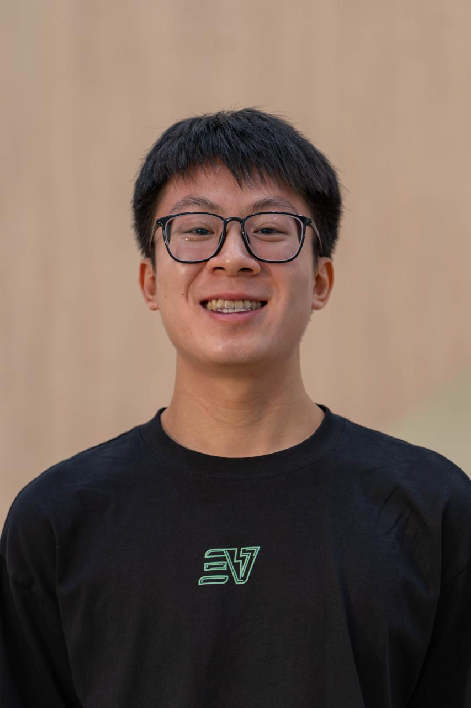
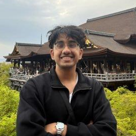
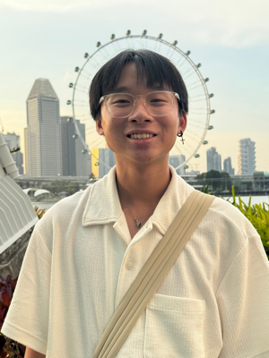
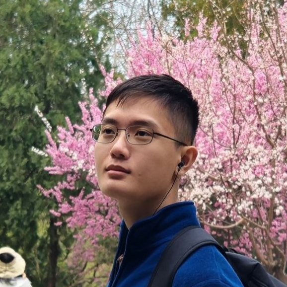
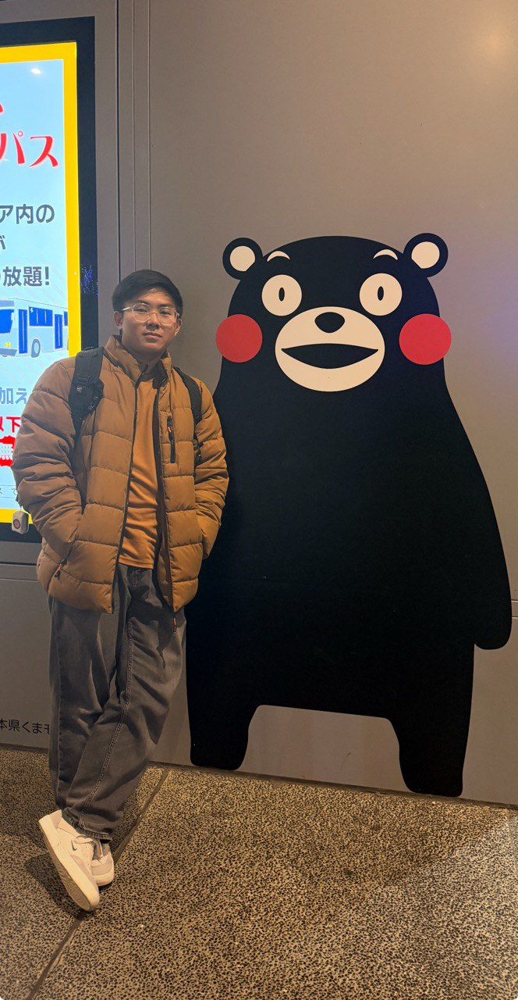

We are a team based in the [School of Computing, National University of Singapore](https://www.comp.nus.edu.sg).

## Project team

### Min Wenn

[[github](https://github.com/minweed)]

- Role: Developer
- Responsibilities: Lessons and schooling levels, sorting by level and rate, sample data

### Pranav Pappu

[[github](https://github.com/pranavp311)]

- Role: Developer
- Responsibilities: Main window and calendar UI, student grouping, progress notes, data file backup

### Dylan Sim

[[github](https://github.com/dygrik)]

- Role: Developer
- Responsibilities: Student search and filters, hourly rates, safe saving, name and log handling

### Lee Jian Yi

[[github](https://github.com/savemywifi)]

- Role: Developer
- Responsibilities: Weekly lesson slots and schedule, archiving, school field, command structure

### Mervin Ang

[[github](https://github.com/nivremi)]

- Role: Developer
- Responsibilities: Guardians and follow-ups, lesson clash warnings, input validation
