StudentBook builds on AddressBook Level 3 (AB3). The diagrams below describe its current architecture and tuition features.

* Table of Contents
{:toc}

## Acknowledgements

* Based on [AddressBook Level 3](https://github.com/se-edu/addressbook-level3) from the [SE-EDU initiative](https://se-education.org).
* Pranav used Claude (Anthropic), through Claude Code, to draft the v1.3 UI restyle: the mock-ups, the FXML and CSS in `src/main/resources/view`, the UI classes in `seedu.address.ui`, and their tests. He reviewed, ran and tested the changes.
* The UI uses the [Geist and Geist Mono fonts](https://github.com/vercel/geist-font) (v1.7.2) by The Geist Project Authors, under the SIL Open Font License 1.1. The font files and license are in `src/main/resources/fonts`.

## Getting started

Refer to the guide [*Setting up and getting started*](SettingUp.md)

## Design

### Architecture

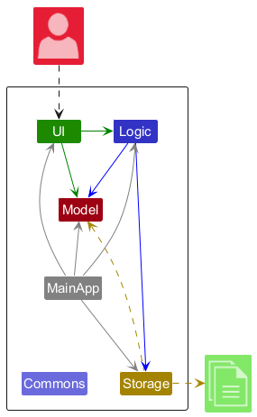

Solid arrows show associations; dashed arrows show dependencies. The icons represent the tutor and local files.

#### Overview

StudentBook relies primarily on 4 components:

| Component | Responsibility |
|---|---|
| [**`UI`**](#ui-component) | App UI |
| [**`Logic`**](#logic-component) | Command parsing and execution |
| [**`Model`**](#model-component) | Hold app records and settings in memory |
| [**`Storage`**](#storage-component) | Read and write JSON files |

**`Main`** then manages these components as follows:
* **App launch**: Initialise components in correct sequence and connect them with one another
* **Shutdown**: Shut down components, invoke necessary cleanup methods

**`Commons`** shares utilities across the above components.

#### Interactions
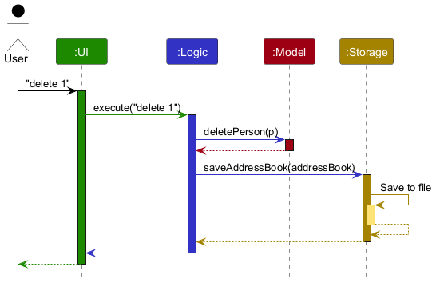

Each main component
* Defines its *API* through an interface
* Provides functionality through a concrete `{COMPONENT_NAME}Manager` class that implements the corresponding API interface

Other components interact with a component through its interface (rather than its concrete class), preventing them from coupling to that component's implementation.

Example component structure (Logic)

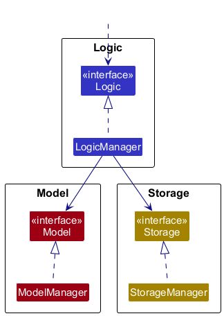

`LogicManager`
* implements the `Logic` interface
* interacts with `Model` and `Storage` components through their respective interfaces (not their concrete implementations)

### UI component

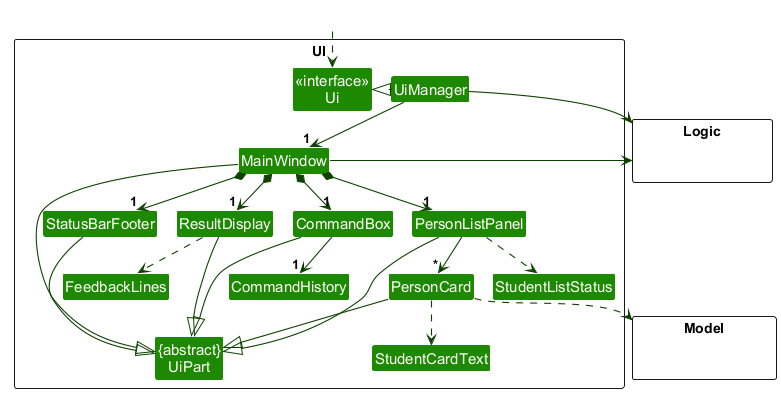

`MainWindow` contains separate active and archived student panels. Its `WeekPanel` uses `ScheduleGrid` to display
`LessonCard`s, each backed by a `ScheduleEntry` linking a student to a lesson.

**API Specification**: `Ui.java`
**Interacts with**: `Model`, `Logic`
**Depends on**: `Model`, `Logic`

Abstract class `UiPart` captures common behaviour among classes representing visible GUI parts. Each part:
* Inherit from `UiPart`
* Use the JavaFX UI framework
* Defines layout in a matching `.fxml` file in `src/main/resources/view`
* Use `LightTheme.css` for style, with fonts loaded by `AppFonts` at startup

List of UI components

| Class | UI Component |
|---|---|
|`MainWindow`|Main application window|
|`CommandBox`|Command input box|
|`StatusBarFooter`|Status bar footer|
|`ResultDisplay`|Result display|
|`PersonListPanel`|Student list display|
|`PersonCard`|Individual student display|
|`WeekPanel`|Weekly schedule header|
|`ScheduleGrid`|Weekly schedule display|
|`LessonCard`|Individual lesson display|

 

#### Interactions
**`Logic`**
User commands received by the UI component are sent to `Logic` for execution.

Additionally, `Logic` supplies the following data:
* The list of students to display, from `Logic#getFilteredPersonList()`. `ModelManager` sorts it by school stage (Primary, Secondary, JC, then others), then by level (`P1` before `P2`), then alphabetically by name, with stored order as the final tie-break. After `sort rate asc` or `sort rate desc`, `ModelManager#setRateSortOrder` orders students by rate within each stage instead, until `list` resets it. `PersonListPanel` shows it in this order, so the number on each card is the `STUDENT_INDEX` that commands use. Editing a student's name or level can therefore move it, changing its index.
* The total number of students and lessons, from `Logic#getAddressBook()`
* Empty-state message, also from `Logic#getAddressBook()`
* Lesson filter, to determine total number of students and lessons, from `Logic#getLessonPredicate()`

**`Ui`** and **`Model`**
* `Ui` listens for changes to `Model` data for updates
* `Ui` depends on some classes in `Model` to display `Student` objects correctly

### Logic component

**API Specification**: `Logic.java`
**Interacts with**: `Ui`, `Model`, `Storage`
**Depends on**: `Model`

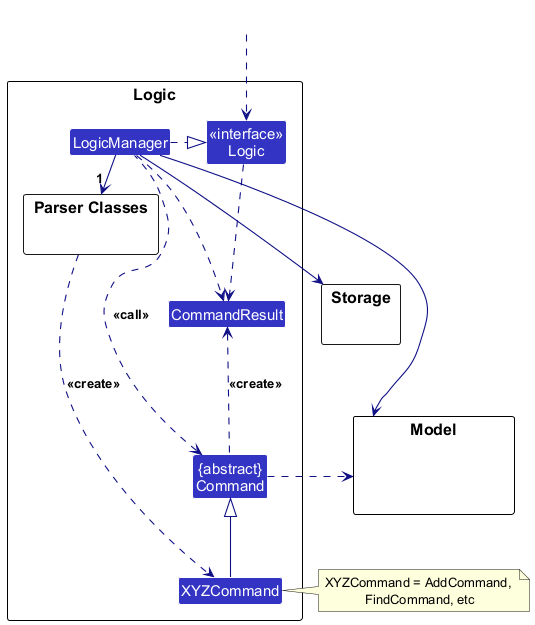

Above is a (partial) class diagram of the `Logic` component.

#### Command execution
The sequence diagram below illustrates the interactions within the `Logic` component (API call `execute("delete 1")` is used as an example).

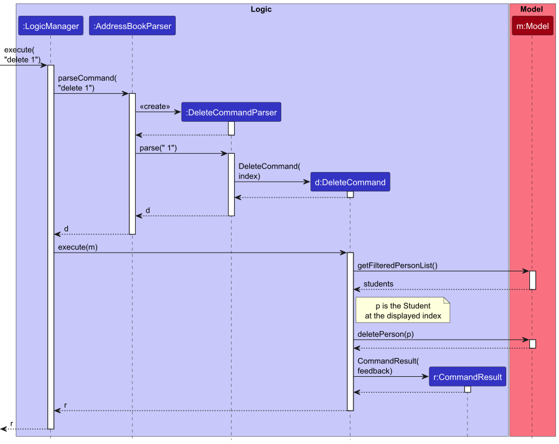

Command execution works as follows:
1. `Logic` is called to execute a command.
1. Command is passed to an `AddressBookParser`.
1. `AddressBookParser` creates a parser matching the command (e.g. `DeleteCommandParser`).
1. The created parser is used to parse the command into a `Command` object (e.g. `DeleteCommand`).
1. The `Command` object is executed by `LogicManager`
1. The `Command` object communicates with `Model` when executed. For deletion, it resolves the displayed index to a `Student` before calling `deletePerson(student)`.
1. The result of the command is encapsulated as a `CommandResult` object when returned from `Logic`.

#### Command parsing

The other classes in `Logic` (omitted from the class diagram above) that are used for parsing a user command:

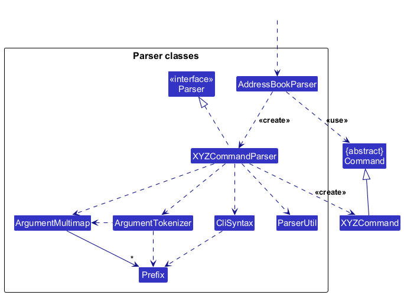

Command parsing works as follows:
1. `Logic` is called to parse a command.
1. `AddressBookParser` creates an `XYZCommandParser`(`XYZ` is a placeholder for a specific command name, e.g. `AddCommandParser`).
1. The parser uses the other classes shown above to parse the user command and create an `XYZCommand` object (e.g. `AddCommand`).
1. `AddressBookParser` returns that object as a `Command` object.

### Model component

**API Specification**: `Model.java`
**Interacts with**: `Ui`, `Logic`
**Depends on**: `None`

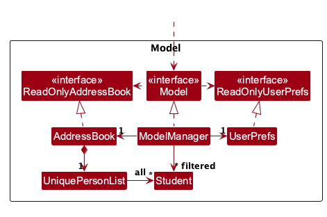

The `Model` component stores:
* active and archived students in separate `UniquePersonList`s
* filtered and sorted views of both lists, exposed as unmodifiable `ObservableList<Student>`s
* the lesson filter, rate sort order and selected archive view
* user preferences in `UserPrefs`

:information_source: An alternative design keeps a list of unique tags in `AddressBook`, then each `Student` references tags in that list, allowing `AddressBook` to maintain one `Tag` object per unique tag instead of each `Student` holding its own `Tag` object.

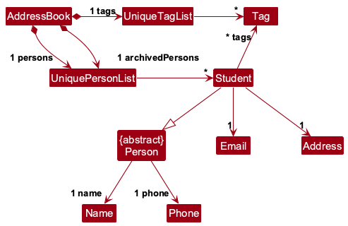

This alternative is not the current implementation.

 

`Student` extends `Person` and references its contact details, guardian, lessons, progress notes and follow-ups.

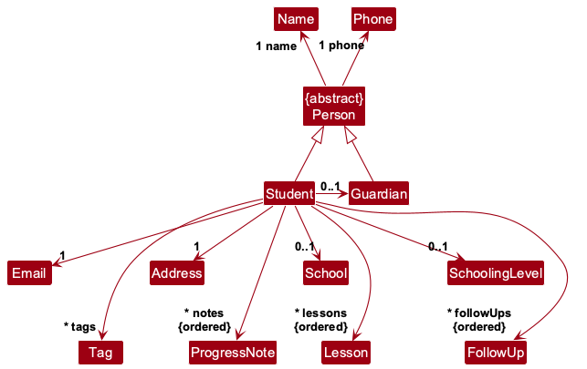

Each `Lesson` combines a required subject, weekly slot and hourly rate with an optional location and mode.

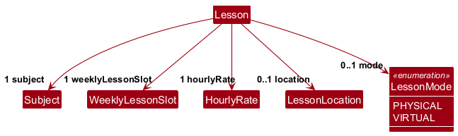

### Storage component

**API Specification**: `Storage.java`
**Interacts with**: `Model`
**Depends on**: `Model`

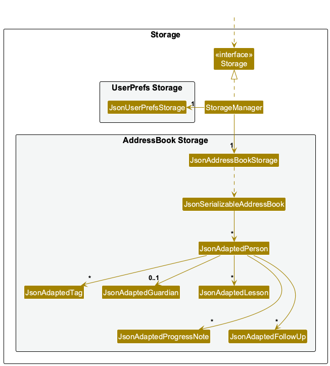

The `Storage` component:
* Saves student data (`data/studentbook.json`) and user preferences (`preferences.json`) in JSON format, and reads them back into corresponding objects
* Delegates JSON file access to `JsonAddressBookStorage` and `JsonUserPrefsStorage` (one class per data file)
* Uses JSON adapters for students, tags, guardians, lessons, weekly slots, progress notes and follow-ups

### Common classes
Classes used by multiple components are in the `seedu.address.commons` package.

## Implementation

This section describes noteworthy details on how certain features are implemented.

### Lesson clash detection

After a valid lesson addition or edit, `LessonAddCommand` or `LessonEditCommand` calls `LessonClashes.resultForLesson` with the complete active or archived
student list matching the edited student and the changed lesson's position. Search filters do not limit clash checks.
The helper excludes that lesson itself and checks every other lesson in that list.
Intervals clash when their weekdays match and each starts strictly before the other ends. Thus touching endpoints
are allowed. The warning confirms the lesson was saved and lists the clashes; existing validation and persistence still apply.
Deleting a lesson requires no clash warning. No clash state is stored, so each warning reflects current records.
Clashing changes return `CommandResult.warning`. `MainWindow` routes these successful results to
`ResultDisplay#setWarningToUser`, which applies an amber warning style and an exclamation icon.
The next success, error or warning result replaces the previous feedback and clears its styling.

`unarchive` uses `LessonClashes.resultForStudent`, which checks each of the restored student's lessons against the
active list. Archived lessons are never compared with active ones, so a restored student can clash with lessons added
while they were archived.

The activity diagram below shows the checks for `lesson-add`. `lesson-edit` takes the same path for the edited lesson.

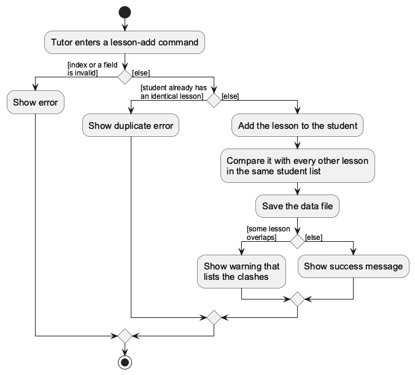

### Student search

The following class diagram shows the search predicates used by `FindCommand`. Prefixed searches use
`StudentSearchPredicate`; bare name keywords use `NameContainsKeywordsPredicate`. The command holds
both a student predicate and a lesson predicate.

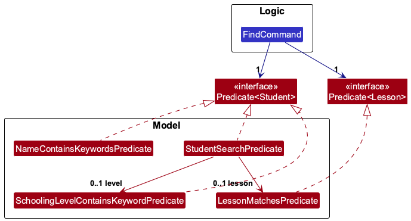

The following two sequences illustrate a successful `find sch/nanyang subject/math day/mon` search.
Blue participants belong to Logic; red participants belong to Model. Each diagram focuses on one stage
of the search, leaving the surrounding command-routing and persistence workflow to the
[Logic component](#logic-component) description.

**Constructing the search command.** `AddressBookParser` creates a `FindCommandParser` and calls
`parse(args)`. After validation, the parser creates the lesson predicate `l`, then the student predicate
`s`, then the command `f`. Here, `subject` contains `math`, `day` contains `MONDAY`, and the omitted
student criteria are empty except for school, which contains `nanyang`. The same `l` is supplied to
both `s` and `f`. Prefix validation and the parser's own creation and lifetime are outside this diagram's scope.

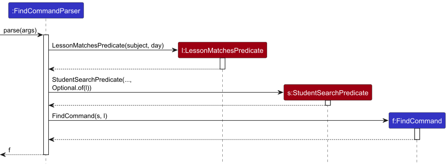

**Executing the search command.** `LogicManager` calls `f.execute(m)`. The command passes `s` and `l`
to the model, reads the matching students to form the result summary, and returns a `CommandResult`
that selects the students screen. The model is shown through its interface; internal filtering, logging
and UI observation are omitted. The repeated list lookup used by logging is also omitted.
`LogicManager` saves only record changes and rolls back records, filters and sorting on failure; the UI restores open details.
`JsonAddressBookStorage` atomically replaces the file from a temporary file, preserving permissions.
Failures retain the original and remove the temporary file. Unsupported atomic replacement fails without a fallback.

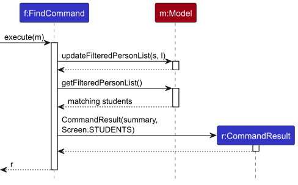

`FindCommandParser` accepts `name/`, `guardian/`, `sch/`, `level/`, `subject/` and `day/`, rejecting empty
values, duplicate prefixes and bare name keywords mixed with prefixes. It builds one `StudentSearchPredicate`
for every prefixed search. The predicate requires every supplied criterion to match: student name, guardian
name or phone, school and schooling level use case-insensitive substrings. Missing optional fields fail only
when their criteria are supplied. Searches without lesson criteria do not require students to have lessons.
Bare name keywords retain whole-word, case-insensitive OR matching through `NameContainsKeywordsPredicate`.

`LessonMatchesPredicate` stays separate: subject and day must match the same lesson. The student predicate
requires at least one such lesson, and `FindCommand` passes that same lesson filter to the model for `week`.
A later search without lesson criteria resets the lesson filter; `list` clears the active search and
`list-archive` clears the archived search. Data mutations, including editing, archiving and
unarchiving students, preserve both student lists' filters, the active calendar lesson filter and the
selected archive view. The observable lists automatically apply their existing predicates to changed data.
An edited student who no longer matches disappears from the results; a transferred student appears only if
they match the destination list's filter. Remaining students are renumbered. `add` is the exception: it
clears the active search and lesson filter and leaves Archives so that `AddCommand` can select the new student.

Search logging uses the existing `LogsCenter` framework. The parser logs selected prefix names and rejection
reasons at `FINE`; the command logs the result count at `INFO`. These search-specific diagnostics omit search
values. Command-level logging in `LogicManager` records parsed command types and outcomes without input values
or result messages. Logs go to the console and rotating `studentbook.log.*` files; set `LOG_LEVEL` in
`LogsCenter` to `Level.FINE` for parser diagnostics.

### Guardian follow-ups

A `FollowUp` holds 1–200 characters of single-line text, trimmed, and counted in code points like note text. `Student`
keeps its outstanding follow-ups in an unmodifiable list in the order they were added; a follow-up's position in that
list is the `FOLLOW_UP_INDEX` shown in the details. Completing an item removes it, so the model has no "done" state:
every stored item is outstanding. Follow-ups belong to the student rather than the `Guardian`, so they survive
`guardian-delete` and can be recorded for a student with no guardian (for example, while waiting for contact details).

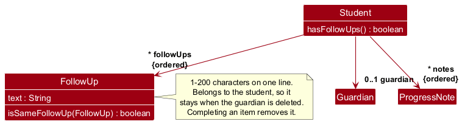

`followup-add`, `followup-edit` and `followup-done` are routed by `AddressBookParser` to `FollowUpAddCommandParser`,
`FollowUpEditCommandParser` and `FollowUpDoneCommandParser`, respectively. The add and edit parsers read only
`text/`, so a word such as `and/or` stays in the text. Adding requires exactly one index; editing and completing
require two. `ParserUtil#parseFollowUp` checks the text.

The follow-up commands resolve the student from the current filtered list, reject a follow-up index past the end, and
reject text that matches another of the student's items ignoring case (an item may be edited to change only its
case). They call `Student#withFollowUps` to replace the student with a copy whose follow-ups have changed.
The success message includes the item's text, so a wrong index on `followup-done` is visible straight away.

`followups` (`FollowUpListCommand`) sets the student filter to active (not archived) students with at least one
item, matching `list`, which hides archived students. It also resets the lesson filter.
Because the filtered list re-applies its predicate after `Model#setPerson`, completing a student's last item while
this filter is active removes the student from the list and renumbers the students after them. Each follow-up command
returns a `CommandResult` selecting the student's new position, or no student if they are no longer shown.
`MainWindow` applies that selection after execution.

The sequence diagram below focuses on executing `followup-done 1 2`. Parsing follows the
[Logic component](#logic-component) workflow; `LogicManager` saves the updated student data before returning the result.

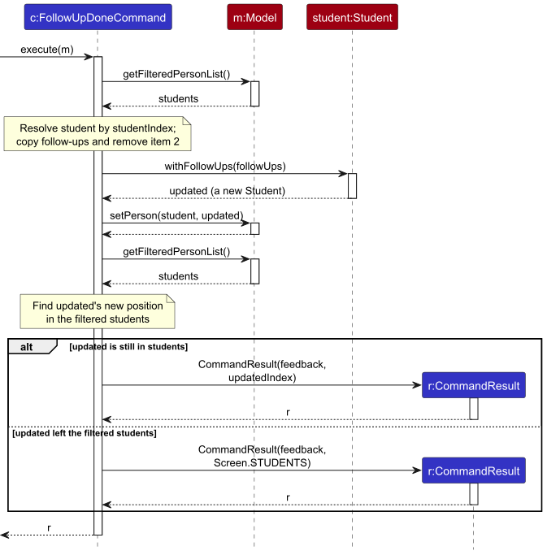

Every command that rebuilds a `Student` (`edit`, the guardian, lesson and note commands, and `Student#withArchived`
for `archive` and `unarchive`) passes the existing follow-ups on. `FollowUpWorkflowTest` checks each of them, so a later
field change cannot silently drop follow-ups. `PersonCard` shows the items in a **Follow-ups** section under the guardian.

`JsonAdaptedFollowUp` stores each item as `{"text": "..."}` in the person's `followUps` array. A missing or `null`
`followUps` key loads as no follow-ups, so older data files still load; a `null` item, a non-string `text` or text
that fails validation makes the file invalid.

### Progress notes

A `ProgressNote` holds a `LocalDate` and 1–500 characters of single-line text. `Student` keeps its notes in an
unmodifiable list sorted oldest first; the sort is stable, so notes on the same date keep the order they were added.
A note's position in that list is the `NOTE_INDEX` shown in the details. New students start with no notes.

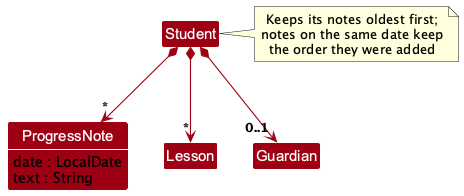

`note-add`, `note-edit` and `note-delete` are routed by `AddressBookParser` to their corresponding command parsers.
Editing takes the student index, the note's number and an optional date and/or text; at least one field is required.
Deleting takes only the student index and the note's number. Add and edit treat everything after the first `text/`
as note text, including words resembling prefixes, so `date/` must precede `text/` when both are supplied.
`ParserUtil#parseProgressNote` uses the shared `parseProgressNoteDate` and `parseProgressNoteText` validators.
The edit parser uses these validators for each supplied field. Dates must be real `YYYY-MM-DD` dates between
`2000-01-01` and today, and text must be 1–500 characters on one line. The
future-date check is in the parser rather than the model, so a saved file still loads if the computer's clock is
wrong.

`NoteAddCommand` and `NoteDeleteCommand` resolve the student from the current filtered list. Adding rejects an identical note on the same
date; deleting rejects a note number past the end. Either command calls `Student#withNotes` to replace the student
with a copy whose notes have changed, then returns a `CommandResult` that opens that student's
details, where `PersonCard` lists the notes. Every command that rebuilds a `Student` (`edit`, archiving, and the
guardian, lesson and follow-up commands) passes the existing notes on. `NoteWorkflowTest` checks `edit` and the guardian
and lesson commands, so a later field change cannot silently drop notes there.

The sequence diagram below focuses on executing `note-add 1 date/2026-10-15 text/Fractions`. Parsing follows the
[Logic component](#logic-component) workflow; `LogicManager` saves the updated student data before returning the result.

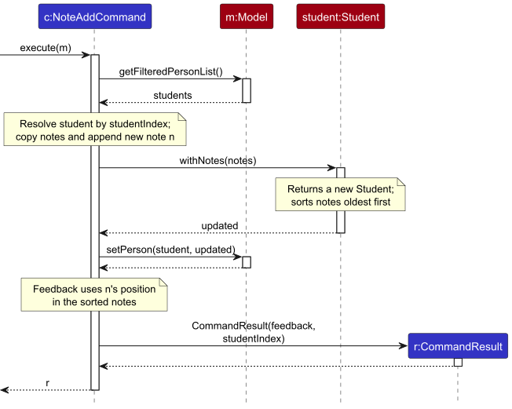

`JsonAdaptedProgressNote` stores each note as `{"date": "YYYY-MM-DD", "text": "..."}` in the person's `notes`
array. A missing or `null` `notes` key loads as no notes, so older data files still load.

## Documentation, logging, testing, dev-ops

* [Documentation](Documentation.md)
* [Testing](Testing.md)
* [Logging](Logging.md)
* [Builds, CI and releases](DevOps.md)

## Appendix: Requirements

### Product scope

**Target user profile**:

Independent private tutors who:
* teach many students one-to-one without administrative support, mostly from primary school to junior college (JC)
* keep track of student details, lesson arrangements, and guardian contacts themselves
* regularly retrieve and update this information before and after lessons
* can type quickly and prefer typing over mouse-driven input

**Value proposition**: StudentBook keeps each student's contact details, school and level, guardian contact, weekly lessons with hourly rates, progress notes and guardian follow-ups in one place. Tutors find and update them by typing commands, see their week on a calendar, and are warned when lessons clash.

StudentBook does not process payments, send messages or manage group classes. Each lesson belongs to one student.

### Student and lesson fields

A student has any number of lessons. Each lesson groups a required subject, weekly slot and hourly rate with an optional location and mode. School and schooling level are optional; students can be added without either, and `edit STUDENT_INDEX sch/` or `edit STUDENT_INDEX level/` can clear the corresponding field. Each student has at most one school, with 1 to 60 characters after trimming leading and trailing whitespace.

### User stories

Priorities: `***` = high, `**` = medium, `*` = low.

Stories marked *(not supported)* are ideas that the current version does not support. They are kept for reference only and are not commitments.

| ID | Priority | As a... | I want to... | So that I can... |
|---|---|---|---|---|
| 1 | `***` | private tutor | add a student record with a name | begin tracking each student |
| 2 | `***` | private tutor | view the list of current students | see who I currently teach |
| 3 | `***` | private tutor | view a student's subjects and schooling level | prepare for the right subject and level |
| 4 | `***` | private tutor | delete a student record | remove students who leave or recreate incorrect records |
| 5 | `***` | private tutor | record a student's schooling level | choose material at the right level |
| 6 | `***` | private tutor | record the subjects I teach a student | remember what I teach each student |
| 7 | `***` | private tutor | record one guardian's name and phone number for a student | reach the right adult about lessons |
| 8 | `***` | private tutor | view the guardian name and phone number linked to a student | contact a guardian without searching elsewhere |
| 9 | `***` | private tutor | keep my student details and guardian contacts when I close and reopen the app | continue my work without re-entering information |
| 10 | `**` | private tutor | edit a student's name | correct typos without recreating the record |
| 11 | `**` | private tutor | record a student's school | remember which school the student attends |
| 12 | `**` | private tutor | update a student's school, schooling level or subjects | keep records current as circumstances change |
| 13 | `**` | private tutor | search for a student by a partial name | retrieve a record quickly |
| 14 | `**` | private tutor | see students ordered by level, then alphabetically by name | scan a long student list faster |
| 15 | `**` | private tutor | filter students by school | find students from the same school |
| 16 | `**` | private tutor | filter students by schooling level | prepare level-appropriate materials |
| 17 | `**` | private tutor | filter students by subject | prepare for a subject-specific class |
| 18 | `**` | private tutor | mark a student as inactive | keep former students without cluttering the current list |
| 19 | `**` | private tutor | view inactive students separately | refer to past records when needed |
| 20 | `**` | private tutor | add another guardian to a student *(not supported)* | keep alternative contacts for the same student |
| 21 | `**` | private tutor | record each guardian's relationship to the student *(not supported)* | know who I am contacting |
| 22 | `**` | private tutor | edit a guardian's name or phone number | keep a changed phone number current |
| 23 | `**` | private tutor | remove a guardian from a student | discard contacts that are no longer relevant |
| 24 | `**` | private tutor | search by guardian name or contact | find the right student when a guardian contacts me |
| 25 | `**` | private tutor | add a recurring weekly lesson slot to a student | remember when the student is taught |
| 26 | `**` | private tutor | add more than one weekly lesson slot to a student | track students with several lessons each week |
| 27 | `**` | private tutor | view lessons scheduled on a chosen day | prepare for that day's students |
| 28 | `**` | private tutor | edit a lesson slot | keep the agreed schedule current |
| 29 | `**` | private tutor | remove a lesson slot | clear a cancelled arrangement |
| 30 | `**` | private tutor | record a lesson's location or delivery mode | know where and how the lesson will happen |
| 31 | `**` | private tutor | assign students to a shared group class *(not supported)* | manage one lesson arrangement for its attendees |
| 32 | `**` | private tutor | view every student in a group class *(not supported)* | prepare the correct class list |
| 33 | `**` | private tutor | add a dated progress note to a student | remember what happened in recent lessons |
| 34 | `**` | private tutor | view a student's dated progress notes in chronological order | recall learning needs before the next lesson |
| 35 | `**` | private tutor | record a follow-up item for a guardian | remember what I need to communicate |
| 36 | `**` | private tutor | list outstanding guardian follow-up items | avoid missing promised updates |
| 37 | `**` | private tutor | record a student's payment status *(not supported)* | know which payments need follow-up without processing them |
| 38 | `**` | private tutor | record a guardian's preferred contact method *(not supported)* | contact each guardian appropriately |
| 39 | `**` | private tutor exploring the app | find out which student-management tasks the app supports | decide whether it suits my work |
| 40 | `**` | private tutor learning the app | look up command usage and examples | complete a task when I do not remember what to type |
| 41 | `**` | private tutor | combine subject, schooling-level and lesson-day filters | find students matching the criteria for my preparation |
| 42 | `**` | private tutor | see the next scheduled lesson and its attending students | know which lesson to prepare for next |
| 43 | `**` | private tutor | edit a guardian follow-up item | keep the recorded request accurate when arrangements change |
| 44 | `**` | private tutor | mark a guardian follow-up item as complete | remove finished work from my outstanding follow-ups |
| 45 | `**` | private tutor learning the app | see what needs correcting when an entry is rejected | fix the entry without guessing why it failed |
| 46 | `**` | tutor who communicates directly with a student | record the student's own phone number or email address | keep their contact details with their record |
| 47 | `**` | tutor who needs to contact a student directly | view the student's contact details | reach them without searching elsewhere |
| 48 | `**` | tutor checking a student’s lesson arrangements | view that student's weekly lesson times | confirm when I teach them |
| 49 | `**` | tutor planning my week | view all my lessons arranged by day and time | see which students I will teach each day |
| 50 | `*` | private tutor | identify students who share a guardian contact | coordinate communication without contacting the same guardian separately for each student |
| 51 | `*` | private tutor | receive a warning when separate lesson arrangements overlap | avoid accepting conflicting arrangements |
| 52 | `*` | private tutor | export all records to a human-readable file *(not supported)* | inspect and back up my data outside the app |
| 53 | `**` | private tutor | record and view the hourly rate agreed for each lesson | check the agreed rate before discussing fees |
| 54 | `**` | private tutor | change a lesson's recorded hourly rate | keep the agreed rate current |

### Use cases

These use cases describe how the current version behaves. The [User Guide](UserGuide.md) gives each command's format.

The actor is a private tutor and the system is StudentBook. The app is already open unless stated otherwise. **MSS** means main success scenario.

#### UC01: Register a student

**Related user stories:** 1, 5, 6, 9.

**MSS**

1. Tutor requests to add a student, supplying name, phone, email and address, with optional tags, school and schooling level.
2. StudentBook confirms the addition and displays the new student.

Use case ends.

**Extensions**

* 1a. A required detail is missing or a supplied value is invalid.
  * 1a1. StudentBook reports the error without adding a record.
  * 1a2. Tutor corrects and resubmits the request.
  * Use case resumes at step 1.
* 1b. An active or archived student with the exact same name already exists.
  * 1b1. StudentBook reports the duplicate without adding a record.
  * Use case ends.
* 2a. StudentBook cannot save the change.
  * 2a1. StudentBook reports the save failure without adding the student.
  * Use case ends.

#### UC02: Retrieve a guardian's contact details

**Related user stories:** 2, 8.

**MSS**

1. Tutor requests to list students.
2. StudentBook displays student records with their linked guardian names and contact details.
3. Tutor reads the intended student's guardian contact details.

Use case ends. Contacting the guardian takes place outside StudentBook.

**Extensions**

* 2a. No student records exist.
  * 2a1. StudentBook displays an empty list.
  * Use case ends.

* 2b. The intended student has no guardian contact.
  * 2b1. StudentBook indicates that no guardian is recorded.
  * Use case ends.

#### UC03: Remove a student who has stopped attending lessons

**Related user stories:** 2, 4.

**MSS**

1. Tutor requests to list students.
2. StudentBook displays the student list with an index for each record.
3. Tutor requests to delete the intended student using the displayed index.
4. StudentBook removes that student's record and linked guardian contact, and displays a success message and the updated list.

Use case ends.

**Extensions**

* 2a. The student list is empty.
  * Use case ends.
* 3a. The supplied index is invalid for the displayed list.
  * 3a1. StudentBook displays an error without deleting any record.
  * Use case resumes at step 2.

#### UC04: Change a lesson's slot

**Related user stories:** 2, 28, 48.

**Preconditions:** The student has an existing lesson.

**MSS**

1. Tutor requests to list students.
2. StudentBook displays students and their lessons.
3. Tutor requests to edit a lesson, supplying the student's displayed index, the lesson's number in the student's details and the new slot.
4. StudentBook displays the updated lesson.

Use case ends.

**Extensions**

* 2a. The student list is empty.
  * Use case ends.
* 3a. The student index or lesson number is invalid, the new slot is invalid, or the change would duplicate another lesson of that student.
  * 3a1. StudentBook explains the error without changing any lesson.
  * 3a2. Tutor corrects and resubmits the request.
  * Use case resumes at step 3.
* 4a. The new slot overlaps another lesson in the same student list.
  * 4a1. StudentBook saves the change and shows a warning that lists the clashing lessons.
  * Use case ends.

#### UC05: Complete a guardian follow-up

**Related user stories:** 36, 44.

**Preconditions:** At least one outstanding guardian follow-up item exists.

**MSS**

1. Tutor requests to list outstanding guardian follow-up items.
2. StudentBook displays the students with outstanding items.
3. Tutor opens a student's details to see the student's numbered items and guardian.
4. Tutor carries out the selected follow-up outside StudentBook.
5. Tutor requests to mark the selected item as complete.
6. StudentBook removes the item from the student's outstanding items and shows its text.

Use case ends.

**Extensions**

* 2a. No student has an outstanding item.
  * 2a1. StudentBook shows an empty list and suggests `list`.
  * Use case ends.
* 5a. The supplied student or item number is invalid, for example because the item is already complete.
  * 5a1. StudentBook explains the error without changing any item.
  * Use case resumes at step 1.
* 6a. The completed item was the student's last one.
  * 6a1. StudentBook removes the student from the outstanding list.
  * Use case ends.

#### UC06: Attach a guardian contact

**Related user stories:** 7, 9.

**Preconditions:** The student exists and is visible in the displayed list.

**MSS**

1. Tutor requests to attach a guardian, supplying the student's displayed index and the guardian's name and phone.
2. StudentBook displays the linked guardian and confirms the addition.

Use case ends.

**Extensions**

* 1a. The index or guardian details are invalid, or a guardian is already attached.
  * 1a1. StudentBook reports the error without changing the record.
  * 1a2. Tutor corrects and resubmits the request.
  * Use case resumes at step 1.
* 2a. StudentBook cannot save the change.
  * 2a1. StudentBook reports the save failure without adding the guardian.
  * Use case ends.

#### UC07: Archive a past student and restore them later

**Related user stories:** 18, 19, 51.

**MSS**

1. Tutor requests to list active students.
2. StudentBook displays the active students.
3. Tutor requests to archive a student using the displayed index.
4. StudentBook moves the student to the archived list, keeping their details, lessons, notes and follow-ups. Their lessons leave the weekly calendar.
5. Later, tutor requests to list archived students.
6. StudentBook displays the archived students.
7. Tutor requests to unarchive a student using the index in that list.
8. StudentBook moves the student back to the active list and confirms. The archived list stays on screen.

Use case ends.

**Extensions**

* 3a. The supplied index is invalid for the displayed list.
  * 3a1. StudentBook displays an error without archiving anyone.
  * Use case resumes at step 2.
* 7a. The supplied index is invalid for the displayed list.
  * 7a1. StudentBook displays an error without restoring anyone.
  * Use case resumes at step 6.
* 8a. A restored lesson overlaps a lesson of an active student, for example one added while the student was archived.
  * 8a1. StudentBook still restores the student, and shows a warning that lists each clashing lesson.
  * 8a2. Tutor changes or deletes one of the lessons (UC04).
  * Use case ends.

#### UC08: Add a lesson for a student

**Related user stories:** 25, 26, 30, 51, 53.

**Preconditions:** The student is visible in the displayed list.

**MSS**

1. Tutor requests to add a lesson, supplying the student's displayed index, subject, weekly slot and hourly rate, and optionally the mode and location.
2. StudentBook adds the lesson as the student's last lesson and confirms the addition.

Use case ends.

**Extensions**

* 1a. The index or a lesson field is invalid.
  * 1a1. StudentBook explains the error without changing any lesson.
  * 1a2. Tutor corrects and resubmits the request.
  * Use case resumes at step 1.
* 1b. The student already has a lesson with the same subject, slot, rate, mode and location.
  * 1b1. StudentBook reports the duplicate without changing any lesson.
  * Use case ends.
* 2a. The new lesson overlaps another lesson in the same student list, including the student's own lessons and students hidden by a search.
  * 2a1. StudentBook still saves the lesson, and shows a warning that lists each clashing lesson by student, lesson number, subject and slot.
  * 2a2. Tutor changes or deletes one of the lessons (UC04).
  * Use case ends.
* 2b. StudentBook cannot save the change.
  * 2b1. StudentBook reports the save failure without adding the lesson.
  * Use case ends.

#### UC09: Find students matching several criteria

**Related user stories:** 13, 15, 16, 17, 24, 27, 41.

**MSS**

1. Tutor requests to find students, supplying one or more criteria: name, guardian name or phone, school, schooling level, lesson subject and lesson day.
2. StudentBook displays the students who match every criterion, with the number shown out of the total. When both subject and day are given, one lesson must match both.
3. Tutor requests the weekly calendar.
4. StudentBook shows only the matching students' lessons that meet the lesson criteria.

Use case ends.

**Extensions**

* 1a. No criterion is given, a criterion is empty or repeated, the day is not a weekday, or bare name keywords are mixed with criteria.
  * 1a1. StudentBook explains the error and keeps the current results.
  * 1a2. Tutor corrects and resubmits the request.
  * Use case resumes at step 1.
* 2a. No student matches.
  * 2a1. StudentBook shows an empty list and suggests `list`.
  * Use case ends.
* 2b. Tutor edits, archives or deletes a displayed student.
  * 2b1. StudentBook keeps the search, so a student who no longer matches leaves the results, and renumbers the rest.
  * Use case resumes at step 2.
* *a. At any time, tutor requests to list all students.
  * *a1. StudentBook clears the search and the calendar's lesson filter.
  * Use case ends.

### Non-functional requirements

1. **Compatibility.** Run on Windows, macOS and Linux with Java `25`, on systems supported by the bundled JavaFX runtime.
2. **Capacity and speed.** Support 1,000 active students, each with one guardian. Adding, listing or deleting a student should show its result within two seconds. Test on a supported computer with at least 4 GB of RAM and local storage. Measure from command submission to the displayed result, excluding startup.
3. **Keyboard use.** Every command, and moving between students and screens, works from the keyboard without a mouse.
4. **Error messages.** Explain what is wrong and how to fix it. Invalid input should leave existing records unchanged.
5. **Saved data.** Save every change as soon as a command succeeds, and restore all records on restart, including lessons, notes, follow-ups and archived students.
6. **Offline use.** Manage and save records on the tutor's computer without internet access or an online account.
7. **Data protection.** Keep student and guardian contact details out of external services and diagnostic logs. The tutor's operating-system account and file permissions control access to local files.
8. **File errors.** If the data file cannot be read, StudentBook copies it to a timestamped backup beside it, starts with no students and shows where the backup is. If it cannot make the backup, it closes without changing the file. If a save fails, the command's changes are undone and the error is shown. Valid AB3 data files load, with the tuition fields empty.

### Glossary

* **StudentBook**: The desktop app for managing student records.
* **Independent private tutor**: A tutor who manages students and lessons without administrative staff.
* **Student record**: One student's contact details, school, schooling level, guardian contact, lessons, dated progress notes and guardian follow-ups.
* **Guardian contact**: The name and phone number of the adult responsible for a student. Each student has at most one guardian. A recorded guardian needs both fields.
* **Schooling level**: The student's year of study, such as P5, Sec 3 or JC1. StudentBook groups recognised levels under Primary, Secondary or JC, and any other level, such as Poly Y1, under Other.
* **Subject**: An academic subject taught by the tutor to a student, such as Mathematics or English.
* **Lesson**: One recurring arrangement for a student: a subject, a weekly slot and an hourly rate, with an optional location and mode. A student can have many lessons.
* **Recurring lesson slot**: A lesson's weekly day, start time and end time on a single day.
* **Lesson mode**: Whether a lesson is physical or virtual.
* **Hourly rate**: The agreed SGD amount per hour for a lesson, stored as `BigDecimal`. It does not calculate fees or process payments.
* **Progress note**: A dated note recording a student's learning progress or observations from a lesson.
* **Guardian follow-up item**: A recorded action the tutor needs to carry out for a guardian, such as providing an update. An outstanding item has not yet been marked complete.
* **Archived student**: A past student kept in a separate list (`list-archive`) with all their records. Archived students' lessons do not appear in the weekly calendar.
* **Displayed index**: The number beside a student in the current list. It can change when the list changes, so it is not a permanent student ID.
* **Local storage**: Files on the tutor's computer that keep records between launches.
* **Private contact detail**: A student or guardian's phone number, email address, or other contact information intended for the tutor's use rather than public sharing.

## Appendix: Instructions for manual testing

These checks are a starting point; also try variations and boundary values.

Unless a section says otherwise, start it from the sample data: close StudentBook, delete the `data` folder in the test folder, then launch again. The indexes below assume the sample data. Student details open inline, below the student's row in the list.

For larger or boundary-value data sets, generate a data file with `./gradlew seed`, e.g. `./gradlew seed --args="--students 500 --edge-cases --out test/studentbook.json"`, and copy it into the test folder as `data/studentbook.json`. See [Generating test data](Testing.md#generating-test-data).

### Launch and shutdown

1. Download the latest `studentbook.jar` from the [releases page](https://github.com/AY2627S1-CS2103T-F13-4/tp/releases) into an empty test folder, open a terminal there and run `java -jar studentbook.jar`.
   The window opens on **This week**, which shows `13 lessons`, none of them overlapping.
2. Run `list`. **Students** shows `8 students` in four groups: Chloe Lim and Isaac Ng (Primary); Ethan Lim, Muhammad Hafiz bin Rahman and Priya Ramasamy (Secondary); Nur Aisyah binte Ismail and Ryan Goh Jun Jie (JC); Sarah Wong (Other). Chloe and Ethan share the guardian Lim Mei Ling.
3. Run `list-archive`. **Archives** shows one past student, Tan Wei Jie.
4. Resize and move the window, run `exit`, then launch again. The window keeps its new size and position.

### Main window

1. After launch, type `list` and press Enter without clicking anything. The command box has keyboard focus, so the list appears.
2. Run `find Chloe`. The header reads `Showing 1 of 8`. Run `find name/zzz`. The list says `No students match` and suggests `list`.
3. Run `list`, then `delete 0`. The result area turns pink with a red `!`, shows the format and an example, and `delete 0` stays in the box in red. Change it to `delete 1` and press Enter; Chloe Lim is deleted and the box clears.
4. Run `add name/Ryan`. The result area shows a **Format** line and an **Example** line. Press Tab; the example replaces `add name/Ryan` in the command box.
5. Press Esc to clear the box. Run `list` and `week`, then press Up twice and Down twice. The box shows `week`, then `list`, then `week`, then becomes empty again.
6. Run `list`, then `view 1`. Isaac Ng's details (school, contact, guardian, follow-ups, lessons, tags and notes) open below his row, and the rest of the list moves down. Run `view 2`; Isaac's details close and Ethan Lim's open.
7. With the command box empty, press Esc. The details close. Press Alt+Down twice; the first and then the second student's details open, and typing still goes into the command box. Press Page Down and Page Up to scroll the list.
8. Press F1. The user guide opens in the default browser. Clicking **All commands** and running `help` open the same guide.
9. Shrink the window to its minimum width, then run `view 1`. The Subjects and Guardian columns are hidden, and the open details still show the guardian and every lesson.

### Student deletion

1. Run `list`, then `delete 1`. Chloe Lim disappears, and the result describes her record.
2. Try `delete`, `delete x` and `delete 99`. Each reports an error and leaves every record unchanged.
3. Run `find Priya`, then `delete 1`. Priya Ramasamy is deleted, not Isaac Ng, who is now first in the full list.

### Sorting by rate

1. Run `list`, then `sort rate asc`. Each group keeps its place, and the students inside it are ordered by their lowest rate: Isaac Ng, Chloe Lim; Ethan Lim, Priya Ramasamy, Muhammad Hafiz bin Rahman; Ryan Goh Jun Jie, Nur Aisyah binte Ismail; Sarah Wong. The **Rate** column is headed **Min rate**.
2. Run `sort rate desc`. Students are ordered by their highest rate: Chloe Lim, Isaac Ng; Muhammad Hafiz bin Rahman, Priya Ramasamy, Ethan Lim; Nur Aisyah binte Ismail, Ryan Goh Jun Jie; Sarah Wong. The column is headed **Max rate**.
3. Run `list`. The usual order returns.

### Editing school and level

1. Run `list`, then `edit 1 sch/Clementi Primary School level/P6`. Chloe Lim's school and level change, and she moves below Isaac Ng (P5) to index 2.
2. Run `edit 2 sch/ level/`. Chloe's school and level are cleared, and she moves to the Other group, before Sarah Wong.
3. Run `edit 1 level/123`. An error explains that a level must include a letter, and nothing changes.

### Archiving students

1. Run `list`, then `archive 1`. Chloe Lim leaves the list. Run `week`; the summary shows `11 lessons`, without her Tuesday and Thursday lessons.
2. Run `list-archive`. **Archives** shows Chloe Lim and Tan Wei Jie. Run `archive 1`; an error says the student is already archived.
3. Run `unarchive 1`. Chloe returns to the active list, and **Archives** stays open with only Tan Wei Jie. Run `list` to see her again.
4. Restore with a clash: run `archive 1`, then `lesson-add 1 subject/English slot/Tue 4.30pm 5.30pm rate/40`. Isaac Ng gets the lesson without a warning, since archived lessons are not checked. Run `list-archive`, then `unarchive 1`. Chloe is restored with an amber warning that her lesson 1 overlaps `Isaac Ng, lesson 2 (English, Tuesday 4.30pm-5.30pm)`.
5. Run `list`, then `unarchive 1`. An error says the student is already unarchived.

### Lessons and clash warnings

1. Run `list`, then `add name/Test Student phone/91234567 email/test@example.com address/1 Test Road`. Test Student becomes student 9, at the end of the Other group, with their details open.
2. Type `lesson-add 9 subject/Combined Science slot/Wed 1.00pm 5.00pm rate/45.5`, add two more spaces between `Combined` and `Science`, and press Enter. The details show lesson `1.` with subject `Combined Science` (one space), `Wed 1.00pm-5.00pm` and `SGD 45.50/h`.
3. Run `lesson-add 9 subject/English slot/Mon 4.00pm 5.00pm rate/40 mode/virtual location/https://zoom.us/j/123`. The details list both lessons in order, the second with `Virtual` and its location. There is no clash warning, because it ends exactly when Isaac Ng's Monday lesson starts.
4. Run `lesson-edit 9 2 rate/50`, then `edit 9 phone/98765432`. Both lessons stay, and only the rate and phone change.
5. Run `lesson-add 9 subject/Math slot/Mon 5.30pm 6.00pm rate/40`. The lesson is saved with an amber warning: `Lesson saved - scheduling clash detected`, naming `Isaac Ng, lesson 1 (Mathematics, Monday 5.00pm-6.30pm)`.
6. Run `week`. On Monday, Test Student's 5.30pm lesson is drawn beside Isaac Ng's lesson, and that day's column is wider. Run `list`, then `lesson-delete 9 3`.
7. Run `lesson-add 9 subject/Combined Science slot/Wed 1.00pm 5.00pm rate/45.5`. An error says the student already has an identical lesson.
8. Run `exit`, launch again, `list` and `view 9`. Both lessons remain.
9. Run `lesson-edit 9 2 mode/ location/`. The English lesson no longer shows a mode or location, including after a restart.
10. Run `lesson-delete 9 1`. English becomes lesson 1. Run `lesson-delete 9 1` again; the Lessons section shows `No lessons yet`.
11. Each of these reports an error and changes nothing:
    * `lesson-add 9 subject/Math slot/Fri 1.00pm 2.00pm rate/40 mode/hybrid`
    * `lesson-add 9 subject/Math slot/Fri 1.00pm 2.00pm` (missing rate)
    * `lesson-add 9 subject/Math subject/Art slot/Fri 1.00pm 2.00pm rate/40`
    * `lesson-add 9 subject/Math slot/Fri 1.00pm 2.00pm rate/40 x/1`
    * `lesson-add 9 subject/Math slot/Fri 1.00pm 2.00pm rate/40 mode/`
    * `lesson-edit 9 5 rate/40`

### Combined searches and the weekly calendar

1. Run `find subject/math`. Five students are shown. Run `week`; the summary reads `Showing 5 of 13 lessons`, and only their maths lessons appear.
2. Run `find level/sec subject/math`. Only Muhammad Hafiz bin Rahman and Priya Ramasamy match.
3. Run `find guardian/9182`. Chloe Lim and Ethan Lim, who share a guardian phone number, match.
4. Run `list`, then `week`. All `13 lessons` are back.

### Name and guardian searches

1. Run `list`, then `add name/Alex Tan phone/91234567 email/alex@example.com address/1 Clementi Road` and `add name/Alexander Tan phone/92345678 email/alexander@example.com address/2 Clementi Road`. They become students 8 and 9.
2. Run `find alex`; only Alex Tan matches. Run `find name/aLeX`; both match, although neither has lessons.
3. Run `list`, then `guardian-add 8 name/Janet Lee phone/91234567`. Run `find guardian/ANET`, then `find guardian/1234`. Each shows only Alex Tan.
4. Run `find name/alex guardian/janet`; Alex Tan matches. Run `find name/alex guardian/missing`; nobody matches.
5. Run `list`, `lesson-add 8 subject/Math slot/Tue 9.00am 10.00am rate/40` and `lesson-add 8 subject/English slot/Mon 9.00am 10.00am rate/40`. Run `find name/alex subject/math day/mon`; nobody matches, because no single lesson is both Math and on Monday.
6. Run `list`, `lesson-add 8 subject/Math slot/Mon 11.00am 12.00pm rate/40`, then repeat the search. Alex Tan now matches. Run `week`; it reads `Showing 1 of 16 lessons`, the Monday Math lesson. Run `list` to clear the search.
7. Each of these reports an error: `find name/`, `find guardian/`, `find name/alex name/bob`, `find guardian/janet guardian/john`, `find alex guardian/janet` and `find name/alex day/Funday`.

### Guardian contacts

1. Run `list`, then `guardian-add 8 name/Janet Tan phone/91234567`. Run `view 8`; Sarah Wong's details show the guardian, and her other fields are unchanged. Restart, run `list` and `view 8`, and check again.
2. Run `guardian-edit 8 phone/87654321`. The guardian's name stays `Janet Tan`. Run `guardian-edit 8 name/John Tan`; the phone stays `87654321`.
3. Run `guardian-delete 8`. The guardian is gone, and the student and her lessons remain. Restart and check that no guardian is recorded.
4. Each of these reports an error and changes nothing:
    * `guardian-add 1 name/Janet Tan phone/91234567` (Chloe Lim already has a guardian)
    * `guardian-edit 8 phone/87654321` and `guardian-delete 8` (Sarah Wong has no guardian)
    * `guardian-add 99 name/Janet Tan phone/91234567`
    * `guardian-add 8 name/ phone/91234567`
    * `guardian-add 8 name/Janet Tan phone/12`
    * `guardian-add 8 name/Janet Tan name/John Tan phone/91234567`
5. Run `find Sarah`, then `guardian-add 1 name/Janet Tan phone/91234567`. Only Sarah Wong changes, and the search stays active.

### Guardian follow-ups

1. Run `list`, then `followup-add 1 text/Send the term 4 report and/or worksheet`. Chloe Lim's details open with follow-up `1.` under the guardian, with the text unchanged.
2. Run `followup-add 1 text/Confirm the make-up lesson`, then `followup-edit 1 2 text/Confirm Saturday`. Item 2 changes and item 1 does not.
3. Run `edit 1 phone/81234567`, `guardian-delete 1`, `guardian-add 1 name/Lim Mei Ling phone/91827364`, `lesson-add 1 subject/English slot/Sun 1.00pm 2.00pm rate/40` and `note-add 1 date/2026-10-15 text/Fractions`. Both items remain. Restart, run `list` and `view 1`, and check again.
4. Run `followups`. Only Chloe Lim, Isaac Ng and Ryan Goh Jun Jie are listed. Run `followup-done 1 1` twice. Each message shows the completed text. After the second, Chloe leaves the list and no other student's details open. Run `list` to see everyone again.
5. Each of these reports an error and changes nothing:
    * `followup-add 2 text/confirm LESSON day for next term` (Isaac Ng already has this item in different letter case)
    * `followup-add 2 text/`
    * `followup-add text/Hi`
    * `followup-done 2 5`
    * `followup-add 2 text/` followed by 201 characters

### Progress notes

1. Run `list`, then `note-add 1 date/2026-10-15 text/Fractions, and/or decimals next`. Chloe Lim's details open with note `1.`, dated `15 Oct 2026`, with the text unchanged.
2. Run `note-add 1 date/2026-10-08 text/Placement test`. It becomes note 1, and the earlier note becomes note 2.
3. Run `note-edit 1 2 text/Decimals next`. Only note 2's text changes.
4. Run `edit 1 phone/81234567`, `guardian-delete 1` and `lesson-add 1 subject/English slot/Sun 1.00pm 2.00pm rate/40`. Both notes remain. Restart, run `list` and `view 1`, and check again.
5. Run `note-delete 1 1`. Only the `Placement test` note goes, and the other becomes note 1. Run `note-delete 1 2`; an error says the note index is invalid.
6. Each of these reports an error and changes nothing:
    * `note-add 1 date/2026-10-15 text/Decimals next` (a duplicate)
    * `note-add 1 date/2099-01-01 text/Future`
    * `note-add 1 date/2026-02-30 text/Bad date`
    * `note-add 1 date/15-10-2026 text/Bad format`
    * `note-add 1 date/2026-10-15 text/`
    * `note-add 1 date/2026-10-15 date/2026-10-16 text/Twice`
    * `note-add 99 date/2026-10-15 text/Out of range`
    * `note-add 1 date/2026-10-15 text/` followed by 501 characters

### Clearing records

1. Run `list-archive`, then `clear`. The result reads `All archived students have been deleted. Active students are kept`, and **Archives** shows `No archived students yet`. Run `list`; all 8 active students remain.
2. Run `week`, then `clear`. The result reads `All students have been deleted`, and the calendar shows `No lessons yet`. Run `list`; it shows `No students yet` and an example `add` command. Running that command as shown adds a student.

### Missing or invalid data files

Close the app and back up the test data before each case.

* **Missing file:** Move `data/studentbook.json` out of the test folder, then launch. The sample students appear.
* **Invalid file:** Replace the contents of `data/studentbook.json` with `{not json`, then launch. The list is empty, and a warning names a backup such as `data/studentbook-backup-20261101-164639.json`. The original file stays unchanged until you change a record, e.g. with `add`.
* **Old valid file:** Save an AB3 data file, such as `{"persons":[{"name":"Alex Yeoh","phone":"87438807","email":"alexyeoh@example.com","address":"Blk 30 Geylang Street 29, #06-40","tags":["friends"]}]}`, as `data/studentbook.json`, then launch. Run `list` and `view 1`; the contact details and tag remain, and the Lessons section shows `No lessons yet`.
* **Pre-lesson file:** Load a file whose students have `subjects`, `weeklyLessonSlot` and `hourlyRate`. The contact details load, but those properties are ignored and removed on the next save.
