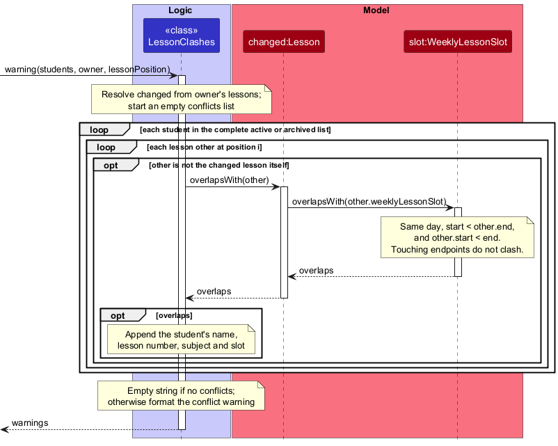
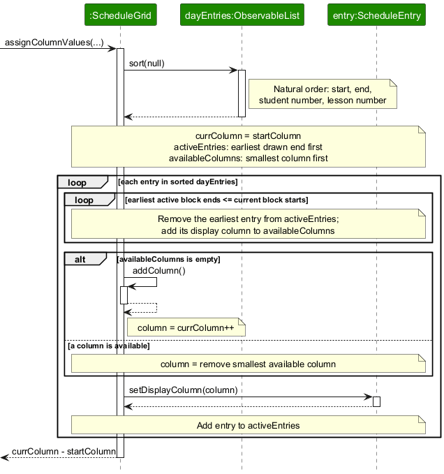

StudentBook builds on AddressBook Level 3 (AB3). The diagrams below describe its current architecture and tuition features.

## Table of Contents

* [Acknowledgements](#acknowledgements)
* [Getting started](#getting-started)
* [Design](#design)
  * [Architecture](#architecture)
    * [Overview](#overview)
    * [Interactions](#interactions)
  * [UI component](#ui-component)
    * [Interactions](#interactions-1)
  * [Logic component](#logic-component)
    * [Command Execution](#command-execution)
    * [Command Parsing](#command-parsing)
  * [Model component](#model-component)
  * [Storage component](#storage-component)
  * [Common classes](#common-classes)
* [Implementation](#implementation)
  * [Lesson clash detection](#lesson-clash-detection)
  * [Interval scheduling](#interval-scheduling)
  * [Student search](#student-search)
  * [Guardian follow-ups](#guardian-follow-ups)
  * [Notes](#notes)
* [Documentation, logging, testing, dev-ops](#documentation-logging-testing-dev-ops)
* [Appendix: Requirements](#appendix-requirements)
  * [Product scope](#product-scope)
  * [Agreed field rules](#agreed-field-rules)
  * [Decisions to confirm](#decisions-to-confirm)
  * [User stories](#user-stories)
  * [Use cases](#use-cases)
    * [UC01: Register a student](#uc01-register-a-student)
    * [UC02: Retrieve a guardian's contact details](#uc02-retrieve-a-guardians-contact-details)
    * [UC03: Remove a student who has stopped attending lessons](#uc03-remove-a-student-who-has-stopped-attending-lessons)
    * [UC04: Change a lesson's slot](#uc04-change-a-lessons-slot)
    * [UC05: Mark a guardian follow-up as complete](#uc05-mark-a-guardian-follow-up-as-complete)
    * [UC06: Attach a guardian contact](#uc06-attach-a-guardian-contact)
  * [Non-functional requirements](#non-functional-requirements)
  * [Glossary](#glossary)
* [Appendix: Instructions for manual testing](#appendix-instructions-for-manual-testing)
  * [Launch and shutdown](#launch-and-shutdown)
  * [Main window](#main-window)
  * [Student deletion](#student-deletion)
  * [Lessons and saved data](#lessons-and-saved-data)
  * [Name and guardian searches](#name-and-guardian-searches)
  * [Guardian contacts](#guardian-contacts)
  * [Guardian follow-ups](#guardian-follow-ups-1)
  * [Notes](#notes-1)
  * [Missing or invalid data files](#missing-or-invalid-data-files)

## Acknowledgements

* Based on [AddressBook Level 3](https://github.com/se-edu/addressbook-level3) from the [SE-EDU initiative](https://se-education.org).
* Pranav used Claude (Anthropic), through Claude Code, to draft the v1.3 UI restyle: the mock-ups, the FXML and CSS in `src/main/resources/view`, the UI classes in `seedu.address.ui`, and their tests. He reviewed, ran and tested the changes.
* The UI uses the [Geist and Geist Mono fonts](https://github.com/vercel/geist-font) (v1.7.2) by The Geist Project Authors, under the SIL Open Font License 1.1. The font files and license are in `src/main/resources/fonts`.

## Getting started

Refer to the guide [*Setting up and getting started*](SettingUp.md)

## Design

### Architecture

Solid arrows show associations; dashed arrows show dependencies. The icons represent the tutor and local files.

#### Overview

StudentBook relies primarily on 4 components:

| Component | Responsibility |
|---|---|
| [**`UI`**](#ui-component) | App UI |
| [**`Logic`**](#logic-component) | Command parsing and execution |
| [**`Model`**](#model-component) | Hold app records and settings in memory |
| [**`Storage`**](#storage-component) | Read and write JSON files |

**`Main`** then manages these components as follows:
* **App launch**: Initialise components in correct sequence and connect them with one another
* **Shutdown**: Shut down components, invoke necessary cleanup methods

**`Commons`** shares utilities across the above components.

#### Interactions

Each main component
* Defines its *API* through an interface
* Provides functionality through a concrete `{COMPONENT_NAME}Manager` class that implements the corresponding API interface

Other components interact with a component through its interface (rather than its concrete class), preventing them from coupling to that component's implementation.

Example component structure (Logic)

`LogicManager`
* implements the `Logic` interface
* interacts with `Model` and `Storage` components through their respective interfaces (not their concrete implementations)

### UI component

**API Specification**: `Ui.java`
**Interacts with**: `Model`, `Logic`
**Depends on**: `Model`, `Logic`

Abstract class `UiPart` captures common behaviour among classes representing visible GUI parts. Each part:
* Inherits from `UiPart`
* Use the JavaFX UI framework
* Defines layout in a matching `.fxml` file in `src/main/resources/view`
* Use `LightTheme.css` for style, with fonts loaded by `AppFonts` at startup

List of UI components

| Class | UI Component |
|---|---|
|`MainWindow`|Main application window|
|`CommandBox`|Command input box|
|`StatusBarFooter`|Status bar footer|
|`ResultDisplay`|Result display|
|`PersonListPanel`|Student list display|
|`PersonCard`|Individual student display|
|`WeekPanel`|Weekly schedule header|
|`ScheduleGrid`|Weekly schedule display|
|`LessonCard`|Individual lesson display|

 

#### Interactions
**`Logic`**
User commands received by the UI component are sent to `Logic` for execution.

Additionally, `Logic` supplies the following data:
* Filtered and sorted active and archived student lists, from `Logic#getFilteredActivePersonList()` and `Logic#getFilteredArchivedPersonList()`
* Complete student records, from `Logic#getAddressBook()`, which the UI uses to calculate student and lesson totals
* The lesson filter, from `Logic#getLessonPredicate()`, which selects matching lessons for the weekly calendar
* The rate sort order, from `Logic#getRateSortOrder()`, which controls the table's rate heading and displayed rates
* The selected archive view, from `Logic#isArchiveView()`, which determines which student table is shown

The UI constructs empty-state messages: `StudentListStatus` supplies the student-list text, and `WeekPanel` supplies the calendar text.

**`Ui`** and **`Model`**
* `Ui` listens for changes to `Model` data for updates
* `Ui` depends on some classes in `Model` to display `Student` objects correctly

### Logic component

**API Specification**: `Logic.java`
**Interacts with**: `Ui`, `Model`, `Storage`
**Depends on**: `Model`

Above is a (partial) class diagram of the `Logic` component.

#### Command execution
The sequence diagram below illustrates the interactions within the `Logic` component (API call `execute("delete 1")` is used as an example).

Command execution works as follows:
1. `Logic` is called to execute a command.
1. Command is passed to an `AddressBookParser`.
1. `AddressBookParser` creates a parser matching the command (e.g. `DeleteCommandParser`).
1. The created parser is used to parse the command into a `Command` object (e.g. `DeleteCommand`).
1. The `Command` object is executed by `LogicManager`
1. The `Command` object communicates with `Model` when executed. For deletion, it resolves the displayed index to a `Student` before calling `deletePerson(student)`.
1. The result of the command is encapsulated as a `CommandResult` object when returned from `Logic`.

#### Command parsing

The other classes in `Logic` (omitted from the class diagram above) that are used for parsing a user command:

Command parsing works as follows:
1. `Logic` is called to parse a command.
1. `AddressBookParser` creates an `XYZCommandParser`(`XYZ` is a placeholder for a specific command name, e.g. `AddCommandParser`).
1. The parser uses the other classes shown above to parse the user command and create an `XYZCommand` object (e.g. `AddCommand`).
1. `AddressBookParser` returns that object as a `Command` object.

### Model component

**API Specification**: `Model.java`
**Interacts with**: `Ui`, `Logic`
**Depends on**: `None`

The `Model` component stores:
* active and archived students in separate `UniquePersonList`s
* filtered and sorted views of both lists, exposed as unmodifiable `ObservableList<Student>`s
* the lesson filter, rate sort order and selected archive view
* user preferences in `UserPrefs`

:information_source: An alternative design keeps a list of unique tags in `AddressBook`, then each `Student` references tags in that list, allowing `AddressBook` to maintain one `Tag` object per unique tag instead of each `Student` holding its own `Tag` object.

This alternative is not the current implementation.

 

`Student` extends `Person` and references its contact details, guardian, lessons, progress notes and follow-ups.

Each `Lesson` combines a required subject, weekly slot and hourly rate with an optional location and mode.

### Storage component

**API Specification**: `Storage.java`
**Interacts with**: `Model`
**Depends on**: `Model`

The `Storage` component:
* Saves student data (`data/studentbook.json`) and user preferences (`preferences.json`) in JSON format, and reads them back into corresponding objects
* Delegates JSON file access to `JsonAddressBookStorage` and `JsonUserPrefsStorage` (one class per data file)
* Uses JSON adapters for students, tags, guardians, lessons, weekly slots, progress notes and follow-ups

### Common classes
Classes used by multiple components are in the `seedu.address.commons` package.

## Implementation

This section describes noteworthy details on how certain features are implemented.

### Lesson clash detection

After a valid lesson addition/edit operation, or unarchive operation, lessons are checked for clashes. If clashes exist, the user will be informed of them through a warning (note that the operation will still succeed).
This is done by `LessonClashes.resultForLesson` for adding/editing lessons, and `LessonClashes.resultForStudent` for unarchived students.

A clash produces a successful `CommandResult.warning`, so the change is still saved. `MainWindow` displays it through `ResultDisplay#setWarningToUser`, using amber styling and an exclamation icon. The next result replaces that feedback.

### Interval scheduling

The calendar uses interval partitioning to display every matching lesson. `ScheduleGrid.refreshSchedule` groups entries by weekday; `assignColumnValues` sorts each day by start time, end time, student number and lesson number. Two priority queues track active entries by drawn end time and reusable columns by number. Before placing an entry, columns whose blocks have ended become reusable. The entry takes the smallest available column, or a new one when all are occupied. This minimises the columns needed; empty days retain one.

Displayed blocks last at least 15 minutes and remain within their day. Saved times and clash checks use the actual intervals. The sequence shows one non-empty day; notes summarise local queue updates.

### Student search

`FindCommand` holds separate student and lesson predicates. Prefixed searches use `StudentSearchPredicate`; bare name keywords use `NameContainsKeywordsPredicate`.

`FindCommandParser` accepts `name/`, `guardian/`, `sch/`, `level/`, `subject/` and `day/`. It rejects empty values, repeated prefixes and bare keywords mixed with prefixes. Every supplied criterion must match. Contact, school and level searches use case-insensitive substrings; guardian phone queries also remove spaces and hyphens. `SchoolingLevel.isStageNamedBy` recognises stage names and prefixes, so `Primary 5` matches `P5`, but `Secondary 3` does not match `Sec 2 G3`. Missing optional fields fail only when searched for. Bare name keywords retain whole-word, case-insensitive OR matching.

Subject and day must match the same lesson. The student needs at least one matching lesson. For active-list searches, the same `LessonMatchesPredicate` filters the weekly calendar; omitting lesson criteria resets that filter. Searches without lesson criteria include students without lessons.

The following sequences show parsing and executing `find sch/nanyang subject/math day/mon`.

Active and archived lists keep separate searches. `list` and `list-archive` reset their respective searches; mutations preserve both searches, the calendar lesson filter and the archive view. Updated records enter or leave results according to those predicates, and indices change accordingly. `add` clears the active search and lesson filter and leaves Archives to display the new student.

Search diagnostics omit input values. `FindCommandParser` logs prefix names and rejection reasons at `FINE`; `FindCommand` logs result counts at `INFO`. `LogicManager` logs command types and outcomes without input or result text. `LogsCenter` writes to the console and rotating `studentbook.log.*` files; set its `LOG_LEVEL` to `Level.FINE` for parser diagnostics.

Tests: `StudentSearchPredicateTest`, `LessonFilterPredicateTest`, `FindCommandParserTest` and `FindLoggingTest`.

Search logging uses the existing `LogsCenter` framework. The parser logs selected prefix names and rejection
reasons at `FINE`; the command logs the result count at `INFO`. These search-specific diagnostics omit search
values. Command-level logging in `LogicManager` records parsed command types and outcomes without input values
or result messages. Logs go to the console and rotating `studentbook.log.*` files; set `LOG_LEVEL` in
`LogsCenter` to `Level.FINE` for parser diagnostics.

### Guardian follow-ups

A `FollowUp` contains 1–200 trimmed, single-line Unicode code points. `Student` stores outstanding items in an unmodifiable list in insertion order; their positions are the displayed `FOLLOW_UP_INDEX` values. Completion removes an item rather than storing a done state. Follow-ups belong to students, so they work without a guardian and survive `guardian-delete`.

The add and edit parsers treat everything after the first `text/` as literal text, including `and/or` and further `text/` strings. Add requires one student index; edit and done require student and item indices. `ParserUtil#parseFollowUp` validates the text and collapses repeated spaces.

Commands resolve students from the current filtered list, reject out-of-range item indices and reject text matching another item ignoring case. Case-only edits to the same item remain valid. Updates use `Student#withFollowUps`, and success feedback includes the affected text.

`followups` selects active students with outstanding items and resets the lesson filter. Completing a student's last item removes them from those results and renumbers subsequent students. Commands select the updated student's current position, or leave details closed if that student is no longer displayed.

The sequence diagram below focuses on executing `followup-done 1 2`. Parsing follows the
[Logic component](#logic-component) workflow; `LogicManager` saves the updated student data before returning the result.

Other student updates preserve follow-ups. `PersonCard` displays them in its **Follow-ups** section. `JsonAdaptedFollowUp` stores each item as `{"text": "..."}` in `followUps`; missing or null arrays load as empty, while null items, non-string text and invalid text reject the file.

Tests include `FollowUpTest`, `FollowUpWorkflowTest`, `FollowUpStorageTest`, the follow-up command and parser tests, and routing tests in `AddressBookParserTest`.

### Notes

A `ProgressNote` contains a `LocalDate` and 1–500 trimmed, single-line Unicode code points. `Student` stores notes in an unmodifiable list sorted oldest first, preserving the relative order of equal-date notes. Their positions are the displayed `NOTE_INDEX` values; adding, deleting or changing dates can renumber them. New students start with no notes.
### Progress notes

A `ProgressNote` holds a `LocalDate` and 1–500 characters of single-line text. `Student` keeps its notes in an
unmodifiable list sorted oldest first; the sort is stable, so notes on the same date keep the order they were added.
A note's position in that list is the `NOTE_INDEX` shown in the details. New students start with no notes.

The add and edit parsers treat everything after the first `text/` as literal text, so `date/` must precede it when both are supplied. Editing requires at least one date or text field. Shared `ParserUtil` validators require real `YYYY-MM-DD` dates between `2000-01-01` and today. The date range is checked during command parsing, rather than storage loading, so a changed computer clock does not prevent saved notes from loading.

Commands resolve the student from the current filtered list, reject invalid note indices and reject duplicate date-and-text pairs. Updates use `Student#withNotes` and open the student's details; other student updates preserve existing notes.

The sequence diagram below focuses on executing `note-add 1 date/2026-10-15 text/Fractions`. Parsing follows the
[Logic component](#logic-component) workflow; `LogicManager` saves the updated student data before returning the result.

`JsonAdaptedProgressNote` stores each note as `{"date": "YYYY-MM-DD", "text": "..."}` in `notes`. Missing or null arrays load as empty; adapters validate stored dates and text. `PersonCard` displays notes in its **Notes** section.

Tests include `ProgressNoteTest`, `NoteWorkflowTest`, `ProgressNoteStorageTest`, and the note command and parser tests.

## Documentation, logging, testing, dev-ops

* [Documentation](Documentation.md)
* [Testing](Testing.md)
* [Logging](Logging.md)
* [Builds, CI and releases](DevOps.md)

## Appendix: Requirements

### Product scope

**Target user profile**:

Independent private tutors who:
* teach many students one-to-one without administrative support, mostly from primary school to junior college (JC)
* keep track of student details, lesson arrangements, and guardian contacts themselves
* regularly retrieve and update this information before and after lessons
* can type quickly and prefer typing over mouse-driven input

**Value proposition**: StudentBook keeps each student's contact details, school and level, guardian contact, weekly lessons with hourly rates, progress notes and guardian follow-ups in one place. Tutors find and update them by typing commands, see their week on a calendar, and are warned when lessons clash.
**Value proposition**: StudentBook keeps student contacts, tuition details, weekly lesson slots and hourly rates in one place, so private tutors can find and update them quickly.

The original MVP covered student records and the five tuition features below. Payment processing and sending messages are out of scope.

| Owner | MVP feature | Story IDs |
|---|---|---|
| Min Wenn | Schooling level | 5; level updates in 12 |
| Pranav | Subject | 6; subject updates in 12 |
| Jian Yi | Weekly lesson slot | 25, 28, 29, 48 |
| Dylan | Hourly rate | 53, 54 |
| Mervin | Guardian contact | 7, 8, 22, 23 |

Current delivery status is listed under [User stories](#user-stories).

StudentBook does not process payments, send messages or manage group classes. Each lesson belongs to one student.

A student has any number of lessons. Each lesson groups a required subject, weekly slot and hourly rate with an optional location and mode. School and schooling level are optional; students can be added without either, and `edit STUDENT_INDEX sch/` or `edit STUDENT_INDEX level/` can clear the corresponding field. Each student has at most one school, with 1 to 60 characters after trimming leading and trailing whitespace.

### Decisions to confirm

The earlier Google specification and the current code differ on the rules below. Keeping AB3 fields was agreed, but it did not settle every validation or failure rule. These are open product decisions, not changes to implement automatically.

| Decision | Earlier specification | Current implementation |
|---|---|---|
| Contact fields | Name required on creation | Name, phone, email and address required; confirm whether all four contact fields are needed |
| Duplicate names | Normalized, case-insensitive comparison | Exact, case-sensitive name comparison |
| Names and phones | Punctuation in names; optional `+` and 7–15 digits in phones | Names start with a letter/number and allow Unicode letters, accents, numbers, spaces, apostrophes, hyphens, periods and `s/o`/`d/o`; phones allow an optional leading `+` and 7–15 digits, with single spaces or hyphens between digit groups |
| Save/load failures | Roll back failed saves; block commands after a failed load | Failed saves roll back; failed loads use backup recovery |

The pre-chat Git and Google documents also differed on registration and guardian attachment. The current plan adds the guardian separately. Confirm the remaining rules with the team before treating the earlier draft as superseded.

### User stories

Priority: `***` high, `**` medium, `*` low. Status records current support independently of priority; future stories are not delivery commitments.

| ID | Priority | Status | As a... | I want to... | So that I can... |
|---|---|---|---|---|---|
| 1 | `***` | Implemented | private tutor | add a student record with a name | begin tracking each student |
| 2 | `***` | Implemented | private tutor | view the list of current students | see who I currently teach |
| 3 | `***` | Implemented | private tutor | view a student's subjects and schooling level | prepare for the right subject and level |
| 4 | `***` | Implemented | private tutor | delete a student record | keep my records free of obsolete or incorrect entries |
| 5 | `***` | Implemented | private tutor | record a student's schooling level | choose material at the right level |
| 6 | `***` | Implemented | private tutor | record the subjects I teach a student | remember what I teach each student |
| 7 | `***` | Implemented | private tutor | record one guardian's name and contact details for a student | reach the right adult about lessons |
| 8 | `***` | Implemented | private tutor | view the guardian name and contact details linked to a student | contact a guardian without searching elsewhere |
| 9 | `***` | Implemented | private tutor | keep my student details and guardian contacts when I close and reopen the app | continue my work without re-entering information |
| 10 | `**` | Implemented | private tutor | edit a student's name | correct typos without recreating the record |
| 11 | `**` | Implemented | private tutor | record a student's school | remember which school the student attends |
| 12 | `**` | Implemented | private tutor | update a student's school, schooling level or lesson subjects | keep records current as circumstances change |
| 13 | `**` | Implemented | private tutor | search for a student by a partial name | retrieve a record quickly |
| 14 | `**` | Implemented | private tutor | view students ordered by school stage, level and name | scan a long student list faster |
| 15 | `**` | Implemented | private tutor | filter students by school | find students from the same school |
| 16 | `**` | Implemented | private tutor | filter students by schooling level | prepare level-appropriate materials |
| 17 | `**` | Implemented | private tutor | filter students by subject | prepare for a subject-specific class |
| 18 | `**` | Implemented | private tutor | mark a student as inactive | keep former students without cluttering the current list |
| 19 | `**` | Implemented | private tutor | view inactive students separately | refer to past records when needed |
| 20 | `**` | Future | private tutor | add another guardian to a student | keep alternative contacts for the same student |
| 21 | `**` | Future | private tutor | record each guardian's relationship to the student | know who I am contacting |
| 22 | `**` | Partial | private tutor | edit a guardian's contact details | keep guardian contact information current |
| 23 | `**` | Implemented | private tutor | remove a guardian from a student | discard contacts that are no longer relevant |
| 24 | `**` | Implemented | private tutor | search by guardian name or contact | find the right student when a guardian contacts me |
| 25 | `**` | Implemented | private tutor | add a recurring weekly lesson slot to a student | remember when the student is taught |
| 26 | `**` | Implemented | private tutor | add more than one weekly lesson slot to a student | track students with several lessons each week |
| 27 | `**` | Implemented | private tutor | view lessons scheduled on a chosen day | prepare for that day's students |
| 28 | `**` | Implemented | private tutor | edit a lesson slot | keep the agreed schedule current |
| 29 | `**` | Implemented | private tutor | remove a lesson slot | clear a cancelled arrangement |
| 30 | `**` | Implemented | private tutor | record a lesson's location or delivery mode | know where and how the lesson will happen |
| 31 | `**` | Future | private tutor | assign students to a shared group class | manage one lesson arrangement for its attendees |
| 32 | `**` | Future | private tutor | view every student in a group class | prepare the correct class list |
| 33 | `**` | Implemented | private tutor | add a dated progress note to a student | remember what happened in recent lessons |
| 34 | `**` | Implemented | private tutor | view a student's dated progress notes in chronological order | recall learning needs before the next lesson |
| 35 | `**` | Implemented | private tutor | record a follow-up item for a guardian | remember what I need to communicate |
| 36 | `**` | Implemented | private tutor | find active students with outstanding guardian follow-ups | avoid missing promised updates |
| 37 | `**` | Future | private tutor | record whether a student's payment for a billing period is outstanding | identify payments that need follow-up |
| 38 | `**` | Future | private tutor | record a guardian's preferred contact method | contact each guardian appropriately |
| 39 | `**` | Implemented | private tutor exploring the app | find out which student-management tasks the app supports | decide whether it suits my work |
| 40 | `**` | Implemented | private tutor learning the app | look up command usage and examples | complete a task when I do not remember what to type |
| 41 | `**` | Implemented | private tutor | combine subject, schooling-level and lesson-day filters | find students matching the criteria for my preparation |
| 42 | `**` | Implemented | private tutor | see each student's next weekly lesson | know which lesson to prepare for next |
| 43 | `**` | Implemented | private tutor | edit a guardian follow-up item | keep the recorded request accurate when arrangements change |
| 44 | `**` | Implemented | private tutor | mark a guardian follow-up item as complete | remove finished work from my outstanding follow-ups |
| 45 | `**` | Implemented | private tutor learning the app | see what needs correcting when an entry is rejected | fix the entry without guessing why it failed |
| 46 | `**` | Implemented | tutor who communicates directly with a student | record the student's own phone number or email address | keep their contact details with their record |
| 47 | `**` | Implemented | tutor who needs to contact a student directly | view the student's contact details | reach them without searching elsewhere |
| 48 | `**` | Implemented | tutor checking a student’s lesson arrangements | view that student's weekly lesson times | confirm when I teach them |
| 49 | `**` | Implemented | tutor planning my week | view all my lessons arranged by day and time | see which students I will teach each day |
| 50 | `*` | Implemented | private tutor | find students by a guardian's phone and compare their guardian details | avoid contacting the same guardian repeatedly |
| 51 | `*` | Implemented | private tutor | receive a warning when separate lesson arrangements overlap | avoid accepting conflicting arrangements |
| 52 | `*` | Implemented | private tutor | inspect and back up all saved records | protect my data and transfer it between computers |
| 53 | `**` | Implemented | private tutor | record and view each lesson's hourly rate | check the agreed rate before discussing fees |
| 54 | `**` | Implemented | private tutor | change a lesson's hourly rate | keep the agreed rate current |
| 55 | `**` | Future | private tutor | remove a lesson's rate without deleting the lesson | retain arrangements when a rate is no longer agreed |
| 56 | `**` | Implemented | private tutor | restore an archived student | resume teaching without re-entering their details |
| 57 | `**` | Implemented | private tutor | edit a progress note | correct mistakes in my learning observations |
| 58 | `**` | Implemented | private tutor | delete a progress note | remove obsolete or incorrect observations |
| 59 | `**` | Implemented | private tutor | sort students by lesson rate within each school stage | compare agreed rates across students |
| 60 | `**` | Implemented | private tutor starting real use | delete all records before entering my own students | start without sample or trial data |

**Selected acceptance criteria**

* **12:** School, level and individual lesson subjects can change independently without altering unrelated details.
* **22:** Guardian name and phone can change independently; email remains future scope.
* **42:** Compare start minutes in the weekly cycle, including the current minute. Earlier starts roll to next week; ties use stored lesson order.
* **50:** Phone searches match substrings and ignore spaces/hyphens; compare full guardian names and phones to confirm shared contacts.
* **52:** Human-readable JSON and manual file copying satisfy this story.
* **59:** Ascending uses each student's minimum lesson rate; descending uses their maximum. Students without lessons come last.
* **60:** Clearing from the active list removes both active and archived records.

### Use cases

These use cases describe how the current version behaves. The [User Guide](UserGuide.md) gives each command's format.

The actor is a private tutor and the system is StudentBook. The app is already open unless stated otherwise. **MSS** means main success scenario.

#### UC01: Register a student

**Related user stories:** 1, 5, 9, 11.

**MSS**

1. Tutor requests to add a student, supplying name, phone, email and address, with optional tags, school and schooling level.
2. StudentBook confirms the addition and displays the new student.

Use case ends.

**Extensions**

* 1a. A required detail is missing or a supplied value is invalid.
  * 1a1. StudentBook reports the error without adding a record.
  * Use case resumes at step 1.
* 1b. An active or archived student with the exact same name already exists.
  * 1b1. StudentBook reports the duplicate without adding a record.
  * Use case ends.

#### UC02: Retrieve a guardian's contact details

**Related user stories:** 2, 8.

**MSS**

1. Tutor requests to list students.
2. StudentBook displays the student list.
3. Tutor requests the intended student's guardian contact details.
4. StudentBook displays the guardian's name and phone number.

Use case ends.

**Extensions**

* 2a. No active students exist.
  * 2a1. StudentBook displays an empty list.
  * Use case ends.
* 3a. The student selection is invalid.
  * 3a1. StudentBook reports the error.
  * Use case resumes at step 3.
* 3b. The intended student has no guardian contact.
  * 3b1. StudentBook indicates that no guardian is recorded.
  * Use case ends.

#### UC03: Remove a student who has stopped attending lessons

**Related user stories:** 2, 4.

**MSS**

1. Tutor requests to list students.
2. StudentBook displays the student list.
3. Tutor identifies the student to delete and requests deletion.
4. StudentBook removes the student's record and confirms deletion with the updated list.

Use case ends.

**Extensions**

* 2a. The student list is empty.
  * Use case ends.
* 3a. The student selection is invalid.
  * 3a1. StudentBook displays an error without deleting any record.
  * Use case resumes at step 3.

#### UC04: Change a lesson's slot

**Related user stories:** 2, 28, 48.

**Preconditions:** The intended student is active and has an existing lesson.

**MSS**

1. Tutor requests to list students.
2. StudentBook displays the student list.
3. Tutor requests the intended student's lesson details.
4. StudentBook displays the student's lessons.
5. Tutor identifies the lesson to edit and requests a new slot.
6. StudentBook confirms the change and displays the updated lesson.

Use case ends.

**Extensions**

* 3a. The student selection is invalid.
  * 3a1. StudentBook reports the error.
  * Use case resumes at step 3.
* 5a. The student or lesson selection is invalid, the new slot is invalid, or the change would duplicate another lesson of that student.
  * 5a1. StudentBook explains the error without changing any lesson.
  * Use case resumes at step 5.
* 5b. The new slot overlaps another lesson.
  * 5b1. StudentBook applies the change and displays the updated lesson with a clash warning.
  * Use case ends.

#### UC05: Mark a guardian follow-up as complete

**Related user stories:** 36, 44.

**Preconditions:** Tutor has carried out the follow-up outside StudentBook.

**MSS**

1. Tutor requests students with outstanding guardian follow-ups.
2. StudentBook displays the students with outstanding items.
3. Tutor requests a student's follow-up details.
4. StudentBook displays the student's outstanding items.
5. Tutor identifies the completed item and requests to mark it as complete.
6. StudentBook removes the item from the outstanding items and confirms completion with its text.

Use case ends.

**Extensions**

* 2a. No active student has an outstanding item.
  * 2a1. StudentBook displays an empty list.
  * Use case ends.
* 3a. The student selection is invalid.
  * 3a1. StudentBook reports the error.
  * Use case resumes at step 3.
* 5a. The student or follow-up selection is invalid.
  * 5a1. StudentBook explains the error without changing any item.
  * Use case resumes at step 1.
* 6a. The completed item was the student's last one.
  * 6a1. StudentBook removes the student from the outstanding list.
  * Use case ends.

#### UC06: Attach a guardian contact

**Related user stories:** 7, 9.

**Preconditions:** The intended student is in the displayed list.

**MSS**

1. Tutor identifies the student and requests to attach a guardian, supplying the guardian's name and phone number.
2. StudentBook displays the linked guardian and confirms the addition.

Use case ends.

**Extensions**

* 1a. The student selection or guardian details are invalid.
  * 1a1. StudentBook reports the error without changing the record.
  * Use case resumes at step 1.
* 1b. A guardian is already attached.
  * 1b1. StudentBook reports that a guardian is already attached and suggests editing the contact.
  * Use case ends.

#### UC07: Archive a past student and restore them later

**Related user stories:** 18, 19, 51.

**MSS**

1. Tutor requests to list active students.
2. StudentBook displays the active students.
3. Tutor requests to archive a student using the displayed index.
4. StudentBook moves the student to the archived list, keeping their details, lessons, notes and follow-ups. Their lessons leave the weekly calendar.
5. Later, tutor requests to list archived students.
6. StudentBook displays the archived students.
7. Tutor requests to unarchive a student using the index in that list.
8. StudentBook moves the student back to the active list and confirms. The archived list stays on screen.

Use case ends.

**Extensions**

* 3a. The supplied index is invalid for the displayed list.
  * 3a1. StudentBook displays an error without archiving anyone.
  * Use case resumes at step 2.
* 7a. The supplied index is invalid for the displayed list.
  * 7a1. StudentBook displays an error without restoring anyone.
  * Use case resumes at step 6.
* 8a. A restored lesson overlaps a lesson of an active student, for example one added while the student was archived.
  * 8a1. StudentBook still restores the student, and shows a warning that lists each clashing lesson.
  * 8a2. Tutor changes or deletes one of the lessons (UC04).
  * Use case ends.

#### UC08: Add a lesson for a student

**Related user stories:** 25, 26, 30, 51, 53.

**Preconditions:** The student is visible in the displayed list.

**MSS**

1. Tutor requests to add a lesson, supplying the student's displayed index, subject, weekly slot and hourly rate, and optionally the mode and location.
2. StudentBook adds the lesson as the student's last lesson and confirms the addition.

Use case ends.

**Extensions**

* 1a. The index or a lesson field is invalid.
  * 1a1. StudentBook explains the error without changing any lesson.
  * 1a2. Tutor corrects and resubmits the request.
  * Use case resumes at step 1.
* 1b. The student already has a lesson with the same subject, slot, rate, mode and location.
  * 1b1. StudentBook reports the duplicate without changing any lesson.
  * Use case ends.
* 2a. The new lesson overlaps another lesson in the same student list, including the student's own lessons and students hidden by a search.
  * 2a1. StudentBook still saves the lesson, and shows a warning that lists each clashing lesson by student, lesson number, subject and slot.
  * 2a2. Tutor changes or deletes one of the lessons (UC04).
  * Use case ends.
* 2b. StudentBook cannot save the change.
  * 2b1. StudentBook reports the save failure without adding the lesson.
  * Use case ends.

#### UC09: Find students matching several criteria

**Related user stories:** 13, 15, 16, 17, 24, 27, 41.

**MSS**

1. Tutor requests to find students, supplying one or more criteria: name, guardian name or phone, school, schooling level, lesson subject and lesson day.
2. StudentBook displays the students who match every criterion, with the number shown out of the total. When both subject and day are given, one lesson must match both.
3. Tutor requests the weekly calendar.
4. StudentBook shows only the matching students' lessons that meet the lesson criteria.

Use case ends.

**Extensions**

* 1a. No criterion is given, a criterion is empty or repeated, the day is not a weekday, or bare name keywords are mixed with criteria.
  * 1a1. StudentBook explains the error and keeps the current results.
  * 1a2. Tutor corrects and resubmits the request.
  * Use case resumes at step 1.
* 2a. No student matches.
  * 2a1. StudentBook shows an empty list and suggests `list`.
  * Use case ends.
* 2b. Tutor edits, archives or deletes a displayed student.
  * 2b1. StudentBook keeps the search, so a student who no longer matches leaves the results, and renumbers the rest.
  * Use case resumes at step 2.
* *a. At any time, tutor requests to list all students.
  * *a1. StudentBook clears the search and the calendar's lesson filter.
  * Use case ends.

### Non-functional requirements

1. **Compatibility.** Run on Windows, macOS and Linux with Java `25`, on systems supported by the bundled JavaFX runtime.
2. **Capacity and speed.** Support 1,000 active students, each with one guardian. Adding, listing or deleting a student should show its result within two seconds. Test on a supported computer with at least 4 GB of RAM and local storage. Measure from command submission to the displayed result, excluding startup.
3. **Keyboard use.** Every command, and moving between students and screens, works from the keyboard without a mouse.
4. **Error messages.** Explain what is wrong and how to fix it. Invalid input should leave existing records unchanged.
5. **Saved data.** Save every change as soon as a command succeeds, and restore all records on restart, including lessons, notes, follow-ups and archived students.
6. **Offline use.** Manage and save records on the tutor's computer without internet access or an online account.
7. **Data protection.** Keep student and guardian contact details out of external services and diagnostic logs. The tutor's operating-system account and file permissions control access to local files.
8. **File errors.** If the data file cannot be read, StudentBook copies it to a timestamped backup beside it, starts with no students and shows where the backup is. If it cannot make the backup, it closes without changing the file. If a save fails, the command's changes are undone and the error is shown. Valid AB3 data files load, with the tuition fields empty.

### Glossary

* **StudentBook**: The desktop app for managing student records.
* **Independent private tutor**: A tutor who manages students and lessons without administrative staff.
* **Student record**: One student's contact details, school, schooling level, guardian contact, lessons, dated progress notes and guardian follow-ups.
* **Guardian contact**: The name and phone number of the adult responsible for a student. Each student has at most one guardian. A recorded guardian needs both fields.
* **Schooling level**: The student's year of study, such as P5, Sec 3 or JC1. StudentBook groups recognised levels under Primary, Secondary or JC, and any other level, such as Poly Y1, under Other.
* **Subject**: An academic subject taught by the tutor to a student, such as Mathematics or English.
* **Lesson**: One recurring arrangement for a student: a subject, a weekly slot and an hourly rate, with an optional location and mode. A student can have many lessons.
* **Recurring lesson slot**: A lesson's weekly day, start time and end time on a single day.
* **Lesson mode**: Whether a lesson is physical or virtual.
* **Hourly rate**: The agreed SGD amount per hour for a lesson, stored as `BigDecimal`. It does not calculate fees or process payments.
* **Progress note**: A dated note recording a student's learning progress or observations from a lesson.
* **Guardian follow-up item**: A recorded action the tutor needs to carry out for a guardian, such as providing an update. An outstanding item has not yet been marked complete.
* **Archived student**: A past student kept in a separate list (`list-archive`) with all their records. Archived students' lessons do not appear in the weekly calendar.
* **Displayed index**: The number beside a student in the current list. It can change when the list changes, so it is not a permanent student ID.
* **Local storage**: Files on the tutor's computer that keep records between launches.
* **Private contact detail**: A student or guardian's phone number, email address, or other contact information intended for the tutor's use rather than public sharing.

## Appendix: Instructions for manual testing

These checks are a starting point; also try variations and boundary values.

Unless a section says otherwise, start it from the sample data: close StudentBook, delete the `data` folder in the test folder, then launch again. The indexes below assume the sample data. Student details open inline, below the student's row in the list.

For larger or boundary-value data sets, generate a data file with `./gradlew seed`, e.g. `./gradlew seed --args="--students 500 --edge-cases --out test/studentbook.json"`, and copy it into the test folder as `data/studentbook.json`. See [Generating test data](Testing.md#generating-test-data).

### Launch and shutdown

1. Build the JAR using [Build automation](DevOps.md#build-automation), copy it into the test folder and run `java -jar studentbook.jar` there.
2. Check that the window opens with sample data. Run `list`; it should show eight active students, starting with Chloe Lim, Isaac Ng and Ethan Lim. Open Chloe's and Ethan's details to check that they share the guardian Lim Mei Ling. Run `week`; no lessons should overlap. Run `list-archive`; it should show one past student, Tan Wei Jie.
3. Resize and move the window, then close and reopen the app. Check that it keeps the new size and position.

### Main window

1. Launch with sample data. The command box should have keyboard focus, so you can type `list` straight away.
2. Run `find` with a name that matches one student. The header should read `Showing 1 of N`. Run `find zzz`; the list should say `No students match` and suggest `list`.
3. Run `clear` in a test folder. The list should say `No students yet` and show an example `add` command; running it as shown should add a student.
4. Run `delete 0`. The result row should turn pink with a red `!`, and `delete 0` should stay in the box in red. Fix it to a valid index and press Enter; the box should clear.
5. Run `add name/Ryan`. The result row should show the description, a **Format** line and an **Example** line in a monospace font.
6. Run two commands, then press Up twice and Down twice. The box should show the earlier commands, then what you had typed. Press Esc; the box should clear.
7. Run `list` with more students than fit in the window. Press Esc in the empty command box to close any open details, then press Page Down and Page Up. The student list should scroll, and typing should still go into the command box. Run `view STUDENT_INDEX` for a student with long details, then press Page Down and Page Up again; the list, including the expanded details, should scroll without changing the selected student.
8. Press F1 with the window focused. The user guide should open in the default browser. Check that clicking **All commands**, choosing **Help → Help**, and running `help` open the same guide without an extra app window.
9. Run `list`, then `view 1` and `view 2`. The indicated student's details should expand below their row, and the previously open row should collapse. With the command box empty, press Esc to close the details. Press Alt+Down twice; the second student's details should expand, with focus still in the command box. Run `find` with a name that matches only one student; that student's details should open automatically.
10. Add a student with a long name, several lessons and a long address, then run `view STUDENT_INDEX` for that student. Shrink the window to its minimum size. The details should remain below the student's row, with long text wrapping and the detail sections reflowing to fit. The Subjects and Guardian columns should disappear from the compact rows, while their information remains available in the expanded details. Use Page Down or scroll the student list to reach all of the student's information; long command results should also remain scrollable.

### Student deletion

1. Run `list`, then `delete 1`. Chloe Lim disappears, and the result describes her record.
2. Try `delete`, `delete x` and `delete 99`. Each reports an error and leaves every record unchanged.
3. Run `find Priya`, then `delete 1`. Priya Ramasamy is deleted, not Isaac Ng, who is now first in the full list.

### Sorting by rate

1. Run `list`, then `sort rate asc`. Each group keeps its place, and the students inside it are ordered by their lowest rate: Isaac Ng, Chloe Lim; Ethan Lim, Priya Ramasamy, Muhammad Hafiz bin Rahman; Ryan Goh Jun Jie, Nur Aisyah binte Ismail; Sarah Wong. The **Rate** column is headed **Min rate**.
2. Run `sort rate desc`. Students are ordered by their highest rate: Chloe Lim, Isaac Ng; Muhammad Hafiz bin Rahman, Priya Ramasamy, Ethan Lim; Nur Aisyah binte Ismail, Ryan Goh Jun Jie; Sarah Wong. The column is headed **Max rate**.
3. Run `list`. The usual order returns.

### Editing school and level

1. Run `list`, then `edit 1 sch/Clementi Primary School level/P6`. Chloe Lim's school and level change, and she moves below Isaac Ng (P5) to index 2.
2. Run `edit 2 sch/ level/`. Chloe's school and level are cleared, and she moves to the Other group, before Sarah Wong.
3. Run `edit 1 level/123`. An error explains that a level must include a letter, and nothing changes.

### Archiving students

1. Run `list`, then `archive 1`. Chloe Lim leaves the list. Run `week`; the summary shows `11 lessons`, without her Tuesday and Thursday lessons.
2. Run `list-archive`. **Archives** shows Chloe Lim and Tan Wei Jie. Run `archive 1`; an error says the student is already archived.
3. Run `unarchive 1`. Chloe returns to the active list, and **Archives** stays open with only Tan Wei Jie. Run `list` to see her again.
4. Restore with a clash: run `archive 1`, then `lesson-add 1 subject/English slot/Tue 4.30pm 5.30pm rate/40`. Isaac Ng gets the lesson without a warning, since archived lessons are not checked. Run `list-archive`, then `unarchive 1`. Chloe is restored with an amber warning that her lesson 1 overlaps `Isaac Ng, lesson 2 (English, Tuesday 4.30pm-5.30pm)`.
5. Run `list`, then `unarchive 1`. An error says the student is already unarchived.

### Lessons and clash warnings

1. Run `list`, then `add name/Test Student phone/91234567 email/test@example.com address/1 Test Road`. Test Student becomes student 9, at the end of the Other group, with their details open.
2. Type `lesson-add 9 subject/Combined Science slot/Wed 1.00pm 5.00pm rate/45.5`, add two more spaces between `Combined` and `Science`, and press Enter. The details show lesson `1.` with subject `Combined Science` (one space), `Wed 1.00pm-5.00pm` and `SGD 45.50/h`.
3. Run `lesson-add 9 subject/English slot/Mon 4.00pm 5.00pm rate/40 mode/virtual location/https://zoom.us/j/123`. The details list both lessons in order, the second with `Virtual` and its location. There is no clash warning, because it ends exactly when Isaac Ng's Monday lesson starts.
4. Run `lesson-edit 9 2 rate/50`, then `edit 9 phone/98765432`. Both lessons stay, and only the rate and phone change.
5. Run `lesson-add 9 subject/Math slot/Mon 5.30pm 6.00pm rate/40`. The lesson is saved with an amber warning: `Lesson saved - scheduling clash detected`, naming `Isaac Ng, lesson 1 (Mathematics, Monday 5.00pm-6.30pm)`.
6. Run `week`. On Monday, Test Student's 5.30pm lesson is drawn beside Isaac Ng's lesson, and that day's column is wider. Run `list`, then `lesson-delete 9 3`.
7. Run `lesson-add 9 subject/Combined Science slot/Wed 1.00pm 5.00pm rate/45.5`. An error says the student already has an identical lesson.
8. Run `exit`, launch again, `list` and `view 9`. Both lessons remain.
9. Run `lesson-edit 9 2 mode/ location/`. The English lesson no longer shows a mode or location, including after a restart.
10. Run `lesson-delete 9 1`. English becomes lesson 1. Run `lesson-delete 9 1` again; the Lessons section shows `No lessons yet`.
11. Each of these reports an error and changes nothing:
    * `lesson-add 9 subject/Math slot/Fri 1.00pm 2.00pm rate/40 mode/hybrid`
    * `lesson-add 9 subject/Math slot/Fri 1.00pm 2.00pm` (missing rate)
    * `lesson-add 9 subject/Math subject/Art slot/Fri 1.00pm 2.00pm rate/40`
    * `lesson-add 9 subject/Math slot/Fri 1.00pm 2.00pm rate/40 x/1`
    * `lesson-add 9 subject/Math slot/Fri 1.00pm 2.00pm rate/40 mode/`
    * `lesson-edit 9 5 rate/40`

1. Add a unique test student, then run `lesson-add STUDENT_INDEX subject/Combined   Science slot/Wed 1.00pm 5.00pm rate/45.5`, using three spaces between the words. Run `view STUDENT_INDEX`; the expanded details below the student's row should show lesson `1.` with subject `Combined Science`, `Wed 1.00pm-5.00pm` and `SGD 45.50/h`.
2. Run `lesson-add STUDENT_INDEX subject/English slot/mon 4.00pm 5.00pm rate/40 mode/virtual location/https://zoom.us/j/123`. The student's details should list both lessons in order, the second with `Virtual` and its location.
3. Run `lesson-edit STUDENT_INDEX 2 rate/50`, then edit the student's phone with `edit`. Both lessons should stay, and only the rate should change.
4. Restart the app. Everything above should remain.
5. Run `lesson-edit STUDENT_INDEX 2 mode/ location/`. The student's details should show the English lesson without mode or location, including after restart.
6. Run `lesson-delete STUDENT_INDEX 1`. English becomes lesson 1. Delete it too and the Lessons section in the student's expanded details should show `No lessons yet`.
7. Try a duplicate `lesson-add`, a lesson index larger than the list, a missing required field, `mode/hybrid`, a repeated prefix, an unknown prefix such as `x/`, and an empty `mode/` on `lesson-add`. Each should report an error and leave every record unchanged.

### Name and guardian searches

1. Run `list`, then `add name/Alex Tan phone/91234567 email/alex@example.com address/1 Clementi Road` and `add name/Alexander Tan phone/92345678 email/alexander@example.com address/2 Clementi Road`. They become students 8 and 9.
2. Run `find alex`; only Alex Tan matches. Run `find name/aLeX`; both match, although neither has lessons.
3. Run `list`, then `guardian-add 8 name/Janet Lee phone/91234567`. Run `find guardian/ANET`, then `find guardian/1234`. Each shows only Alex Tan.
4. Run `find name/alex guardian/janet`; Alex Tan matches. Run `find name/alex guardian/missing`; nobody matches.
5. Run `list`, `lesson-add 8 subject/Math slot/Tue 9.00am 10.00am rate/40` and `lesson-add 8 subject/English slot/Mon 9.00am 10.00am rate/40`. Run `find name/alex subject/math day/mon`; nobody matches, because no single lesson is both Math and on Monday.
6. Run `list`, `lesson-add 8 subject/Math slot/Mon 11.00am 12.00pm rate/40`, then repeat the search. Alex Tan now matches. Run `week`; it reads `Showing 1 of 16 lessons`, the Monday Math lesson. Run `list` to clear the search.
7. Each of these reports an error: `find name/`, `find guardian/`, `find name/alex name/bob`, `find guardian/janet guardian/john`, `find alex guardian/janet` and `find name/alex day/Funday`.

### Guardian contacts

1. Run `list`, then `guardian-add 8 name/Janet Tan phone/91234567`. Run `view 8`; Sarah Wong's details show the guardian, and her other fields are unchanged. Restart, run `list` and `view 8`, and check again.
2. Run `guardian-edit 8 phone/87654321`. The guardian's name stays `Janet Tan`. Run `guardian-edit 8 name/John Tan`; the phone stays `87654321`.
3. Run `guardian-delete 8`. The guardian is gone, and the student and her lessons remain. Restart and check that no guardian is recorded.
4. Each of these reports an error and changes nothing:
    * `guardian-add 1 name/Janet Tan phone/91234567` (Chloe Lim already has a guardian)
    * `guardian-edit 8 phone/87654321` and `guardian-delete 8` (Sarah Wong has no guardian)
    * `guardian-add 99 name/Janet Tan phone/91234567`
    * `guardian-add 8 name/ phone/91234567`
    * `guardian-add 8 name/Janet Tan phone/12`
    * `guardian-add 8 name/Janet Tan name/John Tan phone/91234567`
5. Run `find Sarah`, then `guardian-add 1 name/Janet Tan phone/91234567`. Only Sarah Wong changes, and the search stays active.

### Guardian follow-ups

1. Run `list`, then `followup-add 1 text/Send the term 4 report and/or worksheet`. Chloe Lim's details open with follow-up `1.` under the guardian, with the text unchanged.
2. Run `followup-add 1 text/Confirm the make-up lesson`, then `followup-edit 1 2 text/Confirm Saturday`. Item 2 changes and item 1 does not.
3. Run `edit 1 phone/81234567`, `guardian-delete 1`, `guardian-add 1 name/Lim Mei Ling phone/91827364`, `lesson-add 1 subject/English slot/Sun 1.00pm 2.00pm rate/40` and `note-add 1 date/2026-10-15 text/Fractions`. Both items remain. Restart, run `list` and `view 1`, and check again.
4. Run `followups`. Only Chloe Lim, Isaac Ng and Ryan Goh Jun Jie are listed. Run `followup-done 1 1` twice. Each message shows the completed text. After the second, Chloe leaves the list and no other student's details open. Run `list` to see everyone again.
5. Each of these reports an error and changes nothing:
    * `followup-add 2 text/confirm LESSON day for next term` (Isaac Ng already has this item in different letter case)
    * `followup-add 2 text/`
    * `followup-add text/Hi`
    * `followup-done 2 5`
    * `followup-add 2 text/` followed by 201 characters

### Notes

1. Run `list`, then `note-add 1 date/2026-10-15 text/Fractions, and/or decimals next`. Chloe Lim's details open with note `1.`, dated `15 Oct 2026`, with the text unchanged.
2. Run `note-add 1 date/2026-10-08 text/Placement test`. It becomes note 1, and the earlier note becomes note 2.
3. Run `note-edit 1 2 text/Decimals next`. Only note 2's text changes.
4. Run `edit 1 phone/81234567`, `guardian-delete 1` and `lesson-add 1 subject/English slot/Sun 1.00pm 2.00pm rate/40`. Both notes remain. Restart, run `list` and `view 1`, and check again.
5. Run `note-delete 1 1`. Only the `Placement test` note goes, and the other becomes note 1. Run `note-delete 1 2`; an error says the note index is invalid.
6. Each of these reports an error and changes nothing:
    * `note-add 1 date/2026-10-15 text/Decimals next` (a duplicate)
    * `note-add 1 date/2099-01-01 text/Future`
    * `note-add 1 date/2026-02-30 text/Bad date`
    * `note-add 1 date/15-10-2026 text/Bad format`
    * `note-add 1 date/2026-10-15 text/`
    * `note-add 1 date/2026-10-15 date/2026-10-16 text/Twice`
    * `note-add 99 date/2026-10-15 text/Out of range`
    * `note-add 1 date/2026-10-15 text/` followed by 501 characters

### Clearing records

1. Run `list-archive`, then `clear`. The result reads `All archived students have been deleted. Active students are kept`, and **Archives** shows `No archived students yet`. Run `list`; all 8 active students remain.
2. Run `week`, then `clear`. The result reads `All students have been deleted`, and the calendar shows `No lessons yet`. Run `list`; it shows `No students yet` and an example `add` command. Running that command as shown adds a student.

### Missing or invalid data files

Close the app and back up the test data before each case.

* **Missing file:** Move `data/studentbook.json` out of the test folder, then launch. The sample students appear.
* **Invalid file:** Replace the contents of `data/studentbook.json` with `{not json`, then launch. The list is empty, and a warning names a backup such as `data/studentbook-backup-20261101-164639.json`. The original file stays unchanged until you change a record, e.g. with `add`.
* **Old valid file:** Save an AB3 data file, such as `{"persons":[{"name":"Alex Yeoh","phone":"87438807","email":"alexyeoh@example.com","address":"Blk 30 Geylang Street 29, #06-40","tags":["friends"]}]}`, as `data/studentbook.json`, then launch. Run `list` and `view 1`; the contact details and tag remain, and the Lessons section shows `No lessons yet`.
* **Pre-lesson file:** Load a file whose students have `subjects`, `weeklyLessonSlot` and `hourlyRate`. The contact details load, but those properties are ignored and removed on the next save.
