StudentBook builds on AddressBook Level 3, or AB3. The architecture below describes the inherited application. The shared tuition model, school, schooling-level, guardian and lesson workflows are implemented; other tuition commands are planned.

* Table of Contents
{:toc}

## Acknowledgements

* Based on [AddressBook Level 3](https://github.com/se-edu/addressbook-level3) from the [SE-EDU initiative](https://se-education.org).
* Pranav used Claude (Anthropic), through Claude Code, to draft the v1.3 UI restyle: the mock-ups, the FXML and CSS in `src/main/resources/view`, the UI classes in `seedu.address.ui`, and their tests. He reviewed, ran and tested the changes.
* The UI uses the [Geist and Geist Mono fonts](https://github.com/vercel/geist-font) (v1.7.2) by The Geist Project Authors, under the SIL Open Font License 1.1. The font files and license are in `src/main/resources/fonts`.

## Getting started

Refer to the guide [*Setting up and getting started*](SettingUp.md)

## Design

### Architecture

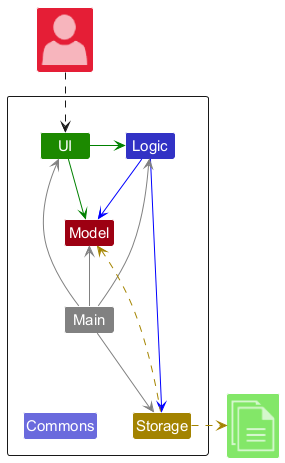

#### Overview

StudentBook relies primarily on 4 components:

| Component | Responsibility |
|---|---|
| [**`UI`**](#ui-component) | App UI |
| [**`Logic`**](#logic-component) | Command parsing and execution |
| [**`Model`**](#model-component) | Hold app records and settings in memory |
| [**`Storage`**](#storage-component) | Read and write JSON files |

**`Main`** then manages these components as follows:
* **App Launch**: Initialise components in correct sequence and connect them with one another
* **Shut down**: Shut down components, invoke necessary cleanup methods

**`Commons`** shares utilities across the above components.

#### Interactions
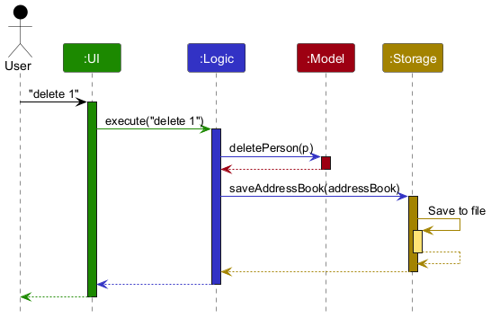

Each main component
* Defines its *API* through an interface
* Provides functionality through a concrete `{COMPONENT_NAME}Manager` class that implements the corresponding API interface

Other components interact with a component through its interface (rather than it's concrete class), preventing them from coupling to that component's implementation.

Example Component Structure (Logic)

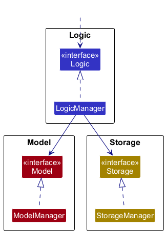

`LogicManager`
* implements the `Logic` interface
* interacts with `Model` and `Storage` components through their respective interfaces (not their concrete implementations)

### UI component

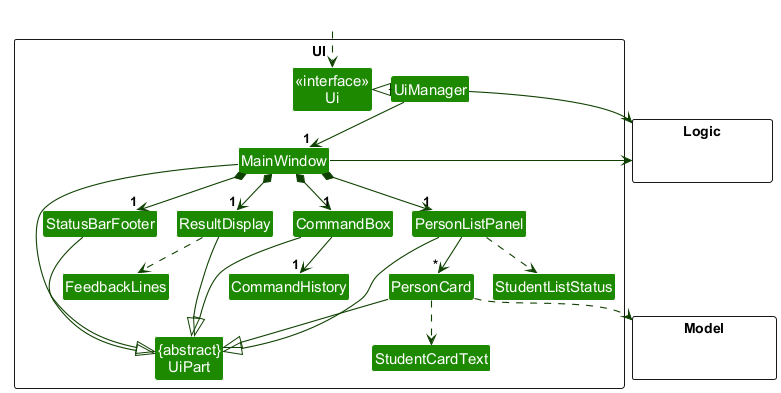

**API Specification**: `Ui.java`
**Interacts with**: `Model`, `Logic`
**Depends on**: `Model`, `Logic`

Abstract class `UiPart` captures common behaviour among classes representing visible GUI parts. Each part:
* Inherit from `UiPart`
* Use the JavaFX UI framework
* Defines layout in a matching `.fxml` file in `src/main/resources/view`
* Use `LightTheme.css` for style, with fonts loaded by `AppFonts` at startup

List of UI Components

| Class | UI Component |
|---|---|
|`MainWindow`|Main application window|
|`CommandBox`|Command input box|
|`StatusBarFooter`|Status bar footer|
|`ResultDisplay`|Result display|
|`HelpWindow`|Help window|
|`PersonListPanel`|Student list display|
|`PersonCard`|Individual student display|
|`WeekPanel`|Weekly schedule header|
|`ScheduleGrid`|Weekly schedule display|
|`LessonCard`|Individual lesson display|

 

#### Interactions
**`Logic`**
User commands received by the UI component are sent to `Logic` for execution.

Additionally, `Logic` supplies the following data:
* The list of students to display, from `Logic#getFilteredPersonList()`
* The total number of students and lessons, from `Logic#getAddressBook()`
* Empty-state message, also from `Logic#getAddressBook()`
* Lesson filter, to determine total number of students and lessons, from `Logic#getLessonPredicate()`

**`Ui`** and **`Model`**
* `Ui` listens for changes to `Model` data for updates
* `Ui` depends on some classes in `Model` to display `Student` objects correctly

### Logic component

**API Specification**: `Logic.java`
**Interacts with**: `Ui`, `Model`, `Storage`
**Depends on**: `Model`

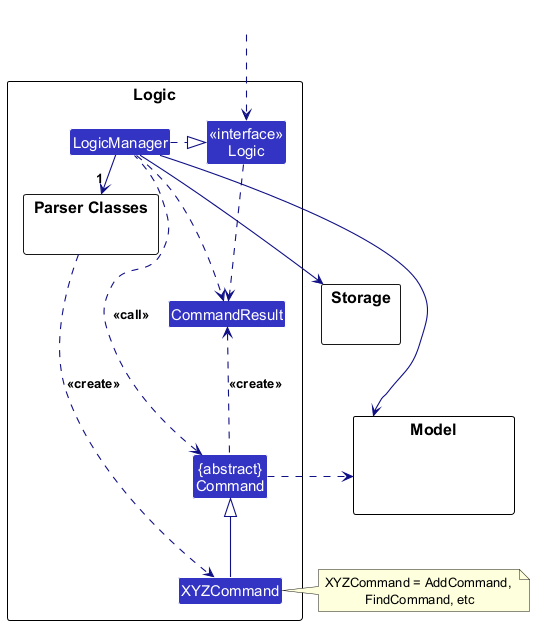

Above is a (partial) class diagram of the `Logic` component.

#### Command Execution
The sequence diagram below illustrates the interactions within the `Logic` component (API call `execute("delete 1")` is used as an example).

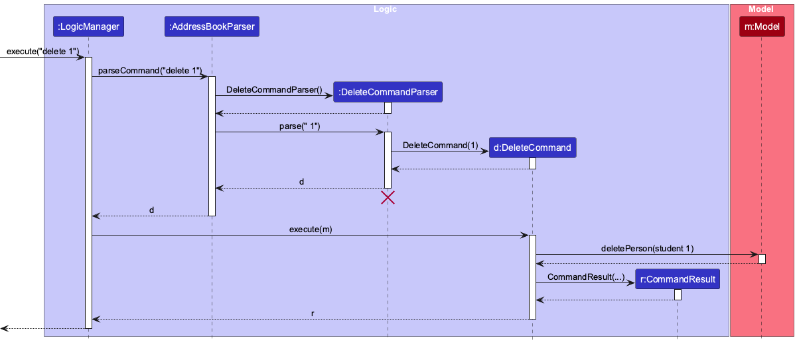

:information_source: **Note:** The lifeline for `DeleteCommandParser` should end at the destroy marker (X), but due to a limitation of PlantUML, it continues to the end of the diagram.

Command execution works as follows:
1. `Logic` is called to execute a command.
1. Command is passed to an `AddressBookParser`.
1. `AddressBookParser` creates a parser matching the command (e.g. `DeleteCommandParser`).
1. The created parser is used to parse the command into a `Command` object (e.g. `DeleteCommand`).
1. The `Command` object is executed by `LogicManager`
1. The `Command` object communicates with `Model` when executed (e.g. deleting a person). This may require several interactions between `Command` and `Model`, but is represented as one interaction above for simplicity.
1. The result of the command is encapsulated as a `CommandResult` object when returned from `Logic`.

#### Command Parsing

The other classes in `Logic` (omitted from the class diagram above) that are used for parsing a user command:

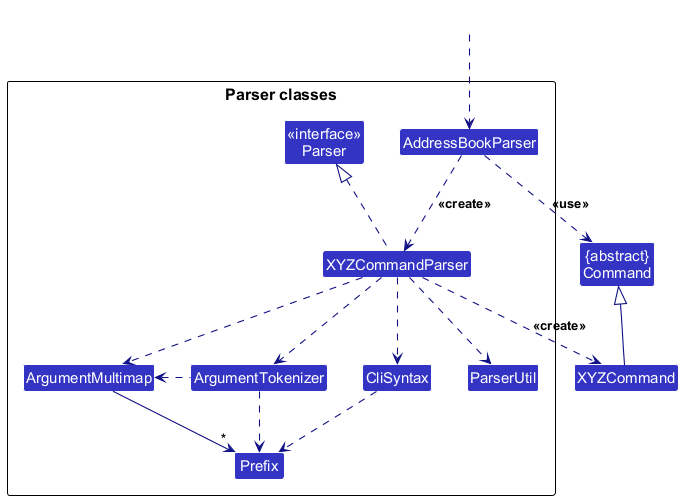

Command parsing works as follows:
1. `Logic` is called to parse a command.
1. `AddressBookParser` creates an `XYZCommandParser`(`XYZ` is a placeholder for a specific command name, e.g. `AddCommandParser`).
1. The parser uses the other classes shown above to parse the user command and create an `XYZCommand` object (e.g. `AddCommand`).
1. `AddressBookParser` returns that object as a `Command` object.

### Model component

**API Specification**: `Model.java`
**Interacts with**: `Ui`, `Logic`
**Depends on**: `None`

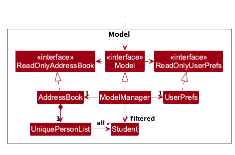

The `Model` component stores:
* all students in one of two `UniquePersonList`s, depending on if they are active or archived
* current filtered list of `Student`s, as a separate unmodifiable `ObservableList<Person>`
* the filter for `Lesson`s
* user preferences in `UserPrefs`

:information_source: An alternative, more object-oriented design keeps a list of unique tags in `AddressBook`, then each `Student` references tags in that list, allowing `AddressBook` to maintain one `Tag` object per unique tag instead of each `Student` holding its own `Tag` object.

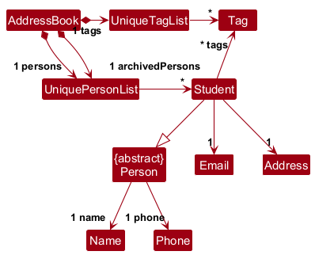

This alternative is not the current implementation.

 

`Student`'s fields and its relationship to `Person` and `Guardian` are shown in the following diagram.

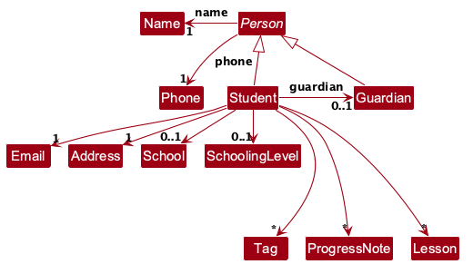

### Storage component

**API Specification**: `Storage.java`
**Interacts with**: `Model`
**Depends on**: `Model`

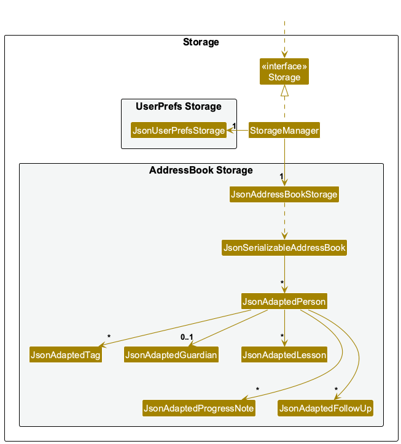

The `Storage` component:
* Saves address book data and user preference data in JSON format, and reads them back into corresponding objects
* Delegates JSON file access to `JsonAddressBookStorage` and `JsonUserPrefsStorage` (one class per data file)

### Common classes
Classes used by multiple components are in the `seedu.address.commons package`.

## Implementation

This section describes noteworthy details on how certain features are implemented.

### Lesson clash detection

After a valid lesson addition or edit, `LessonCommand` calls `LessonClashes.warning` with the complete active or archived
student list matching the edited student and the changed lesson's position. Search filters do not limit clash checks.
The helper excludes that lesson itself and checks every other lesson in that list.
Intervals clash when their weekdays match and each starts strictly before the other ends. Thus touching endpoints
are allowed. The warning is appended to normal success feedback; existing validation and persistence still apply.
Deleting a lesson requires no clash warning. No clash state is stored, so each warning reflects current records.
Clashing changes return `CommandResult.warning`. `MainWindow` routes these successful results to
`ResultDisplay#setWarningToUser`, which applies an amber warning style and an exclamation icon.
The next success, error or warning result replaces the previous feedback and clears its styling.

### Student search

The following class diagram shows the search predicates used by `FindCommand`. Prefixed searches use
`StudentSearchPredicate`; bare name keywords use `NameContainsKeywordsPredicate`. The command holds
both a student predicate and a lesson predicate.

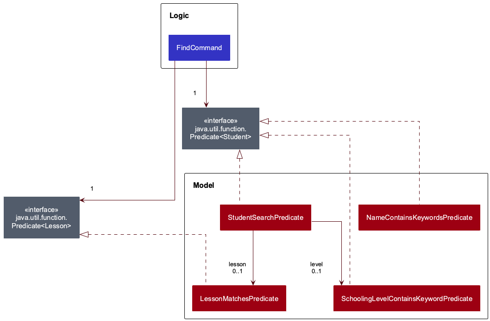

The following two sequences illustrate a successful `find sch/nanyang subject/math day/mon` search.
Blue participants belong to Logic; red participants belong to Model. Each diagram focuses on one stage
of the search, leaving the surrounding command-routing and persistence workflow to the
[Logic component](#logic-component) description.

**Constructing the search command.** `AddressBookParser` creates a `FindCommandParser` and calls
`parse(args)`. After validation, the parser creates the lesson predicate `l`, then the student predicate
`s`, then the command `f`. Here, `subject` contains `math`, `day` contains `MONDAY`, and the omitted
student criteria are empty except for school, which contains `nanyang`. The same `l` is supplied to
both `s` and `f`. Prefix validation and the parser's own creation and lifetime are outside this diagram's scope.

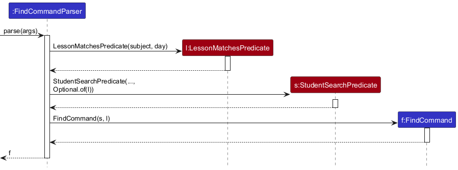

**Executing the search command.** `LogicManager` calls `f.execute(m)`. The command passes `s` and `l`
to the model, reads the matching students to form the result summary, and returns a `CommandResult`
that selects the students screen. The model is shown through its interface; internal filtering, logging
and UI observation are omitted. The repeated list lookup used by logging is also omitted.
`LogicManager` performs the existing storage save after execution, outside this diagram's scope.

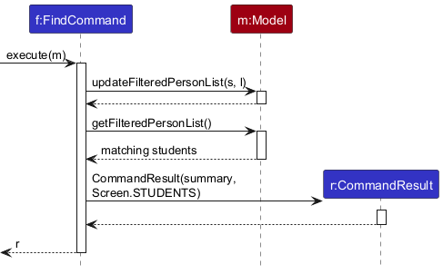

`FindCommandParser` accepts `name/`, `guardian/`, `sch/`, `level/`, `subject/` and `day/`, rejecting empty
values, duplicate prefixes and bare name keywords mixed with prefixes. It builds one `StudentSearchPredicate`
for every prefixed search. The predicate requires every supplied criterion to match: student name, guardian
name or phone, school and schooling level use case-insensitive substrings. Missing optional fields fail only
when their criteria are supplied. Searches without lesson criteria do not require students to have lessons.
Bare name keywords retain whole-word, case-insensitive OR matching through `NameContainsKeywordsPredicate`.

`LessonMatchesPredicate` stays separate: subject and day must match the same lesson. The student predicate
requires at least one such lesson, and `FindCommand` passes that same lesson filter to the model for `week`.
A later search without lesson criteria
resets the lesson filter; `list` clears the entire search. `EditCommand`, including school changes and
clearing a school, clears both student and lesson filters and displays all students after a successful edit.

Search logging uses the existing `LogsCenter` framework. The parser logs selected prefix names and rejection
reasons at `FINE`; the command logs the result count at `INFO`. These search-specific diagnostics omit search
values. Existing command-level logging in `LogicManager` still records raw commands. Logs go to the console
and rotating `studentbook.log.*` files; set `LOG_LEVEL` in `LogsCenter` to `Level.FINE` for parser diagnostics.

Tests: `StudentSearchPredicateTest`, `LessonFilterPredicateTest`, `FindCommandParserTest` and `FindLoggingTest`
cover contact and school substrings, absent fields, searches without lessons, all criteria combined, same-lesson
and calendar filtering, bare-name compatibility, filter resets, school edits through `EditCommand`, invalid
input, prefix ordering, equality, defensive checks and logging.

### Guardian follow-ups <!-- Move to model...? -->

A `FollowUp` holds 1–200 characters of single-line text, trimmed, and counted in code points like note text. `Student`
keeps its outstanding follow-ups in an unmodifiable list in the order they were added; a follow-up's position in that
list is the `FOLLOW_UP_INDEX` shown in the details. Completing an item removes it, so the model has no "done" state:
every stored item is outstanding. Follow-ups belong to the student rather than the `Guardian`, so they survive
`guardian-delete` and can be recorded for a student with no guardian (for example, while waiting for contact details).
The 11-argument `Student` constructor (ending `isArchived, notes`) still creates a student with no follow-ups; the
12-argument form appends `followUps` after `notes`.

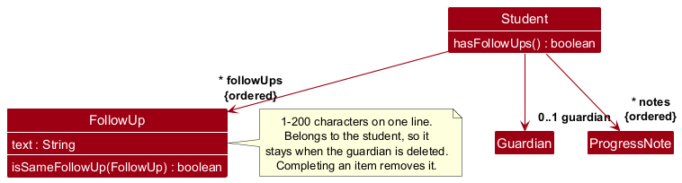

`followup-add`, `followup-edit` and `followup-done` are routed by `AddressBookParser` to `FollowUpCommandParser`,
parameterized by `FollowUpCommand.Operation` like the lesson, guardian and note parsers. The parser reads only
`text/`, so a word such as `and/or` stays in the text, and requires exactly one index for adding and two for editing
and completing. `ParserUtil#parseFollowUp` checks the text.

`FollowUpCommand` resolves the student from the current filtered list, rejects a follow-up index past the end, and
rejects text that matches another of the student's items ignoring case (an item may be edited to change only its
case). It then replaces the student with a copy whose follow-ups have changed. The success message includes the
item's text, so a wrong index on `followup-done` is visible straight away.

`followups` (`FollowUpListCommand`) sets the student filter to active (not archived) students with at least one
item, matching `list`, which hides archived students. It also resets the lesson filter.
Because the filtered list re-applies its predicate after `Model#setPerson`, completing a student's last item while
this filter is active removes the student from the list and renumbers the students after them. `FollowUpCommand`
therefore opens the student's details at the student's new position, and opens none if the student is no longer shown,
so the details never show the wrong student.

The sequence diagram below shows how `followup-done 1 2` completes a student's second follow-up. Storage then saves
the updated address book, as for any other command.

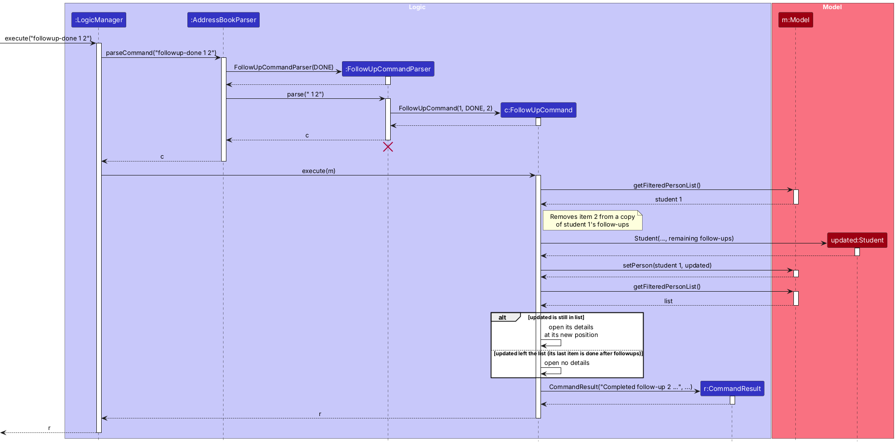

Every command that rebuilds a `Student` (`edit`, the guardian, lesson and note commands, and `Student#withArchived`
for `archive` and `unarchive`) passes the existing follow-ups on. `FollowUpCommandTest` checks each of them, so a later
field change cannot silently drop follow-ups. `PersonCard` shows the items in a **Follow-ups** section under the guardian.

`JsonAdaptedFollowUp` stores each item as `{"text": "..."}` in the person's `followUps` array. A missing or `null`
`followUps` key loads as no follow-ups, so older data files still load; a `null` item, a non-string `text` or text
that fails validation makes the file invalid.

Tests: `FollowUpTest`, `FollowUpCommandTest`, `FollowUpListCommandTest`, `FollowUpCommandParserTest`,
`FollowUpStorageTest` and the routing cases in `AddressBookParserTest`.

### Progress notes <!-- Move to model -->

A `ProgressNote` holds a `LocalDate` and 1–500 characters of single-line text. `Student` keeps its notes in an
unmodifiable list sorted oldest first; the sort is stable, so notes on the same date keep the order they were added.
A note's position in that list is the `NOTE_INDEX` shown in the details. New students start with no notes.

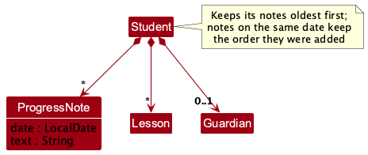

`note-add` and `note-delete` are routed by `AddressBookParser` to `NoteCommandParser`, parameterized by the
operation like the lesson and guardian parsers. Deleting takes only the student index and the note's number. The parser reads only `date/` and `text/`, so a word such as `and/or` stays in the note text.
`ParserUtil#parseProgressNote` rejects dates that are not real `YYYY-MM-DD` dates or are later than today. The
future-date check is in the parser rather than the model, so a saved file still loads if the computer's clock is
wrong.

`NoteCommand` resolves the student from the current filtered list. Adding rejects an identical note on the same
date; deleting rejects a note number past the end. Either way, it replaces the student with a copy whose notes
have changed. It returns a `CommandResult` that opens that student's
details, where `PersonCard` lists the notes. Every command that rebuilds a `Student` (`edit`, archiving, and the
guardian, lesson and follow-up commands) passes the existing notes on. `NoteCommandTest` checks `edit` and the guardian
and lesson commands, so a later field change cannot silently drop notes there.

The sequence diagram below shows how `note-add 1 date/2026-10-15 text/Fractions` adds a note. Storage then saves the
updated address book, as for any other command.

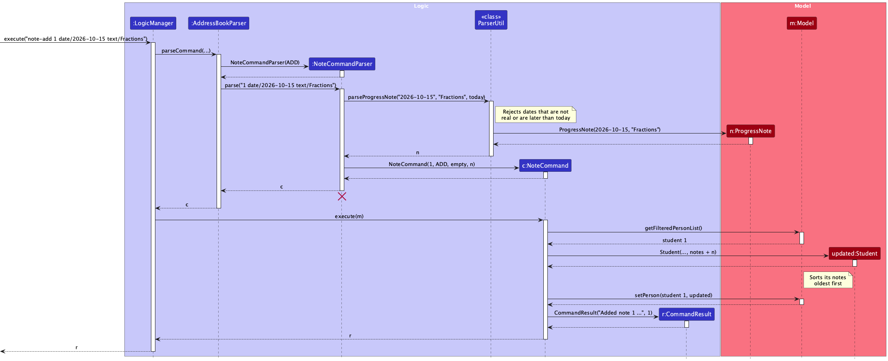

`JsonAdaptedProgressNote` stores each note as `{"date": "YYYY-MM-DD", "text": "..."}` in the person's `notes`
array. A missing or `null` `notes` key loads as no notes, so older data files still load.

## Documentation, logging, testing, dev-ops

* [Documentation](Documentation.md)
* [Testing](Testing.md)
* [Logging](Logging.md)
* [Builds, CI and releases](DevOps.md)

## Appendix: Requirements

### Product scope

**Target user profile**:

Independent private tutors who:
* manage multiple primary- or secondary-school students without administrative support
* keep track of student details, lesson arrangements, and guardian contacts themselves
* regularly retrieve and update this information before and after lessons
* can type quickly and prefer typing over mouse-driven input

**Value proposition**: StudentBook keeps student contacts, tuition details, weekly lesson slots and hourly rates in one place, so private tutors can find and update them quickly.

The planned MVP includes student records and all five tuition features below. Keep the existing AB3 contact fields and commands. Payment processing and sending messages are out of scope. Group classes and other brainstormed ideas remain backlog candidates, not delivery commitments.

| Owner | MVP feature | Story IDs |
|---|---|---|
| Min Wenn | Schooling level | 5; level updates in 12 |
| Pranav | Subject | 6; subject updates in 12 |
| Jian Yi | Weekly lesson slot | 25, 28, 29, 48 |
| Dylan | Hourly rate | 53, 54 |
| Mervin | Guardian contact | 7, 8, 22, 23 |

The shared types and storage are implemented. The app supports add, display, edit and clear for schools and schooling levels, finding students by level, guardian add, edit and delete, and lesson add, edit and delete. Week 8 needs a small working increment per person; the full MVP is the v1.3 target.

### Agreed field rules

A student has any number of lessons. Each lesson groups a required subject, weekly slot and hourly rate with an optional location and mode. School and schooling level are optional; students can be added without either, and `edit INDEX sch/` or `edit INDEX level/` can clear the corresponding field. Each student has at most one school, with 1 to 60 characters after trimming leading and trailing whitespace.

### Decisions to confirm

The earlier Google specification and the current code differ on the rules below. Keeping AB3 fields was agreed, but it did not settle every validation or failure rule. These are open product decisions, not changes to implement automatically.

| Decision | Earlier specification | Current implementation |
|---|---|---|
| Contact fields | Name required on creation | Name, phone, email and address required; confirm whether all four contact fields are needed |
| Duplicate names | Normalized, case-insensitive comparison | Exact, case-sensitive name comparison |
| Names and phones | Punctuation in names; optional `+` and 7–15 digits in phones | AB3 alphanumeric names; phones with at least 3 digits and no `+` |
| Save/load failures | Roll back failed saves; block commands after a failed load | In-memory changes can remain after a failed save; commands remain available after a failed load |

The pre-chat Git and Google documents also differed on registration and guardian attachment. The current plan adds the guardian separately. Confirm the remaining rules with the team before treating the earlier draft as superseded.

### User stories

Priorities from the planning Sheet are retained: `***` = high, `**` = medium, `*` = low. Priority does not determine whether a story is in the MVP or already implemented.

The planned MVP covers stories 1–9, subject/level updates in 12, guardian name/phone updates in 22 and removal in 23, slots in 25/28/29/48, and rates in 53/54. School recording in story 11 and school updates in story 12 are also implemented, in addition to the five tuition features in the MVP ownership table.

The table also preserves existing AB3 capabilities and other ideas for future reference. Unselected ideas are backlog candidates, not commitments, including school filtering in story 15 and guardian email in story 22.

| ID | Priority | As a... | I want to... | So that I can... |
|---|---|---|---|---|
| 1 | `***` | private tutor | add a student record with a name | begin tracking each student |
| 2 | `***` | private tutor | view the list of current students | see who I currently teach |
| 3 | `***` | private tutor | view a student's subjects and schooling level | prepare for the right subject and level |
| 4 | `***` | private tutor | delete a student record | remove students who leave or recreate incorrect records |
| 5 | `***` | private tutor | record a student's schooling level | choose material at the right level |
| 6 | `***` | private tutor | record the subjects I teach a student | remember what I teach each student |
| 7 | `***` | private tutor | record one guardian's name and contact details for a student | reach the right adult about lessons |
| 8 | `***` | private tutor | view the guardian name and contact details linked to a student | contact a guardian without searching elsewhere |
| 9 | `***` | private tutor | keep my student details and guardian contacts when I close and reopen the app | continue my work without re-entering information |
| 10 | `**` | private tutor | edit a student's name | correct typos without recreating the record |
| 11 | `**` | private tutor | record a student's school | remember which school the student attends |
| 12 | `**` | private tutor | update a student's school, schooling level or subjects | keep records current as circumstances change |
| 13 | `**` | private tutor | search for a student by a partial name | retrieve a record quickly |
| 14 | `**` | private tutor | sort students alphabetically | scan a long student list faster |
| 15 | `**` | private tutor | filter students by school | find students from the same school |
| 16 | `**` | private tutor | filter students by schooling level | prepare level-appropriate materials |
| 17 | `**` | private tutor | filter students by subject | prepare for a subject-specific class |
| 18 | `**` | private tutor | mark a student as inactive | keep former students without cluttering the current list |
| 19 | `**` | private tutor | view inactive students separately | refer to past records when needed |
| 20 | `**` | private tutor | add another guardian to a student | keep alternative contacts for the same student |
| 21 | `**` | private tutor | record each guardian's relationship to the student | know who I am contacting |
| 22 | `**` | private tutor | edit a guardian's contact details | keep changed phone numbers and emails current |
| 23 | `**` | private tutor | remove a guardian from a student | discard contacts that are no longer relevant |
| 24 | `**` | private tutor | search by guardian name or contact | find the right student when a guardian contacts me |
| 25 | `**` | private tutor | add a recurring weekly lesson slot to a student | remember when the student is taught |
| 26 | `**` | private tutor | add more than one weekly lesson slot to a student | track students with several lessons each week |
| 27 | `**` | private tutor | view lessons scheduled on a chosen day | prepare for that day's students |
| 28 | `**` | private tutor | edit a lesson slot | keep the agreed schedule current |
| 29 | `**` | private tutor | remove a lesson slot | clear a cancelled arrangement |
| 30 | `**` | private tutor | record a lesson's location or delivery mode | know where and how the lesson will happen |
| 31 | `**` | private tutor | assign students to a shared group class | manage one lesson arrangement for its attendees |
| 32 | `**` | private tutor | view every student in a group class | prepare the correct class list |
| 33 | `**` | private tutor | add a dated progress note to a student | remember what happened in recent lessons |
| 34 | `**` | private tutor | view a student's dated progress notes in chronological order | recall learning needs before the next lesson |
| 35 | `**` | private tutor | record a follow-up item for a guardian | remember what I need to communicate |
| 36 | `**` | private tutor | list outstanding guardian follow-up items | avoid missing promised updates |
| 37 | `**` | private tutor | record a student's payment status | know which payments need follow-up without processing them |
| 38 | `**` | private tutor | record a guardian's preferred contact method | contact each guardian appropriately |
| 39 | `**` | private tutor exploring the app | find out which student-management tasks the app supports | decide whether it suits my work |
| 40 | `**` | private tutor learning the app | look up command usage and examples | complete a task when I do not remember what to type |
| 41 | `**` | private tutor | combine subject, schooling-level and lesson-day filters | find students matching the criteria for my preparation |
| 42 | `**` | private tutor | see the next scheduled lesson and its attending students | know which lesson to prepare for next |
| 43 | `**` | private tutor | edit a guardian follow-up item | keep the recorded request accurate when arrangements change |
| 44 | `**` | private tutor | mark a guardian follow-up item as complete | remove finished work from my outstanding follow-ups |
| 45 | `**` | private tutor learning the app | see what needs correcting when an entry is rejected | fix the entry without guessing why it failed |
| 46 | `**` | tutor who communicates directly with a student | record the student's own phone number or email address | keep their contact details with their record |
| 47 | `**` | tutor who needs to contact a student directly | view the student's contact details | reach them without searching elsewhere |
| 48 | `**` | tutor checking a student’s lesson arrangements | view that student's weekly lesson times | confirm when I teach them |
| 49 | `**` | tutor planning my week | view all my lessons arranged by day and time | see which students I will teach each day |
| 50 | `*` | private tutor | identify students who share a guardian contact | coordinate communication without contacting the same guardian separately for each student |
| 51 | `*` | private tutor | receive a warning when separate lesson arrangements overlap | avoid accepting conflicting arrangements |
| 52 | `*` | private tutor | export all records to a human-readable file | inspect and back up my data outside the app |
| 53 | `**` | private tutor | record and view the hourly rate agreed for a student | check the agreed rate before discussing fees |
| 54 | `**` | private tutor | change or remove a student's recorded hourly rate | keep the agreed rate current |

### Use cases

These use cases describe the intended behavior. The [User Guide](UserGuide.md) lists the commands available now.

The actor is a private tutor and the system is StudentBook. The app is already open unless stated otherwise. The registration and failure paths below follow the current implementation; [decisions to confirm](#decisions-to-confirm) lists differences from the earlier draft.

**MSS** means main success scenario. UC01, UC02, UC03, UC04 and UC06 cover MVP goals. UC05 is a backlog candidate.

#### UC01: Register a student

**Related user stories:** 1, 5, 6, 9.

**MSS**

1. Tutor requests to add a student, supplying name, phone, email and address, with optional tags and supported tuition details.
2. StudentBook confirms the addition and displays the new student.

Use case ends.

**Extensions**

* 1a. A required detail is missing or a supplied value is invalid.
  * 1a1. StudentBook reports the error without adding a record.
  * 1a2. Tutor corrects and resubmits the request.
  * Use case resumes at step 1.
* 1b. A student with the exact same name already exists.
  * 1b1. StudentBook reports the duplicate without adding a record.
  * Use case ends.
* 2a. StudentBook cannot save the change.
  * 2a1. StudentBook reports the save failure. The student may still appear on screen without being saved.
  * Use case ends.

#### UC02: Retrieve a guardian's contact details

**Related user stories:** 2, 8.

**MSS**

1. Tutor requests to list students.
2. StudentBook displays student records with their linked guardian names and contact details.
3. Tutor reads the intended student's guardian contact details.

Use case ends. Contacting the guardian takes place outside StudentBook.

**Extensions**

* 2a. No student records exist.
  * 2a1. StudentBook displays an empty list.
  * Use case ends.

* 2b. The intended student has no guardian contact.
  * 2b1. StudentBook indicates that no guardian is recorded.
  * Use case ends.

#### UC03: Remove a student who has stopped attending lessons

**Related user stories:** 2, 4.

**MSS**

1. Tutor requests to list students.
2. StudentBook displays the student list with an index for each record.
3. Tutor requests to delete the intended student using the displayed index.
4. StudentBook removes that student's record and linked guardian contact, and displays a success message and the updated list.

Use case ends.

**Extensions**

* 2a. The student list is empty.
  * Use case ends.
* 3a. The supplied index is invalid for the displayed list.
  * 3a1. StudentBook displays an error without deleting any record.
  * Use case resumes at step 2.

#### UC04: Change a lesson's slot

**Related user stories:** 2, 28, 48.

**Preconditions:** The student has an existing lesson.

**MSS**

1. Tutor requests to list students.
2. StudentBook displays students and their lessons.
3. Tutor requests to edit a lesson, supplying the student's displayed index, the lesson's number on the card and the new slot.
4. StudentBook displays the updated lesson.

Use case ends.

**Extensions**

* 2a. The student list is empty.
  * Use case ends.
* 3a. The student index or lesson number is invalid, the new slot is invalid, or the change would duplicate another lesson of that student.
  * 3a1. StudentBook explains the error without changing any lesson.
  * 3a2. Tutor corrects and resubmits the request.
  * Use case resumes at step 3.

#### UC05: Complete a guardian follow-up

**Related user stories:** 36, 44.

**Preconditions:** At least one outstanding guardian follow-up item exists.

**MSS**

1. Tutor requests to list outstanding guardian follow-up items.
2. StudentBook displays the students with outstanding items.
3. Tutor opens a student's details to see the student's numbered items and guardian.
4. Tutor carries out the selected follow-up outside StudentBook.
5. Tutor requests to mark the selected item as complete.
6. StudentBook removes the item from the student's outstanding items and shows its text.

Use case ends.

**Extensions**

* 2a. No student has an outstanding item.
  * 2a1. StudentBook shows an empty list and suggests `list`.
  * Use case ends.
* 5a. The supplied student or item number is invalid, for example because the item is already complete.
  * 5a1. StudentBook explains the error without changing any item.
  * Use case resumes at step 1.
* 6a. The completed item was the student's last one.
  * 6a1. StudentBook removes the student from the outstanding list.
  * Use case ends.

#### UC06: Attach a guardian contact

**Related user stories:** 7, 9.

**Preconditions:** The student exists and is visible in the displayed list.

**MSS**

1. Tutor requests to attach a guardian, supplying the student's displayed index and the guardian's name and phone.
2. StudentBook displays the linked guardian and confirms the addition.

Use case ends.

**Extensions**

* 1a. The index or guardian details are invalid, or a guardian is already attached.
  * 1a1. StudentBook reports the error without changing the record.
  * 1a2. Tutor corrects and resubmits the request.
  * Use case resumes at step 1.
* 2a. StudentBook cannot save the change.
  * 2a1. StudentBook reports the save failure. The contact may still appear on screen without being saved.
  * Use case ends.

### Non-functional requirements

These are acceptance targets. They have not all been verified in the current app.

1. **Compatibility.** Run on Windows, macOS and Linux with Java `25`, on systems supported by the bundled JavaFX runtime.
2. **Capacity and speed.** Support 1,000 students, each with one guardian. Adding, listing or deleting a record should show its result within two seconds. Test on a supported computer with at least 4 GB of RAM and local storage. Measure from command submission to the displayed result, excluding startup.
3. **Keyboard use.** After launch, let tutors add, list and delete students without a mouse.
4. **Error messages.** Explain what is wrong and how to fix it. Invalid input should leave existing records unchanged.
5. **Saved data.** After a successful save and normal shutdown, restore every contact and tuition field on restart, including implemented tuition fields. Users should not have to re-enter data.
6. **Offline use.** Manage and save records on the tutor's computer without internet access or an online account.
7. **Data protection.** Keep student and guardian contact details out of external services and diagnostic logs. The tutor's operating-system account and file permissions control access to local files.
8. **File errors.** Report file failures clearly. The intended recovery behavior still needs confirmation; see [decisions to confirm](#decisions-to-confirm). Valid AB3 files must load with new fields absent.

### Glossary

* **StudentBook**: The desktop app for managing student records.
* **Independent private tutor**: A tutor who manages students and lessons without administrative staff.
* **Student record**: One student's contact details, school, schooling level, guardian contact, lessons and dated progress notes.
* **Guardian contact**: The name and phone number of the adult responsible for a student. The first version allows one optional guardian per student. A recorded guardian needs both fields.
* **Schooling level**: The student's stage of primary or secondary education, such as Primary 5 or Secondary 3.
* **Subject**: An academic subject taught by the tutor to a student, such as Mathematics or English.
* **Lesson**: One recurring arrangement for a student: a subject, a weekly slot and an hourly rate, with an optional location and mode. A student can have many lessons.
* **Recurring lesson slot**: A lesson's weekly day, start time and end time on a single day.
* **Lesson mode**: Whether a lesson is physical or virtual.
* **Hourly rate**: The agreed SGD amount per hour for a lesson, stored as `BigDecimal`. It does not calculate fees or process payments.
* **Progress note**: A dated note recording a student's learning progress or observations from a lesson.
* **Guardian follow-up item**: A recorded action the tutor needs to carry out for a guardian, such as providing an update. An outstanding item has not yet been marked complete.
* **Displayed index**: The number beside a student in the current list. It can change when the list changes, so it is not a permanent student ID.
* **Local storage**: Files on the tutor's computer that keep records between launches.
* **Private contact detail**: A student or guardian's phone number, email address, or other contact information intended for the tutor's use rather than public sharing.

## Appendix: Instructions for manual testing

Use an empty test folder and sample data. These checks are a starting point; also try variations and boundary values.

For larger or boundary-value data sets, generate a data file with `./gradlew seed`, e.g. `./gradlew seed --args="--students 500 --edge-cases --out test/studentbook.json"`, and copy it into the test folder as `data/studentbook.json`. See [Generating test data](Testing.md#generating-test-data).

### Launch and shutdown

1. Build the JAR using the [Quick start](UserGuide.md#quick-start), copy it into the test folder and run `java -jar studentbook.jar` there.
2. Check that the window opens with eight sample students, starting with Chloe Lim and Ethan Lim, who share a guardian. Run `week`; no lessons should overlap. Run `list-archive`; it should show one past student, Tan Wei Jie.
3. Resize and move the window, then close and reopen the app. Check that it keeps the new size and position.

### Main window

1. Launch with sample data. The command box should have keyboard focus, so you can type `list` straight away.
2. Run `find` with a name that matches one student. The header should read `Showing 1 of N`. Run `find zzz`; the list should say `No students match` and suggest `list`.
3. Run `clear` in a test folder. The list should say `No students yet` and show an example `add` command; running it as shown should add a student.
4. Run `delete 0`. The result row should turn pink with a red `!`, and `delete 0` should stay in the box in red. Fix it to a valid index and press Enter; the box should clear.
5. Run `add name/Ryan`. The result row should show the description, a **Format** line and an **Example** line in a monospace font.
6. Run two commands, then press Up twice and Down twice. The box should show the earlier commands, then what you had typed. Press Esc; the box should clear.
7. With more students than fit, press Esc in the empty command box to clear the selected student, then press Page Down and Page Up. The list should scroll, and typing should still go into the box. Run `view INDEX` for a student with long details, then press Page Down and Page Up again; the sidebar should scroll while the list and selection stay in place.
8. Press F1, then Esc. The help window should close.
9. Run `list`, then `view 1` and `view 2`. The sidebar should switch to the indicated student while the list cards stay compact. With the command box empty, press Esc to clear the selection and show the sidebar's prompt. Press Alt+Down twice; the second student's details should appear in the sidebar, with focus still in the command box. Run `find` with one student's name; the sidebar should show their details.
10. Add a student with a long name, several lessons and a long address, then run `view INDEX` for that student. Shrink the window to its minimum size. The list and sidebar should remain side by side, and the text should wrap. Use Page Down or scroll within the sidebar to reach all the student's information without scrolling the list; long command results should also remain scrollable.

### Student deletion

1. Run `list` with several records present, then `delete 1`. The first record should disappear and the result should describe it.
2. Try `delete 0`, `delete`, `delete x` and an index larger than the list. Each should report an error and leave all records unchanged.
3. Run `find Priya`, then `delete 1`. Check that it deletes that search result, not the record at the same position in the full list.

### Lessons and saved data

1. Add a unique test student, then run `lesson-add INDEX subject/Combined   Science slot/Wed 1.00pm 5.00pm rate/45.5`, using three spaces between the words. Run `view INDEX`; the sidebar should show lesson `1.` with subject `Combined Science`, `Wed 1.00pm-5.00pm` and `SGD 45.50/h`.
2. Run `lesson-add INDEX subject/English slot/mon 4.00pm 5.00pm rate/40 mode/virtual location/https://zoom.us/j/123`. The student's details should list both lessons in order, the second with `Virtual` and its location.
3. Run `lesson-edit INDEX 2 rate/50`, then edit the student's phone with `edit`. Both lessons should stay, and only the rate should change.
4. Restart the app. Everything above should remain.
5. Run `lesson-edit INDEX 2 mode/ location/`. The student's details should show the English lesson without mode or location, including after restart.
6. Run `lesson-delete INDEX 1`. English becomes lesson 1. Delete it too and the sidebar's Lessons section should show `No lessons yet`.
7. Try a duplicate `lesson-add`, a lesson index larger than the list, a missing required field, `mode/hybrid`, a repeated prefix, an unknown prefix such as `x/`, and an empty `mode/` on `lesson-add`. Each should report an error and leave every record unchanged.

### Name and guardian searches

1. Create students named `Alex Tan` and `Alexander Tan`. Run `find alex`; only `Alex Tan` should match.
   Run `find name/aLeX`; both should match, including students without lessons.
2. Give Alex a guardian named `Janet Lee` with phone `91234567`, leaving Alexander without a guardian.
   Run `find guardian/ANET`, then `find guardian/1234`; each should show only Alex.
3. Run `find name/alex guardian/janet`; Alex should match. Replace `janet` with `missing`; nobody should match.
4. Give Alex a Tuesday Math lesson and a Monday English lesson. Run `find name/alex subject/math day/mon`;
   Alex should not match. Add a Monday Math lesson and repeat; Alex should now match. Run `week` and check that
   only the Monday Math lesson appears. Run `list` to clear the search.
5. Try `find name/`, `find guardian/`, `find name/alex name/bob`, `find guardian/janet guardian/john`,
   `find alex guardian/janet` and `find name/alex day/Funday`. Each should report an error.

### Guardian contacts

1. List students and choose an index without a guardian. Run `guardian-add INDEX name/Janet Tan phone/91234567`.
   Check that the guardian appears on that student's card and other fields stay unchanged. Restart and check again.
2. Run `guardian-edit INDEX phone/87654321`. The guardian's name should remain unchanged. Restart and verify persistence.
3. Run `guardian-edit INDEX name/John Tan`. The phone should remain unchanged.
4. Run `guardian-delete INDEX`. The guardian should disappear while the student and all other fields remain.
   Restart and verify that no guardian is recorded.
5. Try adding a second guardian, editing/deleting an absent guardian, an out-of-range index, empty fields,
   an invalid phone and repeated prefixes. Expect an error with existing records unchanged.
6. Filter to one student with `find`, then use `guardian-add 1 name/Janet Tan phone/91234567`.
   Check that only the displayed student changes, the filter remains active, and other students are untouched.

### Guardian follow-ups

1. List students and choose an index. Run `followup-add INDEX text/Send the term 4 report and/or worksheet`.
   The student's details should open with follow-up `1.` under the guardian, with the text unchanged.
2. Run `followup-add INDEX text/Confirm the make-up lesson`, then `followup-edit INDEX 2 text/Confirm Saturday`.
   Item 2 should change and item 1 should not.
3. Edit the student's phone, delete or add a guardian, add a lesson and add a note. Both items should remain.
   Restart and check again.
4. Give a second student one item, then run `followups`. Only students with items should be listed. Complete every
   item of student 1 with `followup-done 1 1`. Each message should show the completed text. After the last one, the
   student should leave the list and no other student's details should open. `list` should show everyone again.
5. Try a duplicate item in different letter case, empty text, 201 characters of text, a repeated `text/`, a missing
   index and an out-of-range index. Each should report an error and leave every record unchanged.

### Progress notes

1. List students and choose an index. Run `note-add INDEX date/2026-10-15 text/Fractions, and/or decimals next`.
   The student's details should open with note `1.`, dated `15 Oct 2026`, with the text unchanged.
2. Run `note-add INDEX date/2026-10-08 text/Placement test`. It should become note 1, and the earlier note 2.
3. Edit the student's phone, add a guardian and add a lesson. Both notes should remain. Restart and check again.
4. Run `note-delete INDEX 1`. Only the `Placement test` note should go, and the other note becomes note 1.
   Restart and check again. `note-delete INDEX 2` should then report an invalid note index.
5. Try a duplicate note, tomorrow's date, `date/2026-02-30`, `date/15-10-2026`, empty text, 501 characters of text,
   a repeated prefix and an out-of-range index. Each should report an error and leave every record unchanged.

### Missing or invalid data files

Close the app and back up the test data before each case.

* **Missing file:** Move `data/studentbook.json` out of the test folder, then restart. Sample records should appear.
* **Invalid file:** Replace the test file with invalid JSON, then restart. An empty list should appear and the log should record the load failure. Do not run commands before restoring the backup; a successful command saves over the file.
* **Old valid file:** Load AB3 data without tuition properties. Run `view INDEX`; the contact details should remain and the sidebar's Lessons section should show `No lessons yet`.
* **Pre-lesson file:** Load a file whose students have `subjects`, `weeklyLessonSlot` and `hourlyRate`. The contact details load, but those properties are ignored and removed on the next save.
