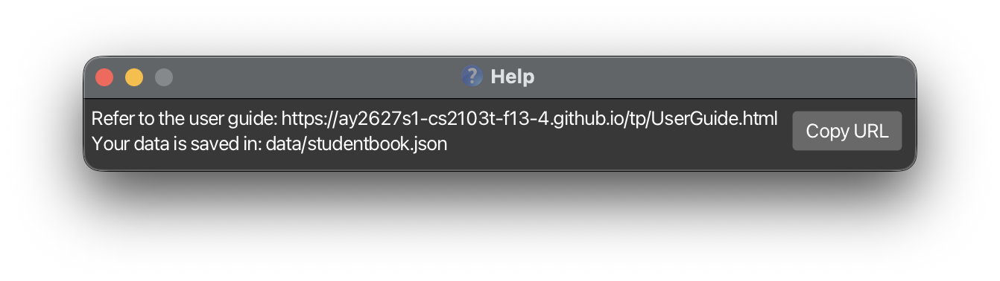

StudentBook is a desktop contact book for private tutors. Type commands to manage student records.

This development version supports contact details, schooling levels, guardian contacts and lessons. Each student can have any number of lessons, and each lesson has a subject, a weekly time slot and an hourly rate. See the [Developer Guide](DeveloperGuide.md#product-scope) for the plan and open decisions.

* Table of Contents
{:toc}

## Quick start

1. Install Java `25`. Mac users should follow the [course Java installation guide](https://se-education.org/guides/tutorials/javaInstallationMac.html).

1. Build the development version from [Pranav's fork](https://github.com/pranavp311/tp). The subject feature is awaiting merge into the [team repository](https://github.com/AY2627S1-CS2103T-F13-4/tp).

   ```text
   git clone --branch student-subject https://github.com/pranavp311/tp.git studentbook
   cd studentbook
   ./gradlew shadowJar
   ```

   On Windows, use `gradlew.bat shadowJar` for the last command. The JAR is `build/libs/studentbook.jar`.

1. Copy the JAR into the folder where you want to keep your records. Open a terminal in that folder and run:

   ```text
   java -jar studentbook.jar
   ```

1. Type `list` in the command box and press Enter. Then try:

   ```text
   add name/Alex Tan phone/91234567 email/alex@example.com address/123 Clementi Road
   lesson-add 1 subject/Math slot/Wed 1.00pm 5.00pm rate/45.50
   ```

   The first command adds Alex, who appears at the bottom of the list. Replace `1` in the second command with Alex's number in the list. It gives that student a Math lesson on Wednesdays from 1pm to 5pm at SGD 45.50 per hour. Type `exit` to close the app.

## Features

### Reading command formats

* Replace uppercase words with your values. For example, `name/NAME` becomes `name/Alex Tan`.
* Square brackets mark optional fields. Do not type the brackets.
* `...` means a field can be repeated. For example, `[tag/TAG]...` allows zero or more tags.
* Fields may appear in any order. Prefixes such as `name/` and `subject/` are case-sensitive.
* `INDEX` is the number beside a student in the current list. It must be 1 or greater.
* `help`, `list`, `clear` and `exit` ignore extra arguments.
* When copying commands from a PDF, check that spaces around line breaks are preserved.

### Add a student: `add`

Format: `add name/NAME phone/PHONE_NUMBER email/EMAIL address/ADDRESS [tag/TAG]... [level/SCHOOLING_LEVEL]`

Name, phone, email and address are required. Tags and schooling level are optional. A new student has no lessons; add them with [`lesson-add`](#manage-a-students-lessons).

The agreed next change is to require a schooling level. Min Wenn owns that change; it is not enforced in this build.

```text
add name/Alex Tan phone/91234567 email/alex@example.com address/123 Clementi Road tag/weekday level/Primary 5
add name/Mei Lim phone/92345678 email/mei@example.com address/45 Dover Road
```

Records with exactly the same name are duplicates. Name matching is case-sensitive: `Alex Tan` and `alex tan` are treated as different names. Schooling level and lessons do not change this rule.

### Record or clear a schooling level

| Task | Command |
|---|---|
| Set or replace a level | `edit 1 level/Secondary 1` |
| Clear a level | `edit 1 level/` |
| Include a level when adding a student | Add `level/Primary 5` to the `add` command |

The card shows `Level: Primary 5` when a level is recorded. If none is recorded, the level line is hidden. Leave out `level/` to keep the existing level when editing. Changing a level keeps every other field unchanged, including lessons.

Levels must have 1 to 30 characters after the space cleanup below. Start with a letter or digit and include at least one letter. Use English letters `A-Z` or `a-z`, digits `0-9`, spaces and these symbols: `'`, `-`, `.`, `(`, `)`. Leading and trailing spaces or tabs are removed, and repeated spaces or tabs become one space. An empty `level/` clears the level with `edit`, but is invalid with `add`. Repeating `level/` in one command is invalid. Invalid input leaves the record unchanged.

### List all students: `list`

Format: `list`

Shows every student and clears any active search filter.

### Edit a student: `edit`

Format: `edit INDEX [name/NAME] [phone/PHONE_NUMBER] [email/EMAIL] [address/ADDRESS] [tag/TAG]... [level/SCHOOLING_LEVEL]`

Include at least one field to change. Fields you leave out stay unchanged.

* Tags replace the entire existing set. Use an empty `tag/` to clear all tags.
* An empty `level/` clears the schooling level.
* Editing a student never changes their lessons or guardian. Use the `lesson-` and `guardian-` commands for those.

Examples:

* `edit 1 phone/91234567 email/alex.tan@example.com` changes the first displayed student's phone and email.
* `edit 2 name/Mei Ling tag/` changes the second displayed student's name and clears their tags.
* `edit 1 level/Primary 6` changes the first displayed student's schooling level.

### Find students by name or schooling level: `find`

Format: `find KEYWORD [MORE_KEYWORDS]` or `find level/TEXT`

Without `level/`, searches names for whole words, ignoring letter case. A student appears if any keyword matches; keyword order does not matter.

* `find John` matches `John Doe`, but not `Johnny`.
* `find alex david` matches names containing `Alex` or `David`.

Use `find level/TEXT` to search schooling levels, ignoring letter case. Partial matches are allowed: `find level/prim` matches `Primary 5`. Students without a level are excluded. Supply one non-empty `level/` value; it cannot be combined with name keywords.

Subject, phone and other fields are not searched.


### Manage a student's lessons

Each student can have zero or more lessons. A lesson has a subject, a weekly time slot and an hourly rate, which are always present, and an optional mode (physical or virtual) and location. A student cannot have two identical lessons, but lessons with overlapping time slots are allowed. Lesson commands use the student's positive `STUDENT_INDEX` in the currently displayed list, including search results. They preserve all other student fields.

* **Create:** `lesson-add STUDENT_INDEX subject/SUBJECT slot/LESSON_SLOT rate/HOURLY_RATE [mode/MODE] [location/LOCATION]`
  Subject, slot and rate are required; mode and location are optional. The new lesson is added to the end of the student's lessons.
* **Read:** Use `list` or `find` to display the student. Their card lists each lesson in order, for example `- Math, Wednesday 1.00pm-5.00pm, SGD 45.50/hour, Physical, at Clementi Library` (mode and location are shown only when recorded), or shows `Lessons: Not recorded` when there are none. The number of a lesson is its position in that list, starting from 1.
* **Update:** `lesson-edit STUDENT_INDEX LESSON_INDEX [subject/SUBJECT] [slot/LESSON_SLOT] [rate/HOURLY_RATE] [mode/MODE] [location/LOCATION]`
  Supply at least one field. Omitted fields stay unchanged. To remove a recorded mode or location, give its prefix with nothing after it: `mode/` clears the mode and `location/` clears the location (see the examples below).
* **Delete:** `lesson-delete STUDENT_INDEX LESSON_INDEX`
  Removes only that lesson. Later lessons move up by one position.

Field rules:

* **Subject** (`subject/`): 1 to 40 characters after space cleanup. Start with a letter or digit and include at least one letter. Use English letters, digits, spaces and these symbols: `'`, `-`, `.`, `(`, `)`. Leading and trailing spaces are removed and repeated spaces become one. Subjects are compared ignoring letter case, so `Math` and `math` are the same subject.
* **Lesson slot** (`slot/`): `DAY START END` on a single day, such as `Wed 1.00pm 5.00pm`. Use a three-letter day (`Mon` to `Sun`), and times like `1.00pm` or `10.30am` with minute precision. Days and `am`/`pm` are not case-sensitive, so `wed 1.00PM 5.00PM` also works. The end must be later than the start on the same day; overnight lessons are not supported. The card shows the full day name, for example `Wednesday 1.00pm-5.00pm`.
* **Hourly rate** (`rate/`): an amount in SGD per hour. It must be non-negative and have at most two decimal places; `45`, `45.5` and `45.50` are valid. Currency symbols, negative amounts and scientific notation are invalid.
* **Mode** (`mode/`, optional): `physical` or `virtual`, not case-sensitive. The card shows `Physical` or `Virtual`.
* **Location** (`location/`, optional): 1 to 100 characters, such as an address, room or meeting link. Repeated spaces become one, and locations are compared ignoring letter case. It must not contain a word of letters followed by `/` (such as `rate/`), which is read as a prefix; `Blk 123/4` and `https://zoom.us/j/1` are fine.
* **Clearing mode and location:** only `lesson-edit` can clear them, by leaving the value empty, for example `lesson-edit 1 2 location/` or `lesson-edit 1 2 mode/ location/`. `lesson-add` rejects an empty `mode/` or `location/`, and `lesson-delete` accepts neither.

Errors:

* Adding a lesson, or editing one so that it becomes identical to another of the same student's lessons, is rejected as a duplicate. Mode and location are part of a lesson's identity, so the same subject, slot and rate at a different location or mode is not a duplicate.
* A student index or lesson index that does not exist is rejected.
* Empty values (except an empty `mode/` or `location/` in `lesson-edit`, which clears the field), repeated prefixes, unknown prefixes and invalid values, such as a mode other than `physical` or `virtual`, are rejected. Any error leaves the record unchanged.

For example, after `list`:

1. `lesson-add 1 subject/Math slot/Wed 1.00pm 5.00pm rate/45.50`
2. `lesson-add 1 subject/English slot/Mon 4.00pm 5.00pm rate/40 mode/virtual location/https://zoom.us/j/123` adds an online lesson with a meeting link.
3. `lesson-edit 1 2 rate/50` changes the English lesson's rate.
4. `lesson-edit 1 2 mode/physical location/Clementi Library` changes it to an in-person lesson at a new place.
5. `lesson-edit 1 2 location/` removes the location but keeps the mode. `lesson-edit 1 2 mode/ location/` removes both.
6. `lesson-delete 1 1` removes the Math lesson. English is now lesson 1.

Lesson commands keep an active search filter. Lessons are saved automatically.

### Manage a student's guardian contact

Each student can have zero or one guardian, with a name and phone number. Guardian commands use the student's
positive `INDEX` in the currently displayed list, including search results. They preserve all other student fields.

* **Create:** `guardian-add INDEX name/NAME phone/PHONE`
  Both fields are required. If a guardian already exists, use `guardian-edit` instead.
* **Read:** Use `list` or `find` to display the student. Their card shows `Guardian: NAME: PHONE`,
  or `Guardian: Not recorded` when none exists.
* **Update:** `guardian-edit INDEX [name/NAME] [phone/PHONE]`
  Supply at least one field. Omitted fields stay unchanged. Empty values and repeated prefixes are rejected.
* **Delete:** `guardian-delete INDEX`
  Removes only the guardian. Editing or deleting a missing guardian reports an error.

Names must contain only alphanumeric characters and spaces and must not be blank. Phone numbers must contain
at least three digits and no other characters, following the existing contact validation rules. Leading and trailing
spaces are trimmed. Guardians may share the same details across different students.

For example, after `list`:

1. `guardian-add 1 name/Janet Tan phone/91234567`
2. `guardian-edit 1 phone/87654321`
3. `guardian-delete 1`

Guardian commands keep an active search filter. Errors leave existing records unchanged. Guardian details are
saved automatically. Older data files without a guardian still load with no guardian recorded.

### Delete a student: `delete`

Format: `delete INDEX`

Deletes the student at that position in the current list, including their attached details. There is no confirmation or undo.

* `list` then `delete 2` deletes the second student in the full list.
* `find Alex` then `delete 1` deletes the first search result.

### Delete all students: `clear`

Format: `clear`

Deletes every student record. There is no confirmation or undo.

### View help: `help`

Format: `help`

Opens a window with a help-page link. That link currently points to the original AddressBook guide; use this guide for lesson and schooling-level commands.



### Exit: `exit`

Format: `exit`

Closes the app.

## Saving and transferring records

The app saves automatically after each successfully executed command. Schooling levels, guardian contacts and lessons are saved with the contact details. Each student's lessons are stored as a `lessons` array, where every lesson has a `subject`, a `weeklyLessonSlot` and an `hourlyRate`, plus an optional `mode` (`PHYSICAL` or `VIRTUAL`) and `location`. Files without these two fields still load.

Older files that stored a student's `subject`, `subjects`, `weeklyLessonSlot` or `hourlyRate` directly on the student still load, but those values are ignored and are lost the next time the app saves. Re-enter them with `lesson-add` or copy them into a `lessons` array first.

If saving fails, the app reports an error. The change may still appear on screen without being saved to disk.

Records are stored in `data/studentbook.json` under the folder where you start the app.

To transfer records, close the app on both computers. Copy the data file to the corresponding location on the new computer, then start the app there.

### Edit the data file manually

Close the app and back up the JSON file before editing it. Keep the existing file structure and valid field values.

If the file is invalid, the app starts with an empty list. The invalid file remains until a successful command saves over it. Restore your backup before running more commands.

## Known issues

* **Window opens off-screen:** Close the app and delete `preferences.json`, then restart it. This resets the saved window position.
* **Help window stays minimized:** Restore the existing help window manually. Running `help` again does not restore it.

## Command summary

| Task | Format |
|---|---|
| Add | `add name/NAME phone/PHONE_NUMBER email/EMAIL address/ADDRESS [tag/TAG]... [level/SCHOOLING_LEVEL]` |
| Edit | `edit INDEX [name/NAME] [phone/PHONE_NUMBER] [email/EMAIL] [address/ADDRESS] [tag/TAG]... [level/SCHOOLING_LEVEL]` |
| Clear schooling level | `edit INDEX level/` |
| Find | `find KEYWORD [MORE_KEYWORDS]` or `find level/TEXT` |
| List | `list` |
| Add lesson | `lesson-add STUDENT_INDEX subject/SUBJECT slot/LESSON_SLOT rate/HOURLY_RATE [mode/MODE] [location/LOCATION]` |
| Edit lesson | `lesson-edit STUDENT_INDEX LESSON_INDEX [subject/SUBJECT] [slot/LESSON_SLOT] [rate/HOURLY_RATE] [mode/MODE] [location/LOCATION]` |
| Delete lesson | `lesson-delete STUDENT_INDEX LESSON_INDEX` |
| Add guardian | `guardian-add INDEX name/NAME phone/PHONE` |
| Edit guardian | `guardian-edit INDEX [name/NAME] [phone/PHONE]` |
| Delete guardian | `guardian-delete INDEX` |
| Delete | `delete INDEX` |
| Delete all | `clear` |
| Help | `help` |
| Exit | `exit` |
