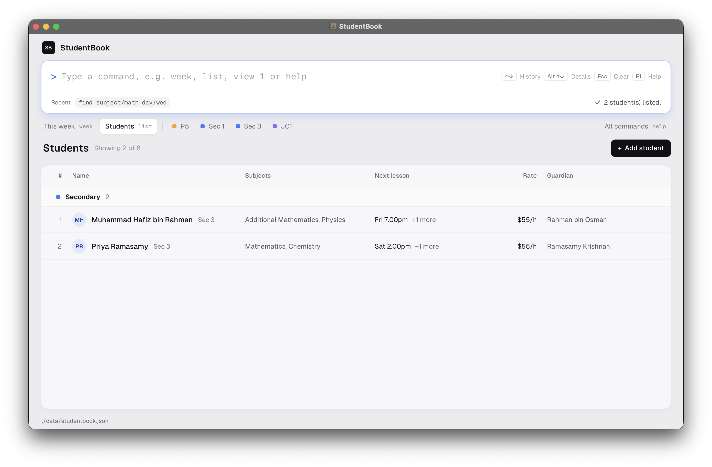

# StudentBook
StudentBook is a desktop contact book for private tutors. Type commands to manage student records.

This development version supports contact details, schools, schooling levels, guardian contacts and lessons. Each student can have any number of lessons, and each lesson has a subject, a weekly time slot and an hourly rate. See the [Developer Guide](DeveloperGuide.md#product-scope) for the plan and open decisions.

## Table of Contents
{:toc}

## Quick Start
1. Install Java `25`. Mac users should follow the [course Java installation guide](https://se-education.org/guides/tutorials/javaInstallationMac.html).
1. Build the development version from the [team repository](https://github.com/AY2627S1-CS2103T-F13-4/tp).
   ```shell
   git clone https://github.com/AY2627S1-CS2103T-F13-4/tp.git studentbook
   cd studentbook
   ./gradlew shadowJar
   ```
   
   On Windows, use `gradlew.bat shadowJar` for the last command. The JAR is `build/libs/studentbook.jar`.

1. Copy the JAR into the folder where you want to keep your records. Open a terminal in that folder and run:
   ```shell
   java -jar studentbook.jar
   ```

1. Type `list` in the command box and press Enter. Then try:

   ```text
   add name/Alex Tan phone/91234567 email/alex@example.com address/123 Clementi Road
   lesson-add 1 subject/Math slot/Wed 1.00pm 5.00pm rate/45.50
   ```

   The first command adds Alex, who appears at the bottom of the list. Replace `1` in the second command with Alex's number in the list. It gives that student a Math lesson on Wednesdays from 1pm to 5pm at SGD 45.50 per hour. Type `exit` to close the app.

## Main Window


Type commands in the box at the top and press **Enter**.

* **This week** shows your lessons on a calendar (`week`). **Students** shows your students (`list`).
* A lesson marked `#3.1` is student `3`'s lesson `1`. Edit it with `lesson-edit 3 1 ...`.
* To see a student's full details, click their row or type `view INDEX`.
* If a command is wrong, the correct format and an example appear below the box. Press **Tab** to copy the example into the box.

| Key | Action |
|---|---|
| Up / Down | Previous commands |
| Esc | Clear the box |
| Alt+Up / Alt+Down | Scroll the calendar, or move between students |
| F1 | Help |

## Features

### Reading Command Formats
<div markdown="block" class="alert alert-info">

**:information_source: Notes about the command format:**<br>

* `UPPER_CASE` words are user-defined parameters.<br>
  E.g. `name/NAME` &rarr; `name/John Doe`.

* `[square brackets]` mark optional fields.<br>
  E.g. `name/NAME [tag/TAG]` &rarr; `name/John Doe tag/friend` or `name/John Doe`.

* `…`​ means a field can be repeated.<br>
  E.g. `[t/TAG]…​` &rarr; ` ` or `t/friend` or `t/friend t/family`. 

* Parameters can be in any order.<br>
  E.g. `name/NAME p/PHONE_NUMBER` &rarr; `name/John Doe phone/87654321` or `phone/87654321 name/John Doe`

* `INDEX` is the number beside a student in the current list display.

* Commands with no parameters (`help`, `list`, `clear`, `exit`, etc.) ignore extra arguments.
  E.g. `help 123` &rarr; `help`
</div>

<div markdown="span" class="alert alert-warning">

**:warning: When copying commands from the PDF version of this document, spaces around line breaks may be omitted.**

</div>

### Add a student: `add`

Adds a student to StudentBook

Format: `add name/NAME phone/PHONE_NUMBER email/EMAIL address/ADDRESS [tag/TAG]... [sch/SCHOOL] [level/SCHOOLING_LEVEL]`

Examples:
* `add name/Alex Tan phone/91234567 email/alex@example.com address/123 Clementi Road tag/weekday sch/Clementi Primary School level/Primary 5`
* `add name/Mei Lim phone/92345678 email/mei@example.com address/45 Dover Road`

<div markdown="block" class="alert alert-primary">

:bulb: **Tips:**<br>
* A new student has no lessons or guardians. Add them with [`lesson-add`](#manage-a-students-lessons) and [`guardian-add`](#manage-a-students-guardian-contact) respectively.
* The added student cannot share a name with an existing one (case-sensitive).

</div>


### List all students: `list`

Shows a list of all students in StudentBook, grouped by schooling level.

Format: `list`

### Edit a student: `edit`

Edits an existing student in StudentBook

Format: `edit INDEX [name/NAME] [phone/PHONE_NUMBER] [email/EMAIL] [address/ADDRESS] [tag/TAG]... [sch/SCHOOL] [level/SCHOOLING_LEVEL]`

* Edits the student at the specified [`INDEX`](#reading-command-formats).
* At least one of the optional fields must be provided.
* Existing values will be updated to the input values.
* Empty parameters for optional fields (e.g. `tag/`) will clear the field

Examples:
* `edit 1 phone/91234567 email/alex.tan@example.com` changes the first displayed student's phone and email.
* `edit 2 name/Mei Ling tag/` changes the second displayed student's name and clears their tags.
* `edit 1 sch/Clementi Primary School` changes the first displayed student's school.
* `edit 1 level/Primary 6` changes the first displayed student's schooling level.

<div markdown="block" class="alert alert-primary">

:bulb: **Tips:**<br>
* To edit a student's lessons or guardians, use [`lesson-edit`](#manage-a-students-lessons) and [`guardian-edit`](#manage-a-students-guardian-contact) respectively.

</div>

### Show weekly lessons: `week`

Displays all lessons for students in the current list display.

Format: `week`

### View a student's details: `view`

Displays the student at `INDEX` and their details.

Format: `view INDEX`

### Find students by name: `find`

Find students whose names contain any of the given keywords

Format: `find KEYWORD [MORE_KEYWORDS]`
* The search is case-insensitive.
* Only full words match.

Examples:
* `find John` matches `John Doe`, but not `Johnny`.
* `find alex david` matches names containing `Alex` or `David`.

### Find students by filter criteria: `find`

Find students by name, guardian, school, level, lesson subject and/or lesson day.

Format: `find [name/TEXT] [guardian/TEXT] [sch/TEXT] [level/TEXT] [subject/TEXT] [day/DAY]`

* The search is case-insensitive.
* At least one of the optional fields must be provided.
* Partial matches are allowed.
* Students without a level are excluded from the level filter
* When multiple lesson-related criteria are specified, the same lesson must match all criteria
* Day may be specified with three-letter or full names

Examples:
* `find level/prim` matches `Primary 5`.
* `find day/Mon` matches students with a lesson on Monday.
* `find level/Secondary subject/math day/wednesday` matches secondary students with a Math lesson on Wednesday.

The result of `find subject/math day/wed`: students with a Math lesson on Wednesday.



### Delete a student: `delete`

Deletes a student from StudentBook.

Format: `delete INDEX`

### Delete all students: `clear`

Deletes all students from StudentBook.

Format: `clear`

### View help: `help`

Displays link to this guide and location of data file.

Format: `help`

* Alternate hotkey: **F1**
* Press **Enter** to copy the link
* Press **Esc** to close the window and return to the command box


### Exit: `exit`

Closes the app.

Format: `exit`

### Add a lesson: `lesson-add`

Add a lesson for a given student.

Format: `lesson-add INDEX subject/SUBJECT slot/LESSON_SLOT rate/HOURLY_RATE [mode/MODE] [location/LOCATION]`

Examples:
* `lesson-add 3 subject/English slot/Mon 10.00am 12.00pm rate/40`
* `lesson-add 1 subject/Math slot/Fri 4.00pm 6.00pm rate/40 mode/physical location/Home`
* `lesson-add 1 subject/Math slot/Fri 4.00pm 6.00pm rate/40 mode/virtual location/Zoom`


### Edit a lesson: `lesson-edit`

Edit a lesson for a given student.

Format: `lesson-edit STUDENT_INDEX LESSON_INDEX [subject/SUBJECT] [slot/LESSON_SLOT] [rate/HOURLY_RATE] [mode/MODE] [location/LOCATION]`

* Targets the student at the specified [`STUDENT_INDEX`](#reading-command-formats).
* Edits the lesson at the specified [`LESSON_INDEX`](#reading-command-formats)
* Existing values will be updated to the input values
* Empty parameters for optional fields (e.g. `mode/`) will clear the field

Examples:
* `lesson-edit 1 3 subject/Mathematics`
* `lesson-edit 2 1 mode/physical location/Home`
* `lesson-edit 3 1 mode/ location/`

### Delete a lesson: `lesson-delete`

Deletes a lesson for a given student

Format: `lesson-delete STUDENT_INDEX LESSON_INDEX`

Field rules:
* **Subject** (`subject/`)
  * 1-40 characters
  * Start with a letter/digit, include at least 1 letter
* **Lesson Slot** (`slot/`)
  * Format: `DAY START END`
  * `DAY`: Three-letter day, e.g. `Mon`, `Sun`
  * `START`/`END`: Minute-precise time, e.g. `10.30am`, `1.00pm`
  * `START` must be before `END`
* **Hourly Rate** (`rate/`)
  * Numeric value in SGD per hour
  * Non-negative, to nearest cent, e.g. `45.50`
* **Mode** (`mode/`)
  * `physical` or `virtual` only (case insensitive)
* **Location** (`location/`)
  * 1-100 characters

### Add a guardian: `guardian-add`

Add a guardian for a given student.

Format: `guardian-add INDEX name/NAME phone/PHONE`

Examples:
* `guardian-add 1 name/Jane Doe phone/81234567`

### Edit a guardian: `guardian-edit`

Edit a guardian for a given student.

Format: `guardian-edit INDEX [name/NAME] [phone/PHONE]`

* Edits the guardian of the student at the specified [`INDEX`](#reading-command-formats).
* At least one of the optional fields must be provided.
* Existing values will be updated to the input values.

Examples:
* `edit 1 name/Jane Doe`
* `edit 1 name/81234567`

### Delete a guardian: `guardian-delete`

Delete a guardian for a given student.

Format: `guardian-delete INDEX`

## Saving and transferring records

StudentBook saves automatically to `data/studentbook.json`, in the folder you start it from.

To move to another computer, copy that file into the same place on the new computer.

<div markdown="span" class="alert alert-warning">
:warning: Back up the file before editing it by hand. If the file is invalid, StudentBook starts empty.
</div>

## Known issues

* **Window opens off-screen:** Close the app and delete `preferences.json`, then restart it. This resets the saved window position.
* **Help window stays minimized:** Restore the existing help window manually. Running `help` again does not restore it.

### Lesson clash warnings

If a lesson overlaps another lesson, StudentBook still saves it but warns you which lessons clash. Use `lesson-edit` to move one of them.

## Command summary

| Task | Format |
|---|---|
| Add | `add name/NAME phone/PHONE_NUMBER email/EMAIL address/ADDRESS [tag/TAG]... [sch/SCHOOL] [level/SCHOOLING_LEVEL]` |
| Edit | `edit INDEX [name/NAME] [phone/PHONE_NUMBER] [email/EMAIL] [address/ADDRESS] [tag/TAG]... [sch/SCHOOL] [level/SCHOOLING_LEVEL]` |
| Clear school | `edit INDEX sch/` |
| Clear schooling level | `edit INDEX level/` |
| Find | `find KEYWORD [MORE_KEYWORDS]` or `find [name/TEXT] [guardian/TEXT] [sch/TEXT] [level/TEXT] [subject/TEXT] [day/DAY]` |
| List | `list` |
| This week's lessons | `week` |
| A student's details | `view INDEX` |
| Add lesson | `lesson-add STUDENT_INDEX subject/SUBJECT slot/LESSON_SLOT rate/HOURLY_RATE [mode/MODE] [location/LOCATION]` |
| Edit lesson | `lesson-edit STUDENT_INDEX LESSON_INDEX [subject/SUBJECT] [slot/LESSON_SLOT] [rate/HOURLY_RATE] [mode/MODE] [location/LOCATION]` |
| Delete lesson | `lesson-delete STUDENT_INDEX LESSON_INDEX` |
| Add guardian | `guardian-add INDEX name/NAME phone/PHONE` |
| Edit guardian | `guardian-edit INDEX [name/NAME] [phone/PHONE]` |
| Delete guardian | `guardian-delete INDEX` |
| Add note | `note-add STUDENT_INDEX date/DATE text/TEXT` |
| Delete note | `note-delete STUDENT_INDEX NOTE_INDEX` |
| Add follow-up | `followup-add STUDENT_INDEX text/TEXT` |
| Edit follow-up | `followup-edit STUDENT_INDEX FOLLOW_UP_INDEX text/TEXT` |
| Complete follow-up | `followup-done STUDENT_INDEX FOLLOW_UP_INDEX` |
| List outstanding follow-ups | `followups` |
| Delete | `delete INDEX` |
| Delete all | `clear` |
| Help | `help` |
| Exit | `exit` |
