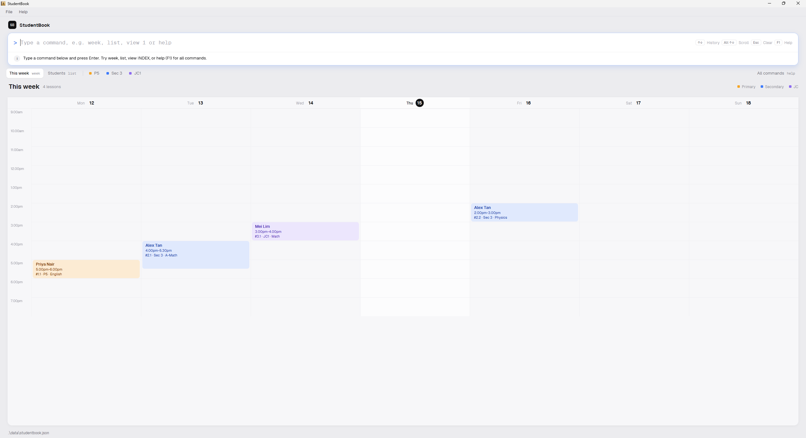

# StudentBook
StudentBook is a desktop contact book for private tutors. Type commands to manage student records.

This development version supports contact details, schools, schooling levels, guardian contacts and lessons. Each student can have any number of lessons, and each lesson has a subject, a weekly time slot and an hourly rate. See the [Developer Guide](DeveloperGuide.md#product-scope) for the plan and open decisions.

## Table of Contents
{:toc}

## Quick Start
1. Install Java `25`. Mac users should follow the [course Java installation guide](https://se-education.org/guides/tutorials/javaInstallationMac.html).
1. Build the development version from the [team repository](https://github.com/AY2627S1-CS2103T-F13-4/tp).
   ```shell
   git clone https://github.com/AY2627S1-CS2103T-F13-4/tp.git studentbook
   cd studentbook
   ./gradlew shadowJar
   ```
   
   On Windows, use `gradlew.bat shadowJar` for the last command. The JAR is `build/libs/studentbook.jar`.

1. Copy the JAR into the folder where you want to keep your records. Open a terminal in that folder and run:
   ```shell
   java -jar studentbook.jar
   ```

1. Type `list` in the command box and press Enter. Then try:

   ```text
   add name/Alex Tan phone/91234567 email/alex@example.com address/123 Clementi Road
   lesson-add 1 subject/Math slot/Wed 1.00pm 5.00pm rate/45.50
   ```

   The first command adds Alex, who appears at the bottom of the list. Replace `1` in the second command with Alex's number in the list. It gives that student a Math lesson on Wednesdays from 1pm to 5pm at SGD 45.50 per hour. Type `exit` to close the app.

## Main Window



The command box sits at the top of the window, under the StudentBook name, since you use the app by typing. The app opens on **This week**, a calendar of active students' lessons. `list` shows the **Students** table, `list-archive` shows the **Archives** table, and `week` brings the calendar back. `find` searches the currently selected student list.

* **This week:** The calendar shows Monday to Sunday of the current week, with today's date circled and a red line at the current time. It always shows 9.00am to 8.00pm, and stretches to fit any lesson outside those hours. Each lesson shows the student, the time, and then its number, level and subject, such as `#3.1 · Sec 3 · A-Math`. The number means student `3`, lesson `1`, so `lesson-edit 3 1` changes that lesson. Lessons are coloured by school stage, as shown in the key at the top right. Lessons at the same time sit side by side, and that day widens to fit them. To see a lesson's rate, mode and location, type `view` with its student's number (e.g. `view 3` for `#3.1`), or point at the lesson. The calendar opens scrolled to the current time.
* **Tabs:** The row under the command box has **This week**, which runs `week`, **Students**, which runs `list`, and **Archives**, which runs `list-archive`; each tab shows the command it runs. The two student tables use the same layout, grouping and detail controls. After them, each schooling level in the selected list runs `find level/LEVEL` (point at one to see the command). **All commands** at the right opens help. The levels are hidden in windows narrower than 900px, and any that do not fit are left out. In windows shorter than 560px, the StudentBook name and the data file path at the bottom are hidden to leave room for your students.
* **Header:** The page header shows how many students there are. **+ Add student** puts the `add` format in the command box for you to fill in.
* **Student list:** The list is a table with one row per student and the columns **#**, **Name**, **Subjects**, **Next lesson**, **Rate** and **Guardian**. **Next lesson** is the lesson that comes next in the week, with `+2 more` when the student has others; **Rate** is that lesson's rate. Use the number in the **#** column as `INDEX`. In narrow windows the Subjects and Guardian columns are hidden.
* **Student details:** On the **Students** table, a student's details open under their row: school, phone, email and address together, followed by guardian information, lessons and tags. Each lesson shows its number, subject, day and time, rate, mode and location. Details open when a search leaves one student (e.g. `find hafiz`), when you press **Alt+Down** or **Alt+Up** to step through students, or when you click a row. Press **Esc** in an empty command box to close them. Use a lesson's number in the details as `LESSON_INDEX`.
* **Colours:** The initials badge and the level dots under the command box are amber for primary (`P5`, `Primary 5`), blue for secondary (`Sec 3`, `Secondary 4 Express`) and violet for JC (`JC1`). Levels written another way, such as `Poly Y1`, stay grey. In a student's details, a lesson's mode shows in green for `Physical` and teal for `Virtual`. Tags are grey.
* **Count:** The count beside the title shows how many students there are. After `find`, it shows how many match, such as `Showing 1 of 8`.
* **Empty list:** When the list is empty, the app suggests the next step. With no students, it shows an example `add` command you can type as shown. When a search matches no one, it suggests `list`. The This week screen does the same: with no lessons it shows an example `lesson-add` command, and when a search hides every lesson it suggests `list`.
* **Result:** The row under the command box shows the result of your last command. After a one-line success, it also shows your last few commands; click one to put it back in the command box, or press Up to step through all your earlier commands. A green tick marks a success. A red `!` on a pink background marks an error, such as an invalid index or format. When you get a command's format wrong, the row shows what the command does, its **Format** and an **Example**, so you can fix the command without opening help. Press **Tab** to put the Example in the command box, then edit it; you can also click a Format or Example line to copy it. Long messages take up to 40% of the window, so they can be read without scrolling.
* **Command box:** It is focused when the app starts and stays focused, so you can use the whole app from the keyboard: clicking elsewhere and closing the help window leave the cursor in the box, which is outlined in blue. Press Enter to run a command. After a successful command, the box clears. After an error, your text stays, shown in red, so you can fix it.

| Key | Action |
|---|---|
| Enter | Run the command |
| Up / Down | Show earlier commands from this session. Down past the newest brings back what you were typing. |
| Esc | Clear the command box. In an empty box, close a student's details. Also closes the help window. |
| Alt+Down / Alt+Up | On **This week**, scroll the calendar. On **Students**, open the next or previous student's details. (On a Mac, Alt is the Option key.) |
| Tab | When the result shows an Example (e.g. after a format error), put that Example in the command box |
| Page Up / Page Down | Also scroll, if your keyboard has these keys (on a Mac laptop: Fn+Up / Fn+Down) |
| F1 | Open help, as the `help` command does (on a Mac laptop you may need Fn+F1) |

Every shortcut is optional: each one has a command that does the same, such as `week`, `list`, `view INDEX` and `help`.

## Features

### Reading Command Formats
<div markdown="block" class="alert alert-info">

**:information_source: Notes about the command format:**<br>

* `UPPER_CASE` words are user-defined parameters.<br>
  E.g. `name/NAME` &rarr; `name/John Doe`.

* `[square brackets]` mark optional fields.<br>
  E.g. `name/NAME [tag/TAG]` &rarr; `name/John Doe tag/friend` or `name/John Doe`.

* `…`​ means a field can be repeated.<br>
  E.g. `[t/TAG]…​` &rarr; ` ` or `t/friend` or `t/friend t/family`. 

* Parameters can be in any order.<br>
  E.g. `name/NAME p/PHONE_NUMBER` &rarr; `name/John Doe phone/87654321` or `phone/87654321 name/John Doe`

* `INDEX` is the number beside a student in the current list display.

* Commands with no parameters (`help`, `list`, `clear`, `exit`, etc.) ignore extra arguments.
  E.g. `help 123` &rarr; `help`
</div>

<div markdown="span" class="alert alert-warning">

**:warning: When copying commands from the PDF version of this document, spaces around line breaks may be omitted.**

</div>

### Add a student: `add`

Adds a student to StudentBook

Format: `add name/NAME phone/PHONE_NUMBER email/EMAIL address/ADDRESS [tag/TAG]... [sch/SCHOOL] [level/SCHOOLING_LEVEL]`

Examples:
* `add name/Alex Tan phone/91234567 email/alex@example.com address/123 Clementi Road tag/weekday sch/Clementi Primary School level/Primary 5`
* `add name/Mei Lim phone/92345678 email/mei@example.com address/45 Dover Road`

<div markdown="block" class="alert alert-primary">

:bulb: **Tips:**<br>
* A new student has no lessons or guardians. Add them with [`lesson-add`](#manage-a-students-lessons) and [`guardian-add`](#manage-a-students-guardian-contact) respectively.
* The added student cannot share a name with an existing one (case-sensitive).

</div>


### List all students: `list`

Shows all active students in StudentBook, grouped by schooling level, and selects this list for searches and indexed commands.

Format: `list`

This also clears any `sort`, so students return to the order they were added within each level.

### Sort students by rate: `sort`

Orders students by hourly rate **within each schooling level**. The Primary, Secondary, JC and Other groups stay where they are, and only the students inside each group are reordered. Numbers shown on screen still match the `INDEX` used by commands.

Format: `sort rate asc` or `sort rate desc`

* `asc` puts the lowest rate first and `desc` puts the highest rate first.
* A student with several lessons is ranked by their lowest rate for `asc` and their highest rate for `desc`.
* Students with no lessons always come last in their group.
* While a sort is on, the **Rate** column is headed **Min rate** or **Max rate** and shows the rate the sort uses, instead of the next lesson's rate.
* Students with the same rate stay in the order they were added.
* The sort stays in place when you edit lessons or use `find`. Type `list` to go back to the order students were added.

Example: `sort rate desc`

### List archived students: `list-archive`

Shows all archived students in a separate **Archives** tab with the same layout as **Students**. Searches and commands using `INDEX` now use this list. Type `list` to return to active students.

Format: `list-archive`

### Archive or restore a student: `archive`, `unarchive`

`archive INDEX` moves an active student to the archived list, keeping their details, lessons, notes and follow-ups. Archived students do not appear in the active list or weekly calendar.

To restore a student, run `list-archive`, then `unarchive INDEX` using the number shown in that tab. The student moves back to the active list; the archived tab stays open. Run `list` to see the restored student.

### Edit a student: `edit`

Edits an existing student in StudentBook

Format: `edit INDEX [name/NAME] [phone/PHONE_NUMBER] [email/EMAIL] [address/ADDRESS] [tag/TAG]... [sch/SCHOOL] [level/SCHOOLING_LEVEL]`

* Edits the student at the specified [`INDEX`](#reading-command-formats).
* At least one of the optional fields must be provided.
* Existing values will be updated to the input values.
* Empty parameters for optional fields (e.g. `tag/`) will clear the field

Examples:
* `edit 1 phone/91234567 email/alex.tan@example.com` changes the first displayed student's phone and email.
* `edit 2 name/Mei Ling tag/` changes the second displayed student's name and clears their tags.
* `edit 1 sch/Clementi Primary School` changes the first displayed student's school.
* `edit 1 level/Primary 6` changes the first displayed student's schooling level.

<div markdown="block" class="alert alert-primary">

:bulb: **Tips:**<br>
* To edit a student's lessons or guardians, use [`lesson-edit`](#manage-a-students-lessons) and [`guardian-edit`](#manage-a-students-guardian-contact) respectively.

</div>

### Show weekly lessons: `week`

Displays lessons for active students, retaining the active list's search and lesson filters. Running `week` from the archived tab returns to active students.

Format: `week`

### View a student's details: `view`

Displays the student at `INDEX` and their details.

Format: `view INDEX`

### Find students by name: `find`

Find students whose names contain any of the given keywords

Format: `find KEYWORD [MORE_KEYWORDS]`
* The search is case-insensitive.
* Only full words match.

Examples:
* `find John` matches `John Doe`, but not `Johnny`.
* `find alex david` matches names containing `Alex` or `David`.

### Find students by filter criteria: `find`

Find students by name, guardian, school, level, lesson subject and/or lesson day.

Format: `find [name/TEXT] [guardian/TEXT] [sch/TEXT] [level/TEXT] [subject/TEXT] [day/DAY]`

* The search is case-insensitive.
* At least one of the optional fields must be provided.
* Partial matches are allowed.
* Students without a level are excluded from the level filter
* When multiple lesson-related criteria are specified, the same lesson must match all criteria
* Day may be specified with three-letter or full names

Examples:
* `find level/prim` matches `Primary 5`.
* `find day/Mon` matches students with a lesson on Monday.
* `find level/Secondary subject/math day/wednesday` matches secondary students with a Math lesson on Wednesday.


### Delete a student: `delete`

Deletes a student from StudentBook.

Format: `delete INDEX`

### Delete all students: `clear`

Deletes all students from StudentBook.

Format: `clear`

### View help: `help`

Displays link to this guide and location of data file.

Format: `help`

* Alternate hotkey: **F1**
* Press **Enter** to copy the link
* Press **Esc** to close the window and return to the command box


### Exit: `exit`

Closes the app.

Format: `exit`

### Add a lesson: `lesson-add`

Add a lesson for a given student.

Format: `lesson-add INDEX subject/SUBJECT slot/LESSON_SLOT rate/HOURLY_RATE [mode/MODE] [location/LOCATION]`

Examples:
* `lesson-add 3 subject/English slot/Mon 10.00am 12.00pm rate/40`
* `lesson-add 1 subject/Math slot/Fri 4.00pm 6.00pm rate/40 mode/physical location/Home`
* `lesson-add 1 subject/Math slot/Fri 4.00pm 6.00pm rate/40 mode/virtual location/Zoom`


### Edit a lesson: `lesson-edit`

Edit a lesson for a given student.

Format: `lesson-edit STUDENT_INDEX LESSON_INDEX [subject/SUBJECT] [slot/LESSON_SLOT] [rate/HOURLY_RATE] [mode/MODE] [location/LOCATION]`

* Targets the student at the specified [`STUDENT_INDEX`](#reading-command-formats).
* Edits the lesson at the specified [`LESSON_INDEX`](#reading-command-formats)
* Existing values will be updated to the input values
* Empty parameters for optional fields (e.g. `mode/`) will clear the field

Examples:
* `lesson-edit 1 3 subject/Mathematics`
* `lesson-edit 2 1 mode/physical location/Home`
* `lesson-edit 3 1 mode/ location/`

### Delete a lesson: `lesson-delete`

Deletes a lesson for a given student

Format: `lesson-delete STUDENT_INDEX LESSON_INDEX`

Field rules:
* **Subject** (`subject/`)
  * 1-40 characters
  * Start with a letter/digit, include at least 1 letter
* **Lesson Slot** (`slot/`)
  * Format: `DAY START END`
  * `DAY`: Three-letter day, e.g. `Mon`, `Sun`
  * `START`/`END`: Minute-precise time, e.g. `10.30am`, `1.00pm`
  * `START` must be before `END`
* **Hourly Rate** (`rate/`)
  * Numeric value in SGD per hour
  * Non-negative, to nearest cent, e.g. `45.50`
* **Mode** (`mode/`)
  * `physical` or `virtual` only (case insensitive)
* **Location** (`location/`)
  * 1-100 characters

### Add a guardian: `guardian-add`

Add a guardian for a given student.

Format: `guardian-add INDEX name/NAME phone/PHONE`

Examples:
* `guardian-add 1 name/Jane Doe phone/81234567`

### Edit a guardian: `guardian-edit`

Edit a guardian for a given student.

Format: `guardian-edit INDEX [name/NAME] [phone/PHONE]`

* Edits the guardian of the student at the specified [`INDEX`](#reading-command-formats).
* At least one of the optional fields must be provided.
* Existing values will be updated to the input values.

Examples:
* `edit 1 name/Jane Doe`
* `edit 1 name/81234567`

### Delete a guardian: `guardian-delete`

Delete a guardian for a given student.

Format: `guardian-delete INDEX`

## Saving and transferring records

The app saves automatically after each successfully executed command. Schools, schooling levels, guardian contacts and lessons are saved with the contact details. A student's school is stored as an optional `school` string; files without it still load with no school recorded. Each student's lessons are stored as a `lessons` array, where every lesson has a `subject`, a `weeklyLessonSlot` and an `hourlyRate`, plus an optional `mode` (`PHYSICAL` or `VIRTUAL`) and `location`. Files without these two fields still load.

Older files that stored a student's `subject`, `subjects`, `weeklyLessonSlot` or `hourlyRate` directly on the student still load, but those values are ignored and are lost the next time the app saves. Re-enter them with `lesson-add` or copy them into a `lessons` array first.

If saving fails, the app reports an error. The change may still appear on screen without being saved to disk.

Records are stored in `data/studentbook.json` under the folder where you start the app.

To transfer records, close the app on both computers. Copy the data file to the corresponding location on the new computer, then start the app there.

### Edit the data file manually

Close the app and back up the JSON file before editing it. Keep the existing file structure and valid field values.

If the file is invalid, the app starts with an empty list. The invalid file remains until a successful command saves over it. Restore your backup before running more commands.

## Known issues

* **Window opens off-screen:** Close the app and delete `preferences.json`, then restart it. This resets the saved window position.
* **Help window stays minimized:** Restore the existing help window manually. Running `help` again does not restore it.

### Lesson clash warnings

Adding or editing a lesson warns when it overlaps another lesson on the same weekday. The change is still applied
and saved normally. Warnings identify each conflicting student by name and their lesson number, subject and time.
Checks include all students, even those hidden by a filter, and other lessons of the same student.
Warnings show the number of conflicting lessons and list each on a separate line.
Clashes appear in an amber feedback panel with an exclamation icon and a bold
"Lesson saved - scheduling clash detected" heading. The warning stays until the next command result.
Every successful lesson edit
checks for clashes, including a rate-only or subject-only edit; an existing clash will therefore warn again.
Back-to-back lessons do not clash. Deleting a lesson does not produce a warning.
Lesson numbers in warnings belong to the named student's lesson list; find that student before editing their lesson.

## Command summary

| Task | Format |
|---|---|
| Add | `add name/NAME phone/PHONE_NUMBER email/EMAIL address/ADDRESS [tag/TAG]... [sch/SCHOOL] [level/SCHOOLING_LEVEL]` |
| Edit | `edit INDEX [name/NAME] [phone/PHONE_NUMBER] [email/EMAIL] [address/ADDRESS] [tag/TAG]... [sch/SCHOOL] [level/SCHOOLING_LEVEL]` |
| Clear school | `edit INDEX sch/` |
| Clear schooling level | `edit INDEX level/` |
| Find | `find KEYWORD [MORE_KEYWORDS]` or `find [name/TEXT] [guardian/TEXT] [sch/TEXT] [level/TEXT] [subject/TEXT] [day/DAY]` |
| List | `list` |
| Sort by rate | `sort rate asc` or `sort rate desc` |
| This week's lessons | `week` |
| A student's details | `view INDEX` |
| Add lesson | `lesson-add STUDENT_INDEX subject/SUBJECT slot/LESSON_SLOT rate/HOURLY_RATE [mode/MODE] [location/LOCATION]` |
| Edit lesson | `lesson-edit STUDENT_INDEX LESSON_INDEX [subject/SUBJECT] [slot/LESSON_SLOT] [rate/HOURLY_RATE] [mode/MODE] [location/LOCATION]` |
| Delete lesson | `lesson-delete STUDENT_INDEX LESSON_INDEX` |
| Add guardian | `guardian-add INDEX name/NAME phone/PHONE` |
| Edit guardian | `guardian-edit INDEX [name/NAME] [phone/PHONE]` |
| Delete guardian | `guardian-delete INDEX` |
| Add note | `note-add STUDENT_INDEX date/DATE text/TEXT` |
| Delete note | `note-delete STUDENT_INDEX NOTE_INDEX` |
| Add follow-up | `followup-add STUDENT_INDEX text/TEXT` |
| Edit follow-up | `followup-edit STUDENT_INDEX FOLLOW_UP_INDEX text/TEXT` |
| Complete follow-up | `followup-done STUDENT_INDEX FOLLOW_UP_INDEX` |
| List outstanding follow-ups | `followups` |
| Delete | `delete INDEX` |
| Delete all | `clear` |
| Help | `help` |
| Exit | `exit` |
