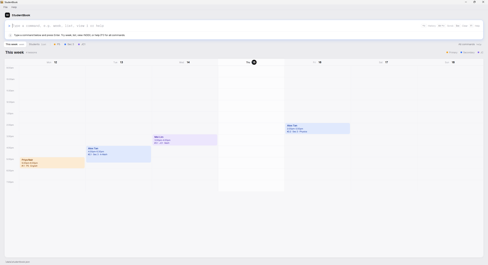

StudentBook helps private tutors manage student and guardian contacts, recurring lessons, progress notes and follow-ups using typed commands. Records stay on your computer and changes are saved automatically.

## Table of contents

* [Quick start](#quick-start)
* [Main window](#main-window)
* [Features](#features)
  * [Reading command formats](#reading-command-formats)
  * [Student tracking](#student-tracking)
    * [Add a student: `add`](#add-a-student-add)
    * [Edit a student: `edit`](#edit-a-student-edit)
    * [List all students: `list`](#list-all-students-list)
    * [Sort students by rate: `sort`](#sort-students-by-rate-sort)
    * [View a student's details: `view`](#view-a-students-details-view)
    * [Find students by name: `find`](#find-students-by-name-find)
    * [Find students by filter criteria: `find`](#find-students-by-filter-criteria-find)
    * [Delete a student: `delete`](#delete-a-student-delete)
    * [Delete all students: `clear`](#delete-all-students-clear)
  * [Archiving students](#archiving-students)
    * [Archive or restore a student: `archive`, `unarchive`](#archive-or-restore-a-student-archive-unarchive)
    * [List archived students: `list-archive`](#list-archived-students-list-archive)
  * [Lesson tracking](#lesson-tracking)
    * [Lesson fields and numbering](#lesson-fields-and-numbering)
    * [Add a lesson: `lesson-add`](#add-a-lesson-lesson-add)
    * [Edit a lesson: `lesson-edit`](#edit-a-lesson-lesson-edit)
    * [Delete a lesson: `lesson-delete`](#delete-a-lesson-lesson-delete)
    * [Show weekly lessons: `week`](#show-weekly-lessons-week)
  * [Guardian tracking](#guardian-tracking)
    * [Add a guardian: `guardian-add`](#add-a-guardian-guardian-add)
    * [Edit a guardian: `guardian-edit`](#edit-a-guardian-guardian-edit)
    * [Delete a guardian: `guardian-delete`](#delete-a-guardian-guardian-delete)
  * [Progress notes](#progress-notes)
    * [Add a progress note: `note-add`](#add-a-progress-note-note-add)
    * [Edit a progress note: `note-edit`](#edit-a-progress-note-note-edit)
    * [Delete a progress note: `note-delete`](#delete-a-progress-note-note-delete)
  * [Follow-ups](#follow-ups)
    * [Add a guardian follow-up: `followup-add`](#add-a-guardian-follow-up-followup-add)
    * [Edit a guardian follow-up: `followup-edit`](#edit-a-guardian-follow-up-followup-edit)
    * [Complete a guardian follow-up: `followup-done`](#complete-a-guardian-follow-up-followup-done)
    * [List students with outstanding follow-ups: `followups`](#list-students-with-outstanding-follow-ups-followups)
  * [Miscellaneous](#miscellaneous)
    * [View help: `help`](#view-help-help)
    * [Exit: `exit`](#exit-exit)
* [Saving and transferring records](#saving-and-transferring-records)
* [Troubleshooting](#troubleshooting)
* [Command summary](#command-summary)

## Quick start

1. Install Java **25**. Mac users can follow the [Java installation guide](https://se-education.org/guides/tutorials/javaInstallationMac.html). Check your version in a terminal:
   ```shell
   java -version
   ```

1. Download `studentbook.jar` from the [StudentBook releases](https://github.com/AY2627S1-CS2103T-F13-4/tp/releases).
1. Put the JAR in an empty folder where you have permission to create files. Open a terminal in that folder and run:
   ```shell
   java -jar "studentbook.jar"
   ```
   Use the actual filename if it differs. If double-clicking the JAR does nothing, start it this way to see the error.

1. The first launch opens with sample data. Type `list` and press Enter.
1. Add a student:

   ```text
   add name/Alex Tan phone/91234567 email/alex@example.com address/123 Clementi Road
   ```

   Alex appears in **Other** because he has no schooling level. Replace `STUDENT_INDEX` below with his displayed number:

   ```text
   lesson-add STUDENT_INDEX subject/Math slot/Wed 1.00pm 5.00pm rate/45.50
   ```

   Type `exit` to close the app.

## Main window

[](images/Ui.png)

Type commands in the box at the top and press **Enter**. Select the screenshot to view it at full size.

* **This week** shows your active students' lessons on a calendar (`week`). **Students** shows your students (`list`), and **Archives** shows archived students (`list-archive`). `find` searches whichever of these two lists is open.
* A lesson marked `#3.1` is student `3`'s lesson `1`. Edit it with `lesson-edit 3 1 ...`.
* To expand a student's full details below their row, click it or type `view STUDENT_INDEX`.
* If a command is wrong, the format and an example appear below the box. Press **Tab** to copy the example into the box.

| Key | Action |
|---|---|
| Up / Down | Previous commands |
| Esc | Clear the box; if already empty, close student details |
| Alt+Up / Alt+Down | Scroll the calendar, or move between students |
| Alt+Left / Alt+Right | Scroll the calendar sideways when the command box is empty |
| Page Up / Page Down | Scroll the calendar or student list |
| Ctrl+L (Cmd+L on macOS) | Move the cursor to the command box |
| F1 | Help |

## Features

### Reading command formats

* `UPPER_CASE` words are values you fill in, e.g. `name/NAME` &rarr; `name/John Doe`.
* `[square brackets]` mark optional fields, e.g. `name/NAME [tag/TAG]` &rarr; `name/John Doe tag/friend` or `name/John Doe`.
* `…` means a field can be repeated, e.g. `[tag/TAG]…` &rarr; (nothing) or `tag/friend` or `tag/friend tag/family`.
* Fields can be in any order, e.g. `name/NAME phone/PHONE` &rarr; `phone/87654321 name/John Doe`. Note commands are the exception: `text/` comes last.
* `STUDENT_INDEX` is the number beside a student in the list on screen.
* Commands without fields (`help`, `list`, `clear`, `exit` and so on) ignore anything typed after them, e.g. `help 123` &rarr; `help`.

<div markdown="span" class="alert alert-warning">

:warning: Commands copied from the PDF version of this guide may lose the spaces at line breaks. Check them before pressing Enter.

</div>

### Student tracking

#### Add a student: `add`

Adds a student.

Format: `add name/NAME phone/PHONE email/EMAIL address/ADDRESS [tag/TAG]... [sch/SCHOOL] [level/SCHOOLING_LEVEL]`

* Names start with a letter or number. They can contain letters (including accents), numbers, spaces, apostrophes, hyphens and periods, e.g. `Mary-Ann O'Brien` or `Zoë Ng`. A slash is allowed only in `s/o` and `d/o`, e.g. `Ravi s/o Kumar`.
* Each name must be unique across active and archived students. Capitals count, so `Alex Tan` and `alex tan` are different names.
* Phone numbers have 7 to 15 digits and an optional `+` country code. Spaces and hyphens are removed, so `+65 9123 4567` is saved as `+6591234567`.
* Emails look like `name@example.com`. Tags use only letters and numbers, with no spaces.
* Schools have up to 60 characters. Levels have up to 30 characters, contain a letter, and use only letters, numbers, spaces, apostrophes, hyphens, periods or parentheses.
* Levels such as `P5`, `Primary 5`, `Sec 3` or `JC1` place the student in the Primary, Secondary or JC group. Any other level, or no level, places them in Other.
* StudentBook clears any search and opens the new student's details. Add lessons with [`lesson-add`](#add-a-lesson-lesson-add) and a guardian with [`guardian-add`](#add-a-guardian-guardian-add).

Examples:
* `add name/Alex Tan phone/91234567 email/alex@example.com address/123 Clementi Road tag/weekday sch/Clementi Primary School level/Primary 5`
* `add name/Mei Lim phone/92345678 email/mei@example.com address/45 Dover Road`

#### Edit a student: `edit`

Changes a student's details.

Format: `edit STUDENT_INDEX [name/NAME] [phone/PHONE] [email/EMAIL] [address/ADDRESS] [tag/TAG]... [sch/SCHOOL] [level/SCHOOLING_LEVEL]`

* Give at least one field. Fields you leave out keep their values.
* The tags you give replace all existing tags.
* `tag/`, `sch/` or `level/` with nothing after it clears that field.
* Values follow the same rules as [`add`](#add-a-student-add), so a new name cannot match another student's.
* To change lessons or the guardian, use [`lesson-edit`](#edit-a-lesson-lesson-edit) or [`guardian-edit`](#edit-a-guardian-guardian-edit).

Examples:
* `edit 1 phone/91234567 email/alex.tan@example.com`
* `edit 2 name/Mei Ling tag/`
* `edit 1 sch/Clementi Primary School`
* `edit 1 level/Primary 6`

#### List all students: `list`

Shows all active students, grouped into Primary, Secondary, JC and Other.

Format: `list`

* Within each group, students are ordered by level (P1 before P2), then by name. Students with no level come last.
* Clears any search, calendar filter and `sort`. Commands then use the numbers in this list.

#### Sort students by rate: `sort`

Orders students by hourly rate within each group. The groups themselves stay in place.

Format: `sort rate asc` or `sort rate desc`

* `asc` puts the lowest rate first. `desc` puts the highest rate first.
* A student with several lessons is ranked by their lowest rate for `asc` and their highest rate for `desc`.
* Students with no lessons come last in their group. Ties keep the `list` order.
* While a sort is on, the **Rate** column is headed **Min rate** or **Max rate** and shows the rate used for sorting.
* The sort stays on when you edit lessons or use `find`. Type `list` to undo it.

Examples:
* `sort rate desc`

#### View a student's details: `view`

Opens a student's details below their row, including every lesson's rate, mode and location.

Format: `view STUDENT_INDEX`

* Clicking the student's row does the same.

Examples:
* `view 3`

#### Find students by name: `find`

Finds students whose names contain any of the given words.

Format: `find KEYWORD [MORE_KEYWORDS]`

* Capitals do not matter.
* Only whole words match, so `find Li` does not find `Chloe Lim`.

Examples:
* `find lim` finds `Chloe Lim` and `Ethan Lim`.
* `find isaac ryan` finds `Isaac Ng` and `Ryan Goh Jun Jie`.

#### Find students by filter criteria: `find`

Finds students by name, guardian, school, level, lesson subject or lesson day.

Format: `find [name/TEXT] [guardian/TEXT] [sch/TEXT] [level/TEXT] [subject/TEXT] [day/DAY]`

* Give at least one field. A student must match all of them.
* Text matches any part of a word, ignoring capitals. `guardian/` matches the guardian's name or phone.
* `day/` takes a three-letter or full day name, e.g. `Mon` or `monday`.
* With `subject/` and `day/` together, one lesson must match both. **This week** then shows only the matching lessons. Student details still show every lesson.
* `find` searches the open list, **Students** or **Archives**. The search stays on as you make changes, so students can join or leave the results and numbers can change. Type `list` or `list-archive` to clear it.

Examples:
* `find level/jc`
* `find day/Mon`
* `find guardian/9182` finds students whose guardian's phone contains `9182`.
* `find level/Sec subject/math day/wednesday` finds `Sec` students with a Math lesson on Wednesday.

#### Delete a student: `delete`

Deletes a student with their lessons, guardian, notes and follow-ups.

Format: `delete STUDENT_INDEX`

* There is no undo. To keep a student's records, [archive](#archive-or-restore-a-student-archive-unarchive) them instead.

Examples:
* `delete 3`

#### Delete all students: `clear`

Deletes students permanently, including students hidden by a search.

Format: `clear`

* In **Students** or **This week**, `clear` deletes **all active and archived students**.
* In **Archives** (after `list-archive`), it deletes **only archived students** and keeps active students.

<div markdown="span" class="alert alert-warning">

:warning: `clear` cannot be undone. Copy `data/studentbook.json` first if you might want the records back.

</div>

### Archiving students

#### Archive or restore a student: `archive`, `unarchive`

`archive` moves an active student to **Archives**. `unarchive` moves them back.

Format: `archive STUDENT_INDEX` or `unarchive STUDENT_INDEX`

* Archiving keeps the student's details, lessons, notes and follow-ups. Archived students leave **Students** and the weekly calendar.
* To restore a student, run `list-archive` first and use the number shown there. **Archives** stays open afterwards. Run `list` to see the restored student.
* If a restored student's lessons overlap other lessons, StudentBook restores them and shows a [clash warning](#troubleshooting).

Examples:
* `archive 2`
* `list-archive`, then `unarchive 1`

#### List archived students: `list-archive`

Shows archived students in **Archives**, laid out like **Students**.

Format: `list-archive`

* Until you type `list`, `find` and commands that take `STUDENT_INDEX` use this list.

### Lesson tracking

#### Lesson fields and numbering

`LESSON_INDEX` is the lesson's number in the student's details (`view STUDENT_INDEX`). Deleting a lesson renumbers the lessons after it.

These rules apply to `lesson-add` and `lesson-edit`:

| Field | Rules |
|---|---|
| `subject/` | 1 to 40 characters. Starts with a letter or digit, contains a letter, and uses only letters, digits, spaces, apostrophes, hyphens, periods, parentheses or `&` |
| `slot/` | `DAY START END`, e.g. `Wed 1.00pm 5.00pm`. Use a three-letter day and 12-hour times such as `9.30am` or `1.00pm`. Start must be before end on the same day, so overnight lessons are not possible |
| `rate/` | SGD per hour, 0 or more, with at most two decimal places, e.g. `45.50` |
| `mode/` | `physical` or `virtual`, ignoring case |
| `location/` | 1 to 100 characters, such as an address or meeting link. Cannot contain a word followed by `/`, such as `x/` |

#### Add a lesson: `lesson-add`

Adds a weekly lesson to a student.

Format: `lesson-add STUDENT_INDEX subject/SUBJECT slot/LESSON_SLOT rate/HOURLY_RATE [mode/MODE] [location/LOCATION]`

* Fields follow the [lesson field rules](#lesson-fields-and-numbering).
* A student cannot have two identical lessons.
* A lesson that overlaps another lesson is still saved, with a [clash warning](#troubleshooting). Lessons are checked against all your active students, including any hidden by a search; an archived student's lessons are checked against other archived students.

Examples:
* `lesson-add 3 subject/English slot/Mon 10.00am 12.00pm rate/40`
* `lesson-add 1 subject/Math slot/Fri 2.00pm 4.00pm rate/40 mode/physical location/Home`
* `lesson-add 1 subject/Math slot/Sun 2.00pm 4.00pm rate/40 mode/virtual location/Zoom`

#### Edit a lesson: `lesson-edit`

Changes one of a student's lessons.

Format: `lesson-edit STUDENT_INDEX LESSON_INDEX [subject/SUBJECT] [slot/LESSON_SLOT] [rate/HOURLY_RATE] [mode/MODE] [location/LOCATION]`

* Give at least one field. Fields you leave out keep their values.
* `mode/` or `location/` with nothing after it clears that field.
* An edit that makes the lesson overlap another is saved, with a [clash warning](#troubleshooting).

Examples:
* `lesson-edit 1 2 subject/Mathematics`
* `lesson-edit 2 1 mode/physical location/Home`
* `lesson-edit 3 1 mode/ location/`

#### Delete a lesson: `lesson-delete`

Deletes one of a student's lessons.

Format: `lesson-delete STUDENT_INDEX LESSON_INDEX`

Examples:
* `lesson-delete 1 1`

#### Show weekly lessons: `week`

Shows active students' lessons on a weekly calendar.

Format: `week`

* The calendar follows the search in **Students**. Running `week` from **Archives** returns to active students.
* Hover over a lesson for its details and exact times. Very short lessons show as small cards.

### Guardian tracking

#### Add a guardian: `guardian-add`

Adds a guardian to a student.

Format: `guardian-add STUDENT_INDEX name/NAME phone/PHONE`

* Each student has at most one guardian. To change one, use [`guardian-edit`](#edit-a-guardian-guardian-edit).
* Names and phones follow the same rules as in [`add`](#add-a-student-add).

Examples:
* `guardian-add 8 name/Jane Doe phone/81234567` adds a guardian to `Sarah Wong`, the only sample student without one.

#### Edit a guardian: `guardian-edit`

Changes a student's guardian.

Format: `guardian-edit STUDENT_INDEX [name/NAME] [phone/PHONE]`

* Give at least one field. Fields you leave out keep their values.

Examples:
* `guardian-edit 1 name/Jane Doe`
* `guardian-edit 1 phone/81234567`

#### Delete a guardian: `guardian-delete`

Removes a student's guardian.

Format: `guardian-delete STUDENT_INDEX`

* The student's follow-ups stay.

Examples:
* `guardian-delete 1`

### Progress notes

#### Add a progress note: `note-add`

Adds a dated note to a student, such as what you covered or what to revise next.

Format: `note-add STUDENT_INDEX date/YYYY-MM-DD text/TEXT`

* Put `date/` before `text/`. Everything after `text/` is note text, even words that look like fields.
* The date must be a real date from `2000-01-01` to today, e.g. `2026-10-15`.
* `TEXT` is 1 to 500 characters on one line.
* Notes are listed oldest first, each with its number and date.
* A student cannot have two notes with the same date and text.

Examples:
* `note-add 1 date/2026-10-15 text/Finished the fractions worksheet; revise decimals next`
* `note-add 1 date/2026-10-08 text/Struggled with word problems` then goes before the first note and becomes note 1.

#### Edit a progress note: `note-edit`

Changes a note's date, text or both.

Format: `note-edit STUDENT_INDEX NOTE_INDEX [date/YYYY-MM-DD] [text/TEXT]`

* `NOTE_INDEX` is the note's number in the student's details.
* Give at least one field. Fields you leave out keep their values, and neither can be cleared.
* Rules are the same as in [`note-add`](#add-a-progress-note-note-add).
* A new date can move the note and change note numbers. Check the details before your next note command.

Examples:
* `note-edit 4 2 text/Chain rule much better; start kinematics next`
* `note-edit 4 2 date/2026-10-15`

#### Delete a progress note: `note-delete`

Deletes one of a student's notes.

Format: `note-delete STUDENT_INDEX NOTE_INDEX`

* The result shows the deleted note's text. Later notes move up by one.

Examples:
* `note-delete 4 1`

### Follow-ups

#### Add a guardian follow-up: `followup-add`

Adds something you still need to do for a student's guardian, such as sending a progress report.

Format: `followup-add STUDENT_INDEX text/TEXT`

* `TEXT` is 1 to 200 characters on one line.
* A student cannot have two follow-ups with the same text, ignoring capitals.
* Follow-ups appear numbered in the student's details, under the guardian. A student does not need a guardian to have follow-ups.

Examples:
* `followup-add 1 text/Send the term 4 progress report`

#### Edit a guardian follow-up: `followup-edit`

Replaces a follow-up's text. Its number stays the same.

Format: `followup-edit STUDENT_INDEX FOLLOW_UP_INDEX text/TEXT`

* `FOLLOW_UP_INDEX` is the follow-up's number in the student's details.
* `TEXT` follows the same rules as in [`followup-add`](#add-a-guardian-follow-up-followup-add).

Examples:
* `followup-edit 2 1 text/Confirm the make-up lesson on Saturday`

#### Complete a guardian follow-up: `followup-done`

Marks a follow-up as done, which removes it.

Format: `followup-done STUDENT_INDEX FOLLOW_UP_INDEX`

* The result shows the removed follow-up's text. Later follow-ups move up by one.

Examples:
* `followup-done 2 1`

#### List students with outstanding follow-ups: `followups`

Shows only active students with at least one follow-up.

Format: `followups`

* Archived students are left out, but keep their follow-ups.
* When you complete a student's last follow-up, they leave this list and the students below move up a number.
* Type `list` to see every student again.

### Miscellaneous

#### View help: `help`

Opens this guide in your web browser.

Format: `help`

* **F1**, the **All commands** button and **Help → Help** in the menu do the same.
* Loading the guide needs an internet connection.

#### Exit: `exit`

Closes the app.

Format: `exit`

## Saving and transferring records

StudentBook saves every change to `data/studentbook.json` in the folder you start it from. The app's footer shows where the file is.

To move to another computer, close StudentBook, then copy the file into the new app folder as `data/studentbook.json`. Back up any file already there first.

<div markdown="span" class="alert alert-warning">

:warning: Back up `data/studentbook.json` before editing it by hand. If StudentBook cannot read it, it starts with no students. See [Troubleshooting](#troubleshooting) to get your records back.

</div>

## Troubleshooting

Click a problem to see the fix. Bold text is the message StudentBook shows.

<script>window.addEventListener('beforeprint', () => document.querySelectorAll('details').forEach(d => { d.open = true; }));</script>

<details class="trouble" markdown="1">
<summary><strong>The student index provided is invalid</strong> (or lesson, note or follow-up index)</summary>

Use the number shown on screen; lesson, note and follow-up numbers are in the student's details. Numbers change after searches and sorts.

</details>
<details class="trouble" markdown="1">
<summary>A student is missing from <strong>Students</strong></summary>

A search is on (`find`, `followups` or a level filter). Type `list`. Still missing? Type `list-archive`, since they may be archived.

</details>
<details class="trouble" markdown="1">
<summary><strong>An active student already has this name</strong></summary>

Type `list` to find them. If this is a different student, add something to the name, e.g. `Alex Tan Sec 2`.

</details>
<details class="trouble" markdown="1">
<summary><strong>An archived student already has this name</strong></summary>

Type `list-archive` and `unarchive` them, or add something to the new name.

</details>
<details class="trouble" markdown="1">
<summary><strong>This student already has a guardian</strong></summary>

Change the guardian with `guardian-edit`, or run `guardian-delete` and then `guardian-add`.

</details>
<details class="trouble" markdown="1">
<summary><strong>This student has no guardian</strong></summary>

Use `guardian-add` first.

</details>
<details class="trouble" markdown="1">
<summary><strong>Lesson saved - scheduling clash detected</strong>, or a <strong>Warning: Lesson ... overlaps</strong> line after <code>unarchive</code></summary>

The change is saved anyway. The warning lists the lessons it overlaps. Move one with `lesson-edit STUDENT_INDEX LESSON_INDEX slot/...` or remove it with `lesson-delete`. A lesson that starts when another ends does not clash.

</details>
<details class="trouble" markdown="1">
<summary><strong>Could not save data</strong></summary>

Nothing changed. Check that you can write to the `data` folder, then run the command again.

</details>
<details class="trouble" markdown="1">
<summary><strong>Could not read</strong> the data file, and StudentBook started with no students</summary>

Close StudentBook before making any change, since the next change saves over `studentbook.json`. Your old records are in `studentbook-backup-<date>-<time>.json` beside it. Fix that file, rename it to `studentbook.json` and restart. If no backup could be made, StudentBook closes without touching the file.

</details>
<details class="trouble" markdown="1">
<summary>The Subjects or Guardian column, or some level filters, are missing</summary>

The window is too narrow to show them. Widen the window, or use `view STUDENT_INDEX` to see a student's full details.

</details>
<details class="trouble" markdown="1">
<summary>The window opens off-screen</summary>

Close StudentBook, delete `preferences.json` in the app folder and restart. This resets the window position.

</details>
<details class="trouble" markdown="1">
<summary>The user guide does not open</summary>

Check your default browser and internet connection, or open the [user guide](https://ay2627s1-cs2103t-f13-4.github.io/tp/UserGuide.html) yourself.

</details>

## Command summary

| Task | Format |
|---|---|
| Add | `add name/NAME phone/PHONE email/EMAIL address/ADDRESS [tag/TAG]... [sch/SCHOOL] [level/SCHOOLING_LEVEL]` |
| Edit | `edit STUDENT_INDEX [name/NAME] [phone/PHONE] [email/EMAIL] [address/ADDRESS] [tag/TAG]... [sch/SCHOOL] [level/SCHOOLING_LEVEL]` |
| Clear school | `edit STUDENT_INDEX sch/` |
| Clear schooling level | `edit STUDENT_INDEX level/` |
| Find | `find KEYWORD [MORE_KEYWORDS]` or `find [name/TEXT] [guardian/TEXT] [sch/TEXT] [level/TEXT] [subject/TEXT] [day/DAY]` |
| List | `list` |
| Sort by rate | `sort rate asc` or `sort rate desc` |
| List archived students | `list-archive` |
| Archive | `archive STUDENT_INDEX` |
| Restore from archive | `unarchive STUDENT_INDEX` |
| This week's lessons | `week` |
| A student's details | `view STUDENT_INDEX` |
| Add lesson | `lesson-add STUDENT_INDEX subject/SUBJECT slot/LESSON_SLOT rate/HOURLY_RATE [mode/MODE] [location/LOCATION]` |
| Edit lesson | `lesson-edit STUDENT_INDEX LESSON_INDEX [subject/SUBJECT] [slot/LESSON_SLOT] [rate/HOURLY_RATE] [mode/MODE] [location/LOCATION]` |
| Delete lesson | `lesson-delete STUDENT_INDEX LESSON_INDEX` |
| Add guardian | `guardian-add STUDENT_INDEX name/NAME phone/PHONE` |
| Edit guardian | `guardian-edit STUDENT_INDEX [name/NAME] [phone/PHONE]` |
| Delete guardian | `guardian-delete STUDENT_INDEX` |
| Add note | `note-add STUDENT_INDEX date/YYYY-MM-DD text/TEXT` |
| Edit note | `note-edit STUDENT_INDEX NOTE_INDEX [date/YYYY-MM-DD] [text/TEXT]` |
| Delete note | `note-delete STUDENT_INDEX NOTE_INDEX` |
| Add follow-up | `followup-add STUDENT_INDEX text/TEXT` |
| Edit follow-up | `followup-edit STUDENT_INDEX FOLLOW_UP_INDEX text/TEXT` |
| Complete follow-up | `followup-done STUDENT_INDEX FOLLOW_UP_INDEX` |
| List outstanding follow-ups | `followups` |
| Delete | `delete STUDENT_INDEX` |
| Delete all | `clear` |
| Help | `help` |
| Exit | `exit` |
