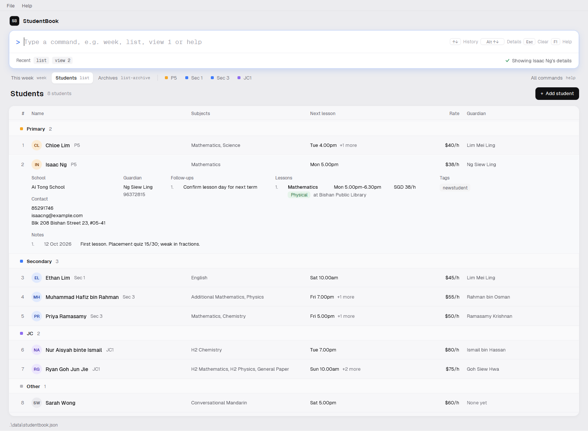

**Your students, lessons and follow-ups in one place.**

StudentBook is a desktop app for private tutors who prefer typing to clicking. Keep student and guardian contacts, plan recurring lessons and track each student's progress. Your records stay on your computer and changes are saved automatically.

[**Download StudentBook**](https://github.com/AY2627S1-CS2103T-F13-4/tp/releases/latest) · [**Getting started**](UserGuide.html#quick-start)

Requires Java 25. See the [User Guide](UserGuide.html) for installation and commands.

## Keep your tutoring week organised

* **See your week.** View recurring lessons on a calendar, with subjects, times and schooling levels. Scheduling warnings flag overlapping lessons.
* **Find the right student.** Search by name, guardian, school, level, subject or lesson day. Keep past students in Archives without losing their records.
* **Keep lesson details together.** Record multiple lessons per student, each with its own hourly rate, time slot and optional mode and location.
* **Remember the next step.** Save dated progress notes and outstanding follow-ups alongside student and guardian contacts.

Both screenshots use sample data. Select either image to view it at full size.

## Help and project information

Read the [User Guide](UserGuide.html), [report a problem](https://github.com/AY2627S1-CS2103T-F13-4/tp/issues), or [meet the team](AboutUs.html). To contribute, see the [Developer Guide](DeveloperGuide.html) and [source code](https://github.com/AY2627S1-CS2103T-F13-4/tp).

StudentBook is based on [AddressBook-Level3](https://se-education.org/addressbook-level3/) by the SE-EDU initiative and uses [JavaFX](https://openjfx.io/), [Jackson](https://github.com/FasterXML/jackson) and [JUnit 5](https://junit.org/junit5/).

