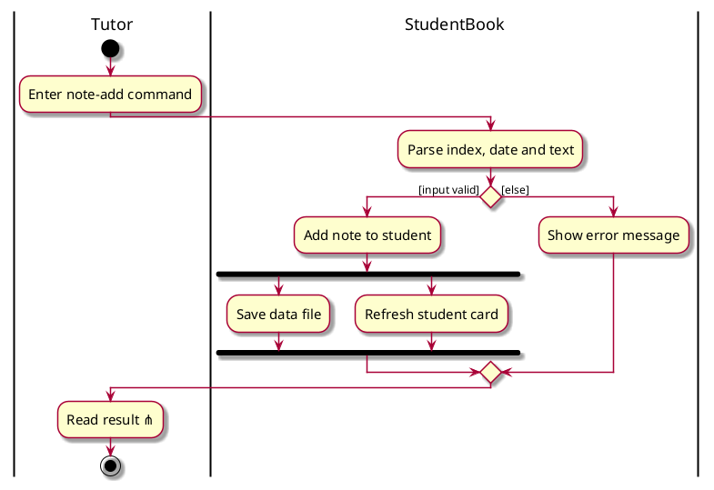
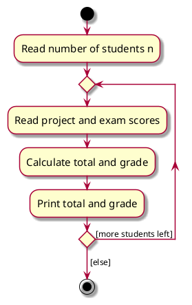

# Activity diagrams

Activity diagrams model workflows: a user's process, or the control flow of an algorithm. They are UML's version of flow charts. In the DG they suit command workflows with branches or loops, such as `CommitActivityDiagram.puml`.

Verify every diagram by looking at it: render, open the PNG, check notation, layout and match with the code, then commit the PNG with the `.puml`. See the [README steps](README.md#look-at-every-diagram-you-make).

## Notation

Basic ([W9.2a](https://nus-cs2103-ay2627-s1.github.io/website/book/modeling/modelingBehaviors/activityDiagrams/))

- Action: rectangle with rounded corners.
- Control flow: line with an arrowhead. The arrowhead style doesn't matter.
- Start node: filled circle. End node: filled circle inside a ring. They are not interchangeable.
- Branch node: diamond with several outgoing flows. Each outgoing flow carries a guard in square brackets, and exactly one guard is true at any time.
- Merge node: diamond where alternate paths rejoin.
- Fork and join: a bar. A fork starts parallel paths; a join ends them. Every path from a fork ends at the same join, and all paths finish before the flow continues. Actions in parallel paths may interleave, but each path keeps its own order.

Accepted simplifications (by convention)

- Omit the merge node when that causes no ambiguity.
- Several flows may leave the same corner of a branch diamond.
- Omit `[else]` when all other paths have guards.

Intermediate ([W9.2b](https://nus-cs2103-ay2627-s1.github.io/website/book/modeling/modelingBehaviors/activityDiagramsIntermediate/))

- Rake: a small rake symbol inside an action means the action is detailed in a separate activity diagram.
- Swimlanes: vertical partitions headed by who does each action.

## Correct and incorrect, from the course's exercise answers

- One action between start and end is fine.
- More than two alternate paths, paths that branch again, paths that rejoin other branches, and a branch looping back to its own diamond are all fine.
- Wrong: swapped start and end symbols; square-cornered actions; double-headed arrows; overlapping guards such as `[x >= 5]` and `[x <= 5]`; guards without square brackets; parallel paths that end in different joins or never reach a join.

## Do

- Put guards on the outgoing flows. A branch diamond holds no text.
- Keep one level of detail per diagram and rake out the rest.

## Don't

- Don't let two guards be true at once.
- Don't merge parallel paths with a diamond; end them with a join bar.

## PlantUML pitfalls

- Use the new syntax with `start` and `stop`. `stop` draws the course's end node. `end` draws a circled X (flow final), which the course doesn't teach.
- PlantUML puts the `if (...)` text inside the diamond and prints branch labels without brackets. Follow `CommitActivityDiagram.puml`: leave the condition empty and write the guard as the branch label, `if () then ([input valid])` ... `else ([else])`.
- `endif` draws a merge diamond. That is correct notation.
- `fork` / `fork again` / `end fork` draws the bars.
- Loops: `repeat` ... `repeat while () is ([more students left])` then `-> [else];` puts the guards on flows. `while (cond)` puts text inside the diamond.
- `|Lane|` lines create swimlanes.
- PlantUML has no rake symbol. Appending the pitchfork character `⋔` to the action text renders a small rake-like mark. Check that it is legible in the PNG; if not, add a note pointing to the sub-diagram.
- Repo style: `skin rose`, `ActivityFontSize 15`, `ArrowFontSize 12`. Activity diagrams don't include `style.puml`.

## Example

A loop with guards on the flows:

Both examples illustrate notation; check the real workflow against the code before adapting them.

## Sources

- W9.2a Activity diagrams, basic: https://nus-cs2103-ay2627-s1.github.io/website/book/modeling/modelingBehaviors/activityDiagrams/
- W9.2b Activity diagrams, intermediate: https://nus-cs2103-ay2627-s1.github.io/website/book/modeling/modelingBehaviors/activityDiagramsIntermediate/
- Week 9 topics page, with exercise answers: https://nus-cs2103-ay2627-s1.github.io/website/schedule/week9/topics.html
