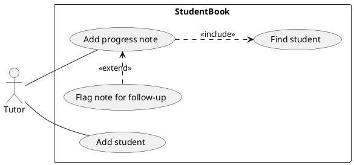

# Use case diagrams

A use case diagram is a visual table of contents for a system's use cases. The course teaches it alongside textual use cases in Week 7, and treats the textual form as where the detail lives. The DG's use cases are textual; add a diagram only if it helps a reader.

Verify every diagram by looking at it: render, open the PNG, check notation, layout and match with the code, then commit the PNG with the `.puml`. See the [README steps](README.md#look-at-every-diagram-you-make).

## Notation

From [W7.1a to W7.1d](https://nus-cs2103-ay2627-s1.github.io/website/schedule/week7/topics.html):

- Use case: oval. Actor: stick figure, connected to its use cases by plain lines. The course examples draw a system boundary box with the system's name.
- An actor is a role, not a person. One person can play several roles; many people can share one.
- Extension: dashed arrow labelled `<<extend>>`, pointing from the extension to the use case it extends.
- Inclusion: dashed arrow labelled `<<include>>`, pointing from the including use case to the included one. That is the opposite direction to `<<extend>>`.
- Actor generalisation: the inheritance triangle between actors. The child actor can do everything the parent can.

## Do

- Keep it brief and leave details to the textual use cases.
- Keep use cases at one level of detail.
- Show only use cases that involve an external actor.

## Don't

- Don't use `System` as an actor. The course mentions the practice and recommends against it.
- Don't add low-level use cases to the diagram just because the requirements mention them. The course's ticket machine answer keeps those details in the descriptions.

## PlantUML notes

- `left to right direction` puts actors on the left as in the course examples.
- `rectangle StudentBook { ... }` draws the boundary.
- `A ..> B : <<include>>` and `Ext .> Base : <<extend>>` give dashed arrows with the right direction.
- `style.puml` has no use case styling, so the example uses PlantUML defaults.

## Example

The use cases are illustrative. Check them against the DG's use case list.

## Sources

- W7.1a Introduction: https://nus-cs2103-ay2627-s1.github.io/website/book/specifyingRequirements/useCases/introduction/
- W7.1b Identifying: https://nus-cs2103-ay2627-s1.github.io/website/book/specifyingRequirements/useCases/identifying/
- W7.1c Details, extend and include: https://nus-cs2103-ay2627-s1.github.io/website/book/specifyingRequirements/useCases/details/
- W7.1d Usage, actor generalisation and System as actor: https://nus-cs2103-ay2627-s1.github.io/website/book/specifyingRequirements/useCases/usage/
